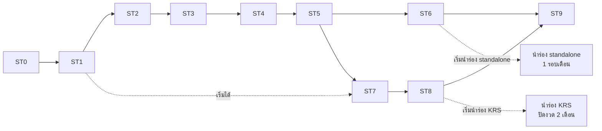

# PLAN — แผนพัฒนา TMS เฟส 0

> v0.2 · 10 พ.ย. 2569 · เจ้าของเลือกทางเลือก **C (standalone ก่อน แล้วต่อ KRS)** และตอบ D-04/D-11/D-15 แล้ว — เริ่ม ST0 วันเดียวกัน
> ฐาน: `docs/` v2 (ขอบเขต P0 ของ `docs/04`, ลำดับพัฒนา `docs/01` §8.3, เกณฑ์ผ่าน `docs/02` §7)
> รายละเอียดงานทีละชิ้น: `plan/01-phase0-backlog.md` · กติกาเอกสาร: `plan/00-source-of-truth.md`

## 1. สถานะตอนนี้

| เรื่อง | สถานะ |
|---|---|
| เอกสารออกแบบ (`docs/` v2), research, ต้นแบบ UI | มีแล้ว |
| Function Spec (`spec/`) | มีแล้ว แต่เขียนโดยไม่ได้อ่าน `docs/` — เทียบแล้วใน `plan/00a`, `plan/00b`; ยังไม่ได้แก้เนื้อหาให้ตรงกัน |
| แผนและ backlog เฟส 0 | ร่างนี้ |
| โค้ด | ST0 ทำไปแล้ว 15 จาก 19 งาน (10 พ.ย. 2569) — ดูตารางใน `PROGRESS.md`; test ผ่าน 73 ข้อ; ยังไม่มี remote/CI ที่รันจริง/staging |
| สิ่งที่ขวางการเริ่ม | ดูรายการตรวจความพร้อม §1.1 — สรุป: งาน backend ของ ST0 เริ่มได้ทันทีที่มี repo + ทีม; งาน UI ต้องรอ D-15; ST3/ST5/ST8 ต้องรอคำตอบตามตาราง |

### 1.1 ความพร้อมเริ่ม dev — ตรวจ 10 พ.ย. 2569

สถานะ: **มี** = พร้อมใช้ · **ขาด** = ยังไม่มี · **ไม่ขวาง** = ยังไม่มีแต่ไม่ต้องรอเพื่อเริ่ม ST0 (มีเส้นตายในคอลัมน์ "ต้องมีก่อน")

| # | ต้องมี | สถานะ | ใครทำ | ต้องมีก่อน |
|---|---|---|---|---|
| **ก. การตัดสินใจ** (`plan/05`) |||||
| 1 | D-15 Frontend framework (React / Angular) | ตัดสินแล้ว: React | เจ้าของ + หัวหน้าเทคนิค | ST0-T02 ส่วน web, ST0-T13 — backend ไม่ต้องรอ |
| 2 | เลือกทางเลือกเวลา/ขอบเขต §6 (ก ยอมรับเวลายาวกว่า 3 เดือน / ข เพิ่มคน / ค ลดขอบเขต) | ตัดสินแล้ว: ทางเลือก C | เจ้าของ | ก่อนตั้งทีมและสัญญากับลูกค้านำร่อง |
| 3 | D-04 KRS อยู่ในเฟส 0 ไหม | ตัดสินแล้ว: ใช่ | เจ้าของ | ก่อนส่ง `plan/08`; กระทบ ST8 และเกณฑ์ผ่าน ไม่กระทบ ST0–ST6 |
| 4 | D-11 ภาษา (ไทย / +EN / +中文) | ตัดสินแล้ว: ไทย + โครง i18n | เจ้าของ | ST0-T15 — ถ้ายังไม่ตอบ ใช้ค่าเริ่มต้น "ไทย + โครง i18n" ได้ |
| 5 | D-07 กฎจัดรถ เตือนหรือบล็อก | **ขาด** | เจ้าของ | ST3 (ประมาณสัปดาห์ที่ 10+) |
| 6 | D-14 ชื่อ tenant standalone ที่จะนำร่อง | **ขาด** | เจ้าของ | ภายใน ST2; ต้องการตัวอย่างเอกสารจริงจากรายนี้ (ข้อ 20) |
| 7 | กลุ่ม A ที่เหลือ 25 ข้อ (D-01–D-03, D-05, D-06, D-08–D-10, D-12, D-13, D-16–D-30) | มีค่าเริ่มต้น | เจ้าของ | จบ ST0 — ถ้าไม่ตอบ ถือว่ารับค่าเริ่มต้น และบันทึกวันที่ไว้ใน `plan/05` |
| **ข. คนและเครื่องมือ** |||||
| 8 | ทีม: หัวหน้าเทคนิค (review ทุก PR ที่แตะบัญชี/ภาษี), จำนวนคน, วันเริ่ม, ใครถนัด Angular/React | **ขาด** | Innovera | วันแรก |
| 9 | ที่เก็บโค้ด + CI (GitHub/GitLab org, สิทธิ์, secret store) | **ขาด remote** — มี git ในเครื่อง + `.github/workflows/ci.yml` พร้อมแล้ว แต่ยังไม่ได้ push/รันจริง | Innovera | ก่อนมีคนที่ 2 ทำงานร่วม และก่อนนับ ST0 จบ |
| 10 | บัญชี cloud + งบรายเดือน (T-08: ไทยหรือสิงคโปร์) | **ขาด** | Innovera | ST0-T03 (staging) — dev ใช้ docker compose บนเครื่องได้ก่อน |
| 11 | ผู้ให้บริการแผนที่/geocode/routing เชิงพาณิชย์ (D-31, T-13) | ไม่ขวาง | หัวหน้าเทคนิค | ST2 (จุดส่ง/ระยะทาง); เงื่อนไขเพิ่มถ้าจะทำ 3 มิติ ดู T-18 |
| 12 | ผู้ให้บริการอีเมล + SMS (D-32, T-14) | ไม่ขวาง | หัวหน้าเทคนิค | ST1 ปลาย (เชิญผู้ใช้), ST3 (ลิงก์รถร่วม) |
| 13 | ชื่อผลิตภัณฑ์/โดเมน (D-37) | ไม่ขวาง | เจ้าของ | ปลายเฟส 0; ระหว่างนี้ใช้ชื่อชั่วคราว |
| **ค. คำตอบจากคนนอก** |||||
| 14 | นักบัญชี — `plan/06` (33 ข้อ + 18 ข้อยืนยัน) | **ยังไม่ส่ง** | เจ้าของส่ง | ส่วน "ต้องตอบก่อนเริ่ม" ต้องได้ก่อน ST5 schema freeze (ปลาย ST0 เป็นร่าง, freeze จริงก่อน ST5) |
| 15 | ทนาย/PDPA — `plan/07` (18 + 5) | **ยังไม่ส่ง** | เจ้าของส่ง | ข้อความ consent/นโยบายใน ST1; ที่ตั้งข้อมูล T-08 |
| 16 | ทีม KRS — `plan/08` (18 + 9) + sandbox/contract ล่าสุด | **ยังไม่ส่ง** | เจ้าของส่ง | ST8 เท่านั้น (ถ้า D-04 = ใช่) |
| **ง. เอกสารและข้อมูลตั้งต้น** |||||
| 17 | `docs/` v2, `spec/`, backlog, ADR, test plan, risk, pilot plan | มี | — | — |
| 18 | แก้ `spec/` ให้ตรง `docs/` ตามรายการ `plan/00a`, `00b` + จุดกำกวม 21 ข้อ (backlog §3.1) | ไม่ขวาง | ทีม (งาน ST0-T19) | จบ ST0 — ระหว่างนี้ใช้กติกาลำดับความสำคัญใน `CLAUDE.md` |
| 19 | ต้นแบบ UI (Claude Design) | **export แล้ว 10 พ.ย.** → `design/` | — | ถ้าแก้ต้นแบบอีกต้อง export ใหม่ก่อน 14 ธ.ค. |
| 20 | ตัวอย่างเอกสารจริงที่ลูกค้าใช้อยู่ (ใบวางบิล, ใบกำกับภาษี/ใบเสร็จ, ใบลดหนี้, ใบคุมรถ, 50 ทวิ, สรุป settlement รถร่วม) อย่างน้อย 1 บริษัท | **ขาด** | เจ้าของขอจาก KRS / tenant นำร่อง | ST0-T17 (แม่แบบ PDF), ST5 golden test — ไม่มีนี่ นักบัญชีเซ็นรับ golden case ไม่ได้ |
| 21 | ข้อมูลตัวอย่างปิดชื่อ (ลูกค้า 20 ราย, จุดส่ง 50, rate card จริง 2–3 ชุด, รถ 30 คัน) สำหรับ seed และ UAT | **ขาด** | เจ้าของ | ST2 seed; UAT |
| 22 | ตารางชั้นใบขับขี่ ↔ ประเภทรถ (LEG-17) และตัวบทกฎ 4 ชม. (spec Q-C4) | ขาด | ทนาย/ขนส่ง | ST2 (กฎจัดรถ) |

**เริ่มได้วันนี้โดยไม่รอข้อใด** (ถ้ามีข้อ 8–9): ST0-T02 ส่วน api/worker/packages, T04–T12 (multi-tenant, harness แยก tenant, API plumbing, state machine, job, security), T16 seed, T17 PDF engine, T19 reconcile เอกสาร, และ `packages/domain` ตัวคำนวณภาษี/ราคา พร้อมโครง golden test (ใส่เคสจริงเมื่อข้อ 14, 20 มา)

**เริ่มไม่ได้จนกว่า:** UI shell/pattern/i18n (T13–T15) ← ข้อ 1 · staging/production (T03) ← ข้อ 10 · ST3 กฎจัดรถ ← ข้อ 5 · ST5 freeze ← ข้อ 14, 20 · ST8 ← ข้อ 3, 16

## 2. เป้าหมายและเกณฑ์ผ่านเฟส 0 (จาก `docs/02` §7)

เฟส 0 = **KRS pilot + Standalone core** ผ่านเมื่อครบ 2 ข้อ:

1. **KRS:** ใช้จริง 1 tenant ปิดงวด 2 เดือนติดกัน โดย MISMATCH ค้าง = 0
2. **Standalone:** tenant ทดสอบ (บริษัทขนส่งจริง) ออกใบกำกับภาษี + 50 ทวิ ครบ 1 รอบเดือน โดยนักบัญชีของเขายอมรับ

ทุกการตัดสินใจเรื่อง "ต้องทำไหม" ในเฟสนี้ให้ถามว่า: ถ้าไม่มีสิ่งนี้ สองข้อข้างบนยังผ่านได้ไหม

## 3. ขอบเขต

**อยู่ในเฟส 0** — แถว P0 ของ `docs/04` (ประมาณ 200 แถว): platform/สิทธิ์/หลายนิติบุคคล, ข้อมูลหลักและ rate card, ทะเบียนรถและเอกสารรถ, รับงาน, กระดานวางแผน, จ่ายงานรถร่วมผ่านลิงก์, ePOD ผ่านเว็บ/ลิงก์, เอกสารขายครบชุดตามกฎหมายไทย, รับชำระ, settlement รถร่วม + 50 ทวิ, แกน Open API + webhook, integration framework, KRS connector, dashboard/รายงานพื้นฐาน

**ไม่อยู่ในเฟส 0** (ตาม `docs/` และ `plan/05` ค่าเริ่มต้น): แอปคนขับ, สมัครเอง/แพ็กเกจ/เรียกเก็บเงิน/Platform Console เต็ม, ใบสั่งซ่อม/น้ำมัน/ยาง/อะไหล่/อุบัติเหตุ, หน้าติดตามรถบนแผนที่ + GPS (รวมโหมด 3 มิติ รอบ 19 — ดู `plan/02` T-18, `plan/05` D-51), custom fields, field mapping, MCP, AI, ศูนย์ข้อยกเว้น, แจ้งลูกค้าปลายทาง, landing page, e-Tax, FlowAccount/PEAK — งานดีไซน์และ spec ของสิ่งเหล่านี้เก็บไว้ใช้เฟสถัดไป

**สิ่งที่เฟส 0 ต้องเผื่อไว้ให้ของเฟสหลัง (ต้นทุนต่ำ ทำใน ST3/ST4):** เก็บ geometry เส้นทางแผนของเที่ยว (nullable), `stop_event` มีพิกัด + `occurredAt`/`receivedAt` (มีอยู่แล้ว), ตาราง `vehicle_position` ออกแบบไว้แต่ยังไม่มีตัวป้อน — รายละเอียดใน T-18

**ไม่ทำเลย:** รายการ K ใน `docs/04`

## 4. ขั้นงาน (ST0–ST9)

ใช้รหัส ST เพื่อไม่ให้สับสนกับ M1–M18 ซึ่งเป็นชื่อจอแอปคนขับ · ขนาดเป็น "วันทำงานของนักพัฒนา 1 คนที่ใช้ AI ช่วยเขียนโค้ด" (ประมาณการ ดู §6)

| ขั้น | ส่งมอบอะไร | งาน | วันทำงาน | ตัดได้ (วัน) | ต้องมีก่อน |
|---|---|---|---|---|---|
| **ST0** เตรียมการและ freeze | repo + CI + environment, แกน API (error, idempotency, pagination, ETag, OpenAPI), `tenant_id` + RLS + ชุดทดสอบแยกข้อมูล, โครง UI จาก design system, ข้อยุติเรื่องเอกสาร 2 ชุด | 19 | 41 | 0 | คำตอบ `plan/05` กลุ่ม A |
| **ST1** Platform และองค์กร | login/2FA/session, ผู้ใช้/สิทธิ์, tenant → นิติบุคคล → สาขา, เลขเอกสาร, setup checklist, นำเข้า Excel แบบ dry-run, audit log, admin portal ขั้นต่ำ | 24 | 61 | 7 | ST0 |
| **ST2** ข้อมูลหลัก + Fleet P0 | ลูกค้า, รถร่วม, รถ, คนขับ, จุดส่ง, เส้นทาง, rate card 2 ฝั่ง + สูตรราคา, ค่าบริการเสริม, เอกสารรถ + เตือนต่ออายุ | 23 | 62.5 | 15.5 | ST1 |
| **ST3** รับงานและวางแผน | งานจากมือ/Excel/API, หน้าใบค้าง, กระดานวางแผน, assign/dispatch, ใบคุมรถ PDF, จ่ายงานรถร่วมผ่านลิงก์ | 25 | 72.5 | 15.5 | ST2 |
| **ST4** วิ่งงานและ POD | stop event แบบส่งซ้ำได้ไม่ซ้ำ, ePOD ผ่านเว็บและลิงก์, ส่งจริง/ตีกลับ, ค่าใช้จ่ายหน้างาน, ลิงก์ติดตามสาธารณะ | 15 | 39.5 | 8.5 | ST3 |
| **ST5** บัญชีลูกหนี้ | บรรทัดรายได้, คิวพร้อมวางบิล, ใบแจ้งหนี้/ใบวางบิล/ใบกำกับ/ใบเสร็จ/ใบลด-เพิ่มหนี้, รับชำระ + 50 ทวิที่ได้รับ, aging, PDF ไทย, รายงานภาษีขาย | 25 | 71.5 | 8.5 | ST4 + คำตอบนักบัญชีส่วนบังคับ |
| **ST6** จ่ายรถร่วม | บรรทัดต้นทุน, settlement + รายการหัก, รถร่วมตรวจผ่านลิงก์, อนุมัติแบบแยกหน้าที่, หัก ณ ที่จ่าย + 50 ทวิ | 12 | 30.5 | 7.5 | ST5 |
| **ST7** Open API และ integration framework | key/OAuth, webhook, external id, outbox + `ErpAdapter` + Standalone/Demo provider, external mapping, หน้าคิวข้อผิดพลาด | 23 | 72 | 39.5 | ST1 (เริ่มคู่ขนานได้), ST5 (เอกสารที่จะส่งออก) |
| **ST8** KRS connector | KrsAdapter กับ mock จาก contract, ดึงงานเข้า, ส่งใบแจ้งหนี้, reconcile + หน้า MISMATCH | 15 | 43 | 0 | ST7 + คำตอบทีม KRS |
| **ST9** รายงาน, เรื่องร่วม, ความปลอดภัย, UAT | dashboard/รายงาน P0, แจ้งเตือน, ตรวจความปลอดภัย, ประสิทธิภาพ, ซ้อมกู้ข้อมูล, UAT ตามเกณฑ์ผ่าน, รายการตรวจก่อนขึ้นจริง | 23 | 49.5 | 25.5 | ทุกขั้น |
| **รวม** | | **204** | **543** | **127.5** | |

แต่ละขั้นจบด้วยเดโมตามบทใน backlog และรายการ "เสร็จเมื่อ" (test เขียว, ทดสอบแยกข้อมูลครอบคลุมตารางใหม่, OpenAPI อัปเดต, ข้อความไทยครบ)

## 5. ลำดับและงานคู่ขนาน

- เส้นหลัก (standalone): ST0 → ST1 → ST2 → ST3 → ST4 → ST5 → ST6
- เส้นเชื่อมระบบ: ST7 (ส่วน outbox/adapter เริ่มได้หลัง ST1 ถ้ามีคนพอ) → ST8
- **ขึ้นนำร่อง standalone ทันทีที่ ST6 + ส่วนจำเป็นของ ST9 ผ่าน** ไม่ต้องรอ KRS เพื่อเริ่มนับรอบเดือนให้เร็ว
- คนที่ 3 ขึ้นไปช่วยได้จำกัดใน ST0–ST1 (งานฐานต้องทำตามลำดับ) และช่วยได้มากตั้งแต่ ST2

## 6. ประมาณเวลา — และข้อขัดแย้งกับ "3 เดือน"

**ข้อสมมติ:** 1 สัปดาห์ = 3.5 วันทำงานสุทธิต่อคน (หัก review, ประชุม, แก้ซ้ำ, รอคำตอบ) · ขนาดงานเป็นประมาณการก่อนเริ่มจริง ความคลาดเคลื่อนสูง (อาจ ±40%) · ไม่รวมช่วงนำร่อง

| ทางเลือกขอบเขต | วันทำงาน | 3 คน | 4 คน | 6 คน |
|---|---|---|---|---|
| A. P0 ของ `docs/04` ครบ | 543 | ~52 สัปดาห์ | ~39 สัปดาห์ | ~26 สัปดาห์ |
| B. ตัดงานที่ "ตัดได้" ทั้งหมด (ส่วนใหญ่คือ Open API สาธารณะ ซึ่ง `docs/02` วางไว้เฟสขาย 2 อยู่แล้ว) | ~415 | ~40 สัปดาห์ | ~30 สัปดาห์ | ~20 สัปดาห์ |
| C. **Standalone ก่อน** (ST0–ST6 + ส่วนจำเป็นของ ST9, ตัดงานที่ตัดได้) | ~340 | ~32 สัปดาห์ | ~24 สัปดาห์ | ~16 สัปดาห์ |
| …แล้วต่อด้วยเส้น KRS (ST7 ส่วนภายใน + ST8) | +~76 | +~7 สัปดาห์ | +~5 สัปดาห์ | คู่ขนานได้ |

**สิ่งที่ตัวเลขนี้บอก**

1. `docs/02` §7 ตั้งเฟส 0 ไว้ "เริ่ม → +3 เดือน" แต่ขอบเขต P0 ของ `docs/04` ตามประมาณการนี้ใช้ราว 5–12 เดือนแล้วแต่ขนาดทีมและการตัดขอบเขต **3 เดือนไม่พอในทุกทางเลือก** เว้นแต่ประมาณการสูงเกินจริงมาก
2. เกณฑ์ผ่านยังต้องการช่วงนำร่องอีก: standalone ~6 สัปดาห์ (เตรียม + 1 รอบเดือน), KRS ~10 สัปดาห์ (เตรียม + ปิดงวด 2 เดือน)
3. ประมาณการจะแม่นขึ้นหลังจบ ST1 (61 วันทำงาน): เทียบเวลาจริงกับประมาณการ แล้วคูณอัตราส่วนนั้นกับขั้นที่เหลือ — **ต้องวางแผนใหม่ ณ จุดนั้น**

**ข้อเสนอ:** ใช้ทางเลือก C เป็นแผนตั้งต้น (ทำ standalone ให้ถึงมือลูกค้านำร่องก่อน แล้วต่อเส้น KRS) และให้เจ้าของเลือกหนึ่งในสามอย่างนี้: (ก) ยอมรับเวลาที่ยาวกว่า 3 เดือน (ข) เพิ่มคน (ค) ลดขอบเขต P0 ลงอีกจากรายการใน backlog §4 — ไม่ควรเริ่มโดยยังถือเป้า 3 เดือนไว้

## 7. ช่วงนำร่อง

รายละเอียดใน `plan/09-pilot-rollout.md`: เตรียม → ตั้งค่า → นำเข้าข้อมูล → ซ้อม → ตัดระบบวันแรกของงวด → ประคอง 4 สัปดาห์ → ปิดงวดและเซ็นรับ · มีแผนถอยทั้งสองกลุ่ม

## 8. สิ่งที่ต้องทำในสัปดาห์แรก (เรียงตามลำดับที่ปลดล็อกงานได้มากสุด)

- [ ] ระบุทีม (§1.1 ข้อ 8) และเปิดที่เก็บโค้ด + CI (ข้อ 9) → ปลดล็อก ST0 ฝั่ง backend ทั้งหมด
- [x] เจ้าของตอบ D-15 (React), D-04 (ใช่), D-11 (ไทย + โครง i18n) และเลือกทางเลือก C — 10 พ.ย. · [ ] ยังรอ D-07, D-14
- [ ] ใส่ชื่อผู้ติดต่อ แล้วส่ง `plan/06-questions-accountant.md`, `07-questions-legal-pdpa.md`, `08-questions-krs.md` (ตัดตารางท้ายไฟล์ออกก่อนส่ง) — ส่งก่อนเพราะใช้เวลาปฏิทิน
- [ ] ขอตัวอย่างเอกสารจริงจากลูกค้า 1 ราย (§1.1 ข้อ 20) — ขาดแล้วนักบัญชีเซ็นรับ golden test ไม่ได้
- [ ] เปิดบัญชี cloud + ตั้งงบ (ข้อ 10) → ปลดล็อก staging
- [ ] เริ่มหา tenant standalone ที่จะนำร่อง (D-14)
- [x] เก็บต้นแบบ Claude Design — export เป็น `design/prototype/` + zip สำรอง 10 พ.ย.
- [ ] เริ่ม ST0: สร้าง repo ตาม `plan/02-tech-decisions.md` T-01 แล้วไล่ T02 → T04 → T05 → T06 ตามลำดับ

## 9. วิธีทำงาน

- 1 task ใน backlog = 1 PR = API + ข้อมูล + UI + test ครบ (ดู `CLAUDE.md`) — ขั้นตอนเต็มใน `plan/10-engineering-loop.md`
- งานนอก backlog เฟส 0 ไม่ทำ — เสนอเข้า "ผู้สมัครเพิ่ม" ให้เจ้าของตัดสินว่าจะแลกกับอะไร
- เดโมท้ายทุกขั้น + ทบทวน `plan/04-risks.md`
- รายงานรายสัปดาห์: งานที่ปิด/ค้าง, วันทำงานจริงเทียบประมาณการ, สถานะคำตอบจากคนนอก, ความเสี่ยง R1/R2/R4/R5/R6
- เมื่อคำตอบใน `plan/05`–`08` เข้ามา: บันทึกในไฟล์นั้น แล้วแก้ `docs/` ให้ตรง — ไม่ปล่อยให้คำตอบอยู่แต่ในแชต

## 10. หลังเฟส 0

ตาม `docs/02` §7: เฟสขาย 1 (trial อัตโนมัติ, FlowAccount/PEAK, หน้าราคา) → เฟส 2 (Open API สาธารณะ, แอปคนขับ, e-Tax) → เฟส 3 (GPS, iOS) · ของที่ออกแบบไว้แล้วใน `spec/` และต้นแบบ (one-platform, fleet ส่วนขยาย, custom fields, MCP, AI, landing) จะถูกจัดเข้าเฟสหลังทบทวนผลนำร่อง (`plan/05` D-48)

## เอกสารที่เกี่ยวข้อง

| ไฟล์ | ใช้ทำอะไร |
|---|---|
| `plan/00-source-of-truth.md` | เอกสารไหนตัดสินเรื่องอะไร |
| `plan/00a-reconcile-architecture.md`, `00b-reconcile-requirements.md` | จุดที่ `docs/` กับ `spec/` ต่างกัน และข้อเสนอ |
| `plan/01-phase0-backlog.md` | งาน 204 ชิ้น, ตารางตรวจความครบกับ `docs/04`, รายการตัดได้, ผู้สมัครเพิ่ม |
| `plan/02-tech-decisions.md` | การตัดสินใจทางเทคนิค |
| `plan/03-test-plan.md` | แผนทดสอบและเกณฑ์ขึ้นใช้งานจริง |
| `plan/04-risks.md` | ทะเบียนความเสี่ยง |
| `plan/05-decisions-needed.md` | รายการรอเจ้าของตัดสิน 50 ข้อ |
| `plan/06`–`08` | คำถามถึงนักบัญชี, ทนาย, ทีม KRS |
| `plan/09-pilot-rollout.md` | แผนนำร่อง |
| `plan/11-reconcile-decisions.md` | ตารางตัดสินจุดขัดกัน 21 ข้อ (ST0-T19) |
| `plan/10-engineering-loop.md` + `plan/templates/` | วิธีทำงาน plan → dev → QA → deploy, PR/QA/release template, CI draft |
| `PROGRESS.md`, `HANDOFF.md` | สถานะล่าสุด และวิธีส่งต่องาน |
| `CLAUDE.md` | คำแนะนำสำหรับ Claude Code |
