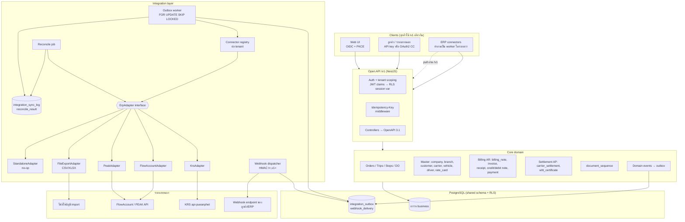
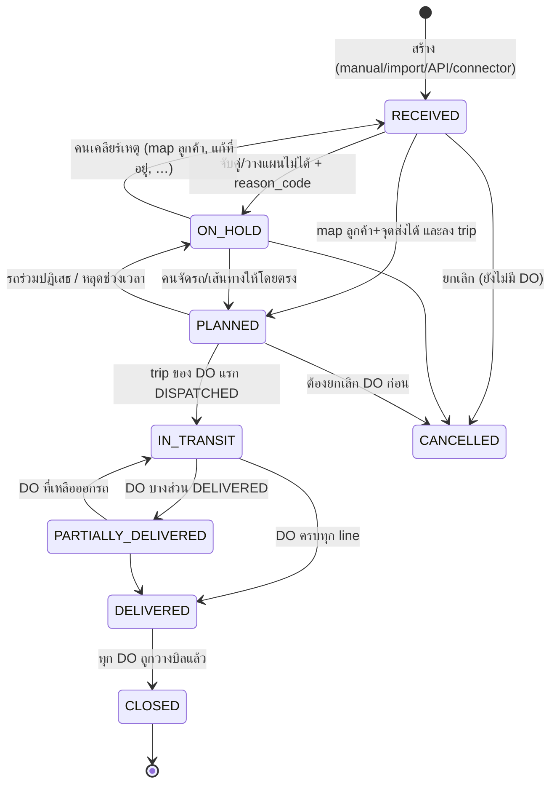
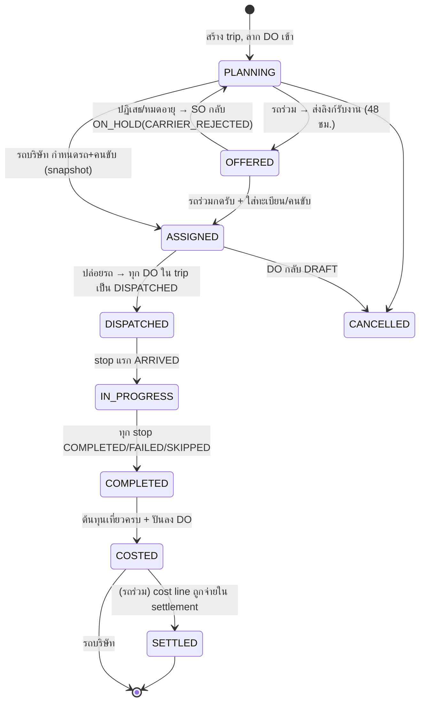
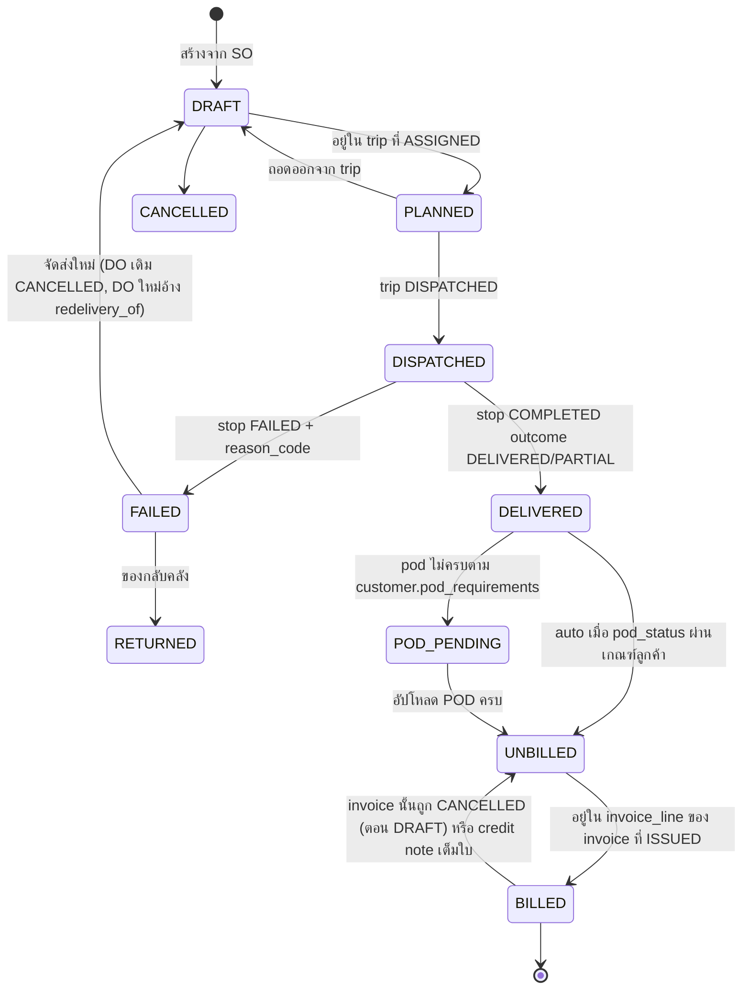
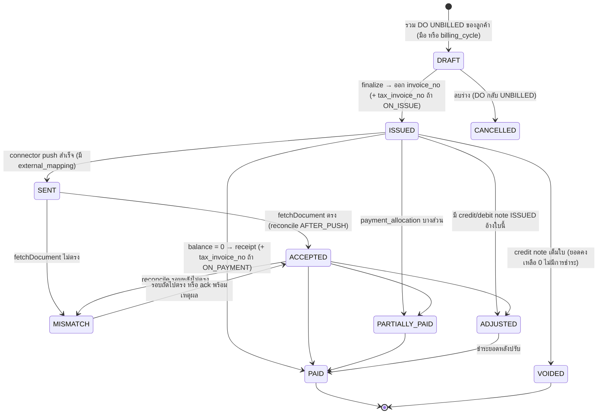
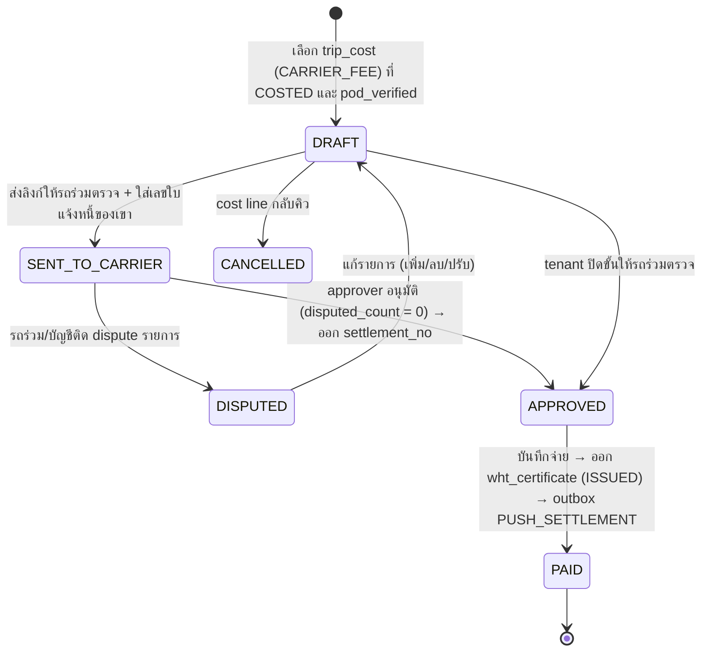
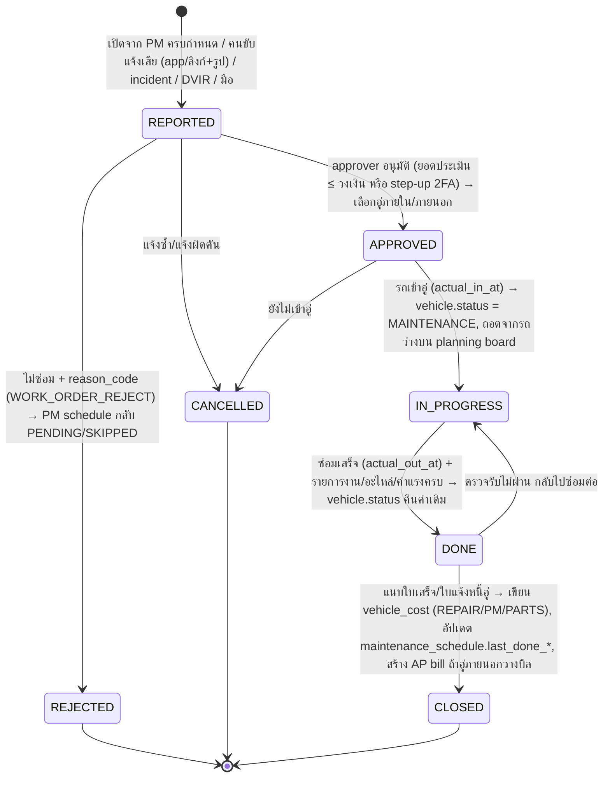

# เอกสารออกแบบ TMS: สถาปัตยกรรม, Data model, Open API และ Integration layer (v2)

Nov 3, 2026 · @wei · แทนที่ "เอกสารออกแบบ TMS × KRS Integration" (Oct 14, 2026)

TMS ของ Innovera เป็นระบบหลักที่สมบูรณ์ในตัว ใช้ standalone ได้โดยไม่มี ERP, เปิด Open API เป็น first-class (UI ของเราเรียก API ชุดเดียวกับที่ลูกค้าและ connector ใช้) และวาง ERP connector ทุกตัว รวมทั้ง KRS ที่เป็นตัวแรก ให้เป็น consumer ของ Open API ผ่าน adapter layer ไม่ใช่โค้ดพิเศษใน core เอกสารนี้เป็นฐานให้ทีมแตก task โดยข้อเท็จจริงเฉพาะ KRS ทั้งหมดถูกย้ายไป Appendix A

**การเปลี่ยนจุดยืนจาก v1**

| เรื่อง | v1 (Oct 14) | v2 (เอกสารนี้) |
| --- | --- | --- |
| TMS คืออะไร | ตัวกลางรับ SO จาก KRS แล้วส่ง Invoice กลับ | System of record ของเอกสารขนส่งและ AR/AP ของบริษัทขนส่ง ใช้งานได้โดยไม่มี ERP |
| ERP | KRS อยู่ในทุกหัวข้อ | ERP เป็น "ปลายทางหนึ่ง" ของ Open API; KRS = connector ตัวแรก อยู่ใน Appendix A |
| API | API สาธารณะเป็น P1 แยกจาก UI | Open API เป็นชั้นเดียวที่ทุก client ใช้ (UI, ลูกค้า, connector) |
| Invoice | 1 ตาราง `invoice` + revision + PUT ทับ | เอกสาร AR/AP ครบตามกฎหมายไทย; แก้หลังออกเลข = credit/debit note เท่านั้น |
| เอกสารแก้ไข | `replaceInvoice` (PUT ทั้งใบ) เป็น method หลัก | `pushCreditNote` เป็น method หลัก; PUT ทับเป็น fallback ของ adapter ที่ไม่มี credit note (ดู Appendix A) |

ป้ายกำกับ: **[KRS]** = ข้อเท็จจริงที่ยืนยันจากระบบจริง ห้ามเปลี่ยนโดยไม่ถามทีม KRS; **[เสนอ]** = ข้อเสนอการออกแบบ ทีมปรับได้; **[ภาษี]** = ข้อเท็จจริงจากกฎหมาย/ข้อหารือสรรพากรตาม research (ที่มาอยู่ใน `thai-tax-docs-research.md`)

## 1. ขอบเขตและหลักการออกแบบ

หลักการ 5 ข้อนี้กำกับทุกหัวข้อถัดไป และถ้าข้อใดถูกเปลี่ยน ให้ตามไปแก้หัวข้อที่อ้างถึง

| # | หลักการ [เสนอ] | ความหมายในทางปฏิบัติ | หัวข้อที่ผูก |
| --- | --- | --- | --- |
| 1 | **Standalone-first** | ทุก flow ตั้งแต่รับงาน → จัดรถ → ส่ง → วางบิล → รับชำระ → จ่ายรถร่วม ทำจบใน TMS ได้โดยไม่มี connector ใดเปิดอยู่; `StandaloneAdapter` (no-op) เป็น default ของทุก tenant | 2, 3, 4 |
| 2 | **API-first** | UI ของเราเป็น client ของ `/v1` เดียวกับลูกค้า; ไม่มี endpoint "internal" ที่ UI ใช้แล้วลูกค้าใช้ไม่ได้ ยกเว้น auth flow; OpenAPI spec generate จาก code และ CI ตรวจ breaking change | 5 |
| 3 | **Multi-tenant shared schema + RLS** | ทุกตารางมี `tenant_id`; Prisma client extension ใส่ `tenant_id` อัตโนมัติ; PostgreSQL Row-Level Security เป็นชั้นป้องกันที่สอง; unique key ทุกตัวเริ่มด้วย `tenant_id`; cross-tenant ตอบ 404 ไม่ใช่ 403 | 3, 5 |
| 4 | **TMS = system of record ของเอกสารขนส่งและใบวางบิล/ใบแจ้งหนี้** | แก้ใน TMS แล้ว sync ออก ห้ามแก้หรือลบใน ERP; ERP เป็นเจ้าของผังบัญชี, GL, การตั้งหนี้ทางบัญชี; ความไม่ตรงถูกจับด้วย reconcile ไม่ใช่ปล่อยให้สองฝั่งต่างกันเงียบ ๆ | 6, 8 |
| 5 | **เอกสารภาษีไทยอยู่ใน core** | ใบวางบิล / ใบแจ้งหนี้ / ใบกำกับภาษี / ใบเสร็จ / ใบเพิ่มหนี้-ลดหนี้ / 50 ทวิ และ document sequence ที่เรียงลำดับ เป็นของ TMS เอง ไม่พึ่ง ERP; ERP connector เป็นทางเลือกเสริม ไม่ใช่เงื่อนไขในการออกเอกสาร | 3, 4 |

**ข้อเท็จจริง [ภาษี] ที่บังคับรูปร่างของ data model** (รายละเอียดและที่มาอยู่ใน research)

| ข้อเท็จจริง | ผลต่อการออกแบบ |
| --- | --- |
| ค่าขนส่งในราชอาณาจักรได้รับยกเว้น VAT (ม.81(1)(ณ)) แต่บริการประกอบ (ยกขน, รอคิว, ลานตู้ ฯลฯ) เสีย VAT 7% | `vat_type` อยู่ที่**รายการ** ไม่ใช่ที่ลูกค้าหรือที่หัวเอกสาร (หัวข้อ 3.6) |
| Tax point ของ "บริการ" = เมื่อได้รับชำระ เว้นแต่ออกใบกำกับภาษีก่อน | ใบแจ้งหนี้ ≠ ใบกำกับภาษี; ต้องมี `payment` และโหมดออกใบกำกับภาษี `ON_PAYMENT` (default) / `ON_ISSUE` ต่อลูกค้า (หัวข้อ 3.6, 4.4) |
| ผู้ว่าจ้างนิติบุคคลหัก ณ ที่จ่าย 1% ค่าขนส่ง; บริษัทขนส่งจ่ายรถร่วมก็หัก 1%; ค่าบริการอื่น 3% | `wht_rate` ต่อรายการ ทั้งฝั่ง AR (รับ 50 ทวิ จากลูกค้า) และ AP (ออก 50 ทวิ ให้รถร่วม) (หัวข้อ 3.7) |
| เลขที่ใบกำกับภาษีต้องเรียงลำดับ ยกเลิกแล้วห้ามใช้เลขซ้ำ และต้องอ้างฉบับเดิม | `document_sequence` ออกเลขตอน finalize เท่านั้น draft ไม่มีเลข; ไม่มี hard delete (หัวข้อ 3.5) |
| ใบกำกับภาษีต้องมีเลขผู้เสียภาษี 13 หลัก + รหัสสาขา 5 หลัก (ภ.พ.20) ของทั้งสองฝ่าย และออกแยกตามสถานประกอบการ | `company` / `branch` เป็น entity แยกใน tenant; ทุกเอกสารภาษีผูก `issuing_branch_id` (หัวข้อ 3.1) |
| แก้ใบกำกับภาษีที่ออกแล้ว = ใบเพิ่มหนี้/ใบลดหนี้ ที่อ้างเลขเดิม + สาเหตุ (ม.86/9, 86/10) | ไม่มี `PUT /invoices/{id}` หลัง ISSUED; มี `credit_note` / `debit_note` พร้อม `reason_code` (หัวข้อ 4.4) |
| เก็บเอกสารภาษี ≥ 5 ปี (ขยายได้ถึง 7) | soft-delete + retention 7 ปี; เก็บ PDF ที่ render ณ วันออกแบบ immutable |

**นอกขอบเขตเอกสารนี้:** อัลกอริทึม VRP, Driver app/ePOD mobile, GPS connector, WMS, e-Tax Invoice XML (เว้น seam ไว้ที่ `invoice.etax_status`), ราคาและ tier (อยู่ใน "Product & Commercial"), รายการฟังก์ชันรายหน้าจอ (อยู่ใน "Functional Requirements")

## 2. สถาปัตยกรรม

Core ไม่รู้จัก ERP ใดเลย ทุกอย่างที่ออกจาก core ไปข้างนอกเดินผ่าน `integration_outbox` และทุกอย่างที่เข้ามาจากข้างนอกเดินผ่าน Open API ชุดเดียวกับที่ UI ใช้



**ส่วนประกอบและเหตุผล [เสนอ]**

| ส่วน | หน้าที่ | เหตุผล |
| --- | --- | --- |
| Open API เดียว | UI, ลูกค้า, connector เรียก controller ชุดเดียว; auth ต่างกันแค่วิธีได้ JWT (PKCE vs client credentials vs API key) ส่วน claims `tenantId, sub, scopes` เหมือนกัน | ไม่มี endpoint "ลับ" ที่ทำให้พฤติกรรม UI กับ API ต่างกัน; ทุก feature ที่ UI ทำได้ ลูกค้า automate ได้ |
| Domain events → outbox | ทุกการเปลี่ยนสถานะเอกสารเขียน `integration_outbox` ใน DB transaction เดียวกัน; worker ค่อยหยิบไป (1) เรียก adapter (2) ส่ง webhook | ไม่มีกรณี "สถานะเปลี่ยนแต่ไม่ได้ส่ง"; retry ได้โดยไม่กระทบ UI |
| Connector registry | ต่อ tenant เลือกได้ว่าเปิด adapter ตัวไหนสำหรับ capability ไหน (เช่น AR → FlowAccount, AP → file export); config เข้ารหัสด้วย KMS | หลายนิติบุคคลใน tenant เดียวอาจใช้โปรแกรมบัญชีต่างกัน |
| `ErpAdapter` interface | สัญญาเดียวที่ core เรียก; adapter ประกาศ `capabilities()` เพื่อให้ core รู้ว่าต้อง fallback อย่างไร (เช่น ไม่มี credit note → ใช้ replace) | เขียน adapter ใหม่โดยไม่แตะ domain; ERP ที่ concept ต่างกัน (PUT ทั้งใบ vs append credit note) อยู่ร่วมกันได้ |
| Inbound ผ่าน Open API | ERP/ลูกค้าที่ push SO มาให้เรา ใช้ `PUT /v1/orders/external/{externalId}` เหมือนลูกค้าทั่วไป; connector แบบ pull (poller) ก็เรียก endpoint เดียวกันนี้จากฝั่งใน | ไม่ต้องมี "import path" พิเศษต่อ ERP |
| Webhook dispatcher | ส่ง event `{resource}.{action}` ไป endpoint ที่ tenant ลงทะเบียน พร้อม HMAC signature, retry 8 ครั้ง, redeliver API | ERP/ลูกค้าไม่ต้อง polling; เป็นช่องทางที่ connector ภายนอก (ที่ไม่ได้รันในระบบเรา) ใช้ได้ |
| Reconcile job | ดึงเอกสารจาก ERP ผ่าน `fetchDocument()` มาเทียบกับ TMS ตามรอบ | จับเคสที่ ERP แก้/ลบเองนอก TMS ซึ่งเป็นเหตุการณ์ที่ core มองไม่เห็น |

**สิ่งที่ตั้งใจไม่ทำ** (จาก research "สิ่งที่ไม่ควรทำ"): ไม่ทำ DB-per-tenant, ไม่ทำ build แยกต่อลูกค้า, ไม่ให้ dashboard คำนวณแยกจาก invoice/settlement line, ไม่เปิดสองเส้นทางสู่ AP ของ ERP พร้อมกัน (จ่ายซ้ำ), ไม่ทำ sync ทางเดียวที่ไม่ reconcile กลับ, ไม่ซ่อน log integration จากลูกค้า

## 3. Data model

Data model ขยายจาก v1 ใน 7 กลุ่ม: นิติบุคคล/สาขา, Trip ที่รวมหลาย DO, รถร่วมและ AP, เอกสาร AR ครบตามกฎหมายไทย, ชั้น integration ที่ไม่ผูก ERP ใด, Fleet (เอกสารรถ / PM / ใบสั่งซ่อม / น้ำมัน / `vehicle_cost` ledger — เพิ่ม 4 พ.ย. 69, หัวข้อ 3.8) และ Driver app (`driver_device` / `stop_event` / DVIR — เพิ่ม 4 พ.ย. 69, หัวข้อ 3.9) ทุกตารางมี `tenant_id uuid NOT NULL` + `created_at/updated_at` + RLS policy และไม่เขียนซ้ำในตารางด้านล่าง

```mermaid
erDiagram
    tenant ||--|{ company : "นิติบุคคล"
    company ||--|{ branch : "ภ.พ.20"
    branch ||--o{ document_sequence : "เลขรันต่อสาขา"

    customer ||--o{ customer_site : "จุดส่ง"
    customer ||--o{ sales_order : "สั่ง"
    customer ||--o{ rate_card : "ราคาขาย"
    carrier ||--o{ rate_card : "ราคาซื้อ"
    carrier ||--o{ vehicle : "รถร่วม"
    carrier ||--o{ driver : "คนขับรถร่วม"

    sales_order ||--|{ sales_order_line : "มี"
    sales_order ||--o{ delivery_order : "แตกเป็น"
    delivery_order ||--|{ delivery_order_line : "มี"
    sales_order_line ||--o{ delivery_order_line : "ส่งบางส่วน"

    trip ||--|{ trip_stop : "จุดแวะ"
    trip ||--o{ delivery_order : "รวมหลาย DO"
    trip ||--o{ trip_cost : "ต้นทุนเที่ยว"
    vehicle ||--o{ trip : "snapshot"
    driver ||--o{ trip : "snapshot"
    carrier ||--o{ trip : "ถ้ารถร่วม"

    delivery_order ||--o{ invoice_line : "revenue line"
    invoice ||--|{ invoice_line : "มี"
    billing_note ||--o{ invoice : "รวมหลายใบ"
    invoice ||--o{ credit_note : "อ้างเลขเดิม"
    invoice ||--o{ debit_note : "อ้างเลขเดิม"
    invoice ||--o{ payment_allocation : "ตัดชำระ"
    payment ||--|{ payment_allocation : "แบ่ง"
    payment ||--o| receipt : "ใบเสร็จ/ใบกำกับภาษี"
    payment ||--o| wht_certificate : "50 ทวิ ที่ลูกค้าหักเรา"

    carrier ||--o{ carrier_settlement : "ใบจ่ายรถร่วม"
    carrier_settlement ||--|{ settlement_line : "มี"
    trip_cost ||--o| settlement_line : "1 cost = 1 line"
    carrier_settlement ||--o| wht_certificate : "50 ทวิ ที่เราหักรถร่วม"

    reason_code ||--o{ sales_order : "เหตุค้าง"
    reason_code ||--o{ credit_note : "สาเหตุ"

    vehicle ||--o{ vehicle_document : "ประกัน/พ.ร.บ./ภาษี/ตรอ."
    vehicle ||--o{ work_order : "ใบสั่งซ่อม"
    vehicle ||--o{ fuel_log : "เติมน้ำมัน"
    vehicle ||--o{ vehicle_cost : "ledger ต้นทุนต่อคัน"
    vehicle ||--o{ incident : "อุบัติเหตุ/เคลม"
    vehicle ||--o{ maintenance_schedule : "กำหนด PM ต่อคัน"
    maintenance_plan ||--o{ maintenance_schedule : "แผน → กำหนดการ"
    maintenance_schedule ||--o| work_order : "ครบกำหนด → เปิด WO"
    incident ||--o{ work_order : "ซ่อมจากเหตุ"
    work_order ||--|{ work_order_line : "งาน/อะไหล่/ค่าแรง"
    part ||--o{ work_order_line : "อะไหล่ที่ใช้"
    part ||--o{ part_stock_movement : "รับเข้า/เบิก"
    work_order ||--o{ part_stock_movement : "เบิกผูก WO"
    trip ||--o{ fuel_log : "เติมระหว่างเที่ยว"
    driver ||--o{ fuel_log : "คนขับที่เติม"
    vehicle_document ||--o{ incident : "กรมธรรม์ที่เคลม"

    driver ||--o{ driver_device : "เครื่องที่จำไว้ 30 วัน"
    trip_stop ||--o{ stop_event : "หลาย event ต่อจุด (idempotent)"
    driver_device ||--o{ stop_event : "เครื่องที่ส่ง"
    vehicle ||--o{ dvir_report : "ตรวจก่อนออกรถ"
    driver ||--o{ dvir_report : "ผู้ตรวจ"
    dvir_report ||--|{ dvir_item : "10 ข้อ"
    dvir_report ||--o| work_order : "ไม่ผ่าน → เปิด WO"

    external_mapping }o--|| connector : "ต่อ connector"
    integration_outbox ||--o{ integration_sync_log : "ทุกครั้งที่ยิง"
    connector ||--o{ reconcile_result : "ผลเทียบ"
    webhook_endpoint ||--o{ webhook_delivery : "ส่ง"
    api_key }o--|| tenant : "ต่อ tenant"
```



### 3.1 นิติบุคคลและสาขา

**company** — นิติบุคคลใน tenant (1 tenant มีได้หลายบริษัทในเครือ)

| คอลัมน์ | ชนิด | หมายเหตุ |
| --- | --- | --- |
| `id` | uuid PK | prefix API `cmp_` |
| `legal_name`, `legal_name_en` | text | ชื่อตามจดทะเบียน (ใช้บนใบกำกับภาษี) |
| `tax_id` | char(13) | เลขประจำตัวผู้เสียภาษี; **unique(tenant_id, tax_id)** |
| `vat_registered` | bool | false = ออกได้แค่ใบแจ้งหนี้/ใบเสร็จ ไม่มีคำว่า "ใบกำกับภาษี" |
| `default_branch_id` | uuid FK → branch | สำนักงานใหญ่ |
| `logo_document_id`, `signature_document_id` | uuid null | ใช้ render PDF |
| `status` | enum | `ACTIVE` / `INACTIVE` |

**branch** — สถานประกอบการตาม ภ.พ.20 (สำนักงานใหญ่ = `00000`)

| คอลัมน์ | ชนิด | หมายเหตุ |
| --- | --- | --- |
| `id` | uuid PK | `brn_` |
| `company_id` | uuid FK |  |
| `branch_code` | char(5) | `00000` / `00001` …; **unique(company_id, branch_code)** |
| `branch_label` | text | "สำนักงานใหญ่" / "สาขาที่ 00001" ที่พิมพ์บนเอกสาร |
| `address` | jsonb | โครง `{line1, line2, subdistrict, district, province, postcode}` |
| `hq_prints_for_all` | bool | true = สำนักงานใหญ่พิมพ์ให้ทุกสาขา (ป.86/2542 ข้อ 19) ไม่ต้องใส่ "สาขาที่ออกใบกำกับภาษีคือ" |
| `is_default_issuer` | bool | สาขาที่ใช้ออกเอกสารถ้าไม่ระบุ |

### 3.2 Master data

**customer** — ลูกค้าที่ถูกวางบิล (เพิ่มจาก v1: ฟิลด์ภาษี, โหมดใบกำกับภาษี, ตัด `erp_*` ออกไปที่ `external_mapping`)

| คอลัมน์ | ชนิด | หมายเหตุ |
| --- | --- | --- |
| `id` | uuid PK | `cus_` |
| `code` | text | รหัสภายใน; **unique(tenant_id, code)** |
| `external_id` | text null | **unique(tenant_id, external_id)** — เลขที่ระบบต้นทาง (ใช้ `PUT /customers/external/{id}`) |
| `legal_name`, `tax_id`, `branch_code` | text, char(13) null, char(5) | ลงบนใบกำกับภาษี; บุคคลธรรมดาต้องมีนามสกุล |
| `billing_address` | jsonb |  |
| `billing_cycle` | enum | `PER_DO` / `WEEKLY` / `MONTHLY` / `MANUAL` |
| `payment_term_days` | int |  |
| `tax_invoice_mode` | enum | `ON_PAYMENT` (default, tax point = รับเงิน) / `ON_ISSUE` (ลูกค้าขอใบกำกับภาษีพร้อมใบวางบิล) |
| `wht_expected_rate` | numeric null | 1.00 ถ้าลูกค้าเป็นนิติบุคคลที่จะหักเรา ใช้คาดการณ์ยอดรับสุทธิ |
| `pod_requirements` | jsonb | `{photo: REQUIRED, signature: ENABLED, ...}` ต่อลูกค้า |
| `default_billing_company_id` | uuid FK → company | ออกใบในนามบริษัทไหน (Invoice As) |
| `status` | enum | `ACTIVE` / `INACTIVE` |

**customer_site** — จุดส่ง/จุดรับของลูกค้า: `id` (`loc_`), `customer_id`, `name`, `address` jsonb, `lat`, `lng`, `geocode_status` enum `OK`/`PENDING`/`FAILED`, `aliases` text[] (ข้อความที่เคย map มาที่จุดนี้ ใช้จับคู่อัตโนมัติครั้งถัดไป), `open_time`, `close_time`, `vehicle_type_allowed` text[], `avg_dwell_min`, `contact` jsonb, `free_time_min` (ค่ารอฟรีก่อนคิด detention)

**carrier** — รถร่วม/ผู้รับขนช่วง แยกจาก driver เด็ดขาด

| คอลัมน์ | ชนิด | หมายเหตุ |
| --- | --- | --- |
| `id` | uuid PK | `car_` |
| `code`, `external_id` | text | unique ต่อ tenant |
| `legal_name` | text |  |
| `entity_type` | enum | `INDIVIDUAL` (ภ.ง.ด.3) / `JURISTIC` (ภ.ง.ด.53) |
| `tax_id`, `branch_code` | char(13), char(5) | บุคคลธรรมดา = เลขบัตรประชาชน (field-level encryption) |
| `wht_rate_default` | numeric | 1.00 (ค่าขนส่ง); override ได้ต่อ settlement line |
| `bank_account` | jsonb (encrypted) | ธนาคาร/เลขบัญชี/ชื่อบัญชี |
| `payment_term_days` | int |  |
| `require_pod_to_pay` | bool | กฎ "ไม่มี POD ไม่จ่าย" |
| `line_contact` | text null | LINE ID สำหรับส่งใบสั่งงาน |
| `score` | jsonb | ตรงเวลา %, ตีกลับ %, ร้องเรียน |

**vehicle** — `id` (`veh_`), `plate`, `plate_province`, `vehicle_type` enum (`PICKUP`/`6W`/`10W`/`TRAILER`/`REEFER`/…), `ownership` enum **`OWN` / `SUBCONTRACT`**, `carrier_id` FK null (บังคับเมื่อ `SUBCONTRACT`), `capacity_kg`, `capacity_cbm`, `gps_provider`, `gps_device_id`, `status` enum `READY`/`MAINTENANCE`/`PARKED`/`RETIRED`, `external_id` — วันหมดอายุเอกสาร (`insurance_expires_at`, `tax_expires_at`, `act_expires_at` ของ v1) **ย้ายไปตาราง `vehicle_document`** และคอลัมน์ Fleet ที่เพิ่ม (เลขตัวถัง, เลขไมล์, หัวลาก–หาง, ต้นทุนซื้อ/ค่าเสื่อม) อยู่ในหัวข้อ 3.8

**driver** — `id` (`drv_`), `name`, `phone`, `license_no`, `license_type`, `license_expires_at`, `employment_type` enum `EMPLOYEE_SALARIED` / `EMPLOYEE_PER_TRIP` / `CARRIER_DRIVER`, `carrier_id` FK null (บังคับเมื่อ `CARRIER_DRIVER`), `default_vehicle_id`, `status`, `external_id`

**rate_card** — ใช้โครงเดียวกันทั้ง 2 ฝั่ง

| คอลัมน์ | ชนิด | หมายเหตุ |
| --- | --- | --- |
| `id` | uuid PK |  |
| `side` | enum | `SELL` (ลูกค้า) / `BUY` (รถร่วม) |
| `customer_id` / `carrier_id` | uuid FK null | ต้องมีอย่างใดอย่างหนึ่งตาม `side` |
| `origin_site_id`, `dest_site_id`, `origin_zone`, `dest_zone` | uuid/text null | key = (ต้นทาง, ปลายทาง, ประเภทรถ); zone ใช้เมื่อไม่ผูกจุด |
| `vehicle_type` | enum null |  |
| `pricing_model` | enum | `PER_TRIP` / `PER_KM` / `PER_TON` / `PER_CBM` / `PER_DAY` |
| `unit_price` | numeric |  |
| `extra_stop_price` | numeric null | "เกิน N จุดคิดเพิ่มต่อจุด" |
| `included_stops` | int | N |
| `fuel_surcharge_pct` | numeric null |  |
| `service_item_id` | uuid FK → service_item | กำหนด `vat_type` และ `wht_rate` ของรายการที่เกิดจาก rate นี้ |
| `valid_from`, `valid_to` | date | ห้ามซ้อนช่วงใน key เดียวกัน (exclusion constraint) |
| `status` | enum | `DRAFT` / `APPROVED` / `EXPIRED` |

**service_item** — catalog รายการที่ขึ้นบนเอกสาร: `id`, `code`, `name_th`, `name_en`, `vat_type` enum **`VAT_7` / `EXEMPT_TRANSPORT` / `ZERO_RATED`**, `wht_rate` numeric (1.00 ค่าขนส่ง / 3.00 ค่าบริการ), `unit_label` ("เที่ยว", "ตัน", "กม."), `is_surcharge` bool (ค่ารอ, ค่าทางด่วน, ยกของ), `default_account_code` text null — ค่าทุกตัวถูก **snapshot** ลงรายการเอกสารตอนสร้าง แก้ master แล้วเอกสารเก่าไม่เปลี่ยน

**reason_code** — master เหตุผลที่ tenant ตั้งเองได้ มีชุดค่าเริ่มต้นภาษาไทย

| คอลัมน์ | ชนิด | หมายเหตุ |
| --- | --- | --- |
| `id` | uuid PK |  |
| `category` | enum | `ORDER_HOLD` (งานค้าง) / `DELIVERY_FAILED` / `REJECTED_BY_RECEIVER` / `POD_MISSING` / `CREDIT_NOTE` / `DEBIT_NOTE` / `SETTLEMENT_DISPUTE` / `OVERRIDE` |
| `code` | text | เช่น `ROUTE_PENDING`, `CDNS03`; **unique(tenant_id, category, code)**; รหัสระบบ (system) ลบไม่ได้ |
| `label_th`, `label_en` | text |  |
| `requires_note`, `requires_photo` | bool |  |
| `auto_reschedule` | bool | สำหรับ `DELIVERY_FAILED` |
| `etda_code` | text null | map กับ purpose code ของ ETDA สำหรับ credit/debit note |
| `is_system` | bool | true = ชุดที่ state machine ใช้ (หัวข้อ 4) |

### 3.3 Orders, Trips, Delivery Orders

**sales_order** — งานที่ลูกค้าสั่ง ไม่ว่ามาจากทางไหน

| คอลัมน์ | ชนิด | หมายเหตุ |
| --- | --- | --- |
| `id` | uuid PK | `ord_` |
| `so_no` | text | เลข TMS จาก `document_sequence` ประเภท `SO`; **unique(tenant_id, so_no)** |
| `source` | enum | `MANUAL` / `IMPORT` / `API` / `PORTAL` / `CONNECTOR` |
| `external_id` | text null | เลขของระบบต้นทาง; **unique(tenant_id, external_id)**; ใช้ upsert idempotent |
| `customer_id` | uuid FK null | null ได้เมื่อ `CUSTOMER_UNMAPPED` |
| `billing_company_id` | uuid FK → company | บริษัทที่จะออกใบ |
| `origin_site_id`, `dest_site_id` | uuid FK null | ว่างจนกว่าจะ map จาก `origin_text`/`dest_text` |
| `origin_text`, `dest_text` | text | ข้อความตามที่ต้นทางให้มา |
| `requested_date`, `window_start`, `window_end` | date, timestamptz |  |
| `vehicle_type_required` | enum null |  |
| `status` | enum | หัวข้อ 4.1 |
| `hold_reason_code_id` | uuid FK → reason_code null | เหตุที่ค้าง เมื่อ `status = ON_HOLD` |
| `hold_note` | text null |  |
| `source_changed_after_plan` | bool | ต้นทางแก้หลังเราวางแผน → ไม่ overwrite แต่เก็บ diff |
| `source_diff` | jsonb null |  |
| `locked_by`, `locked_at` | uuid, timestamptz null | ป้าย "กำลังแก้ไขโดย…" |
| `raw_payload` | jsonb null | payload ดิบจากต้นทาง |
| `version` | int | ETag |

**sales_order_line** — `id`, `sales_order_id`, `line_no` int, `item_code`, `description`, `qty_ordered`, `qty_delivered` (คำนวณจาก DO), `unit`, `weight_kg`, `cbm`, `is_dangerous`, `temp_min`, `temp_max`

**trip** — ใบคุมรถ 1 เที่ยว รวมได้หลาย DO ของหลายลูกค้า; รถ/คนขับเป็น **snapshot ต่อเที่ยว**

| คอลัมน์ | ชนิด | หมายเหตุ |
| --- | --- | --- |
| `id` | uuid PK | `trp_` |
| `trip_no` | text | sequence ประเภท `TRIP` |
| `trip_date` | date |  |
| `vehicle_id` | uuid FK | อ้างอิง |
| `vehicle_plate_snapshot`, `vehicle_type_snapshot` | text | copy ตอน dispatch ไม่ตามเมื่อ master เปลี่ยน |
| `driver_id`, `driver_name_snapshot`, `driver_phone_snapshot` | uuid, text |  |
| `co_driver_ids` | uuid[] | งานทางไกล |
| `carrier_id` | uuid FK null | ถ้า `vehicle.ownership = SUBCONTRACT` |
| `carrier_name_snapshot`, `buy_rate_snapshot` | text, jsonb null | ราคาซื้อที่ตกลง ณ วันจ่ายงาน |
| `assignment_status` | enum null | `OFFERED` / `ACCEPTED` / `REJECTED` / `EXPIRED` (สำหรับรถร่วม) |
| `assignment_token`, `assignment_expires_at` | text, timestamptz null | ลิงก์รับงานผ่าน LINE อายุ 48 ชม. ไม่ต้อง login |
| `planned_distance_km`, `actual_distance_km` | numeric |  |
| `status` | enum | หัวข้อ 4.2 |
| `cost_allocation_method` | enum | `BY_WEIGHT` / `BY_DISTANCE` / `BY_STOP` / `EQUAL` — วิธีปันต้นทุนเที่ยวลง DO |
| `dispatched_at`, `completed_at` | timestamptz |  |

**trip_stop** — จุดแวะเรียงลำดับ: `id` (`stp_`), `trip_id`, `sequence` int, `type` enum `PICKUP`/`DELIVERY`/`RETURN`, `site_id` FK, `planned_arrival`, `planned_departure`, `arrived_at`, `departed_at`, `status` enum `PENDING`/`ARRIVED`/`COMPLETED`/`FAILED`/`SKIPPED`, `outcome` enum null `DELIVERED`/`PARTIAL`/`FAILED`, `fail_reason_code_id`, `arrive_lat/lng`, `geofence_warning` bool, `detention_min` (คำนวณจาก arrive/depart − free time), `pod` jsonb (receiver, signature doc, photo docs), `last_event_id` uuid FK → stop_event null (event ล่าสุดที่เปลี่ยนสถานะ) — **idempotency ของอุปกรณ์ offline ย้ายไปอยู่ที่ตาราง `stop_event` (หัวข้อ 3.9)** เพราะ 1 stop มีหลาย event (arrive, depart, complete, delay) ไม่ใช่ `client_event_id` เดียว; `arrived_at` / `departed_at` / `status` / `outcome` บน trip_stop เป็น projection ที่คำนวณจาก stop_event ตาม `occurred_at` — decision 2026-11-04

**trip_cost** — ต้นทุนรายการต่อเที่ยว: `id`, `trip_id`, `cost_type` enum `FUEL`/`TOLL`/`DRIVER_WAGE`/`CARRIER_FEE`/`ALLOWANCE`/`REPAIR`/`OTHER`, `amount`, `vat_amount`, `source` enum `RATE_CARD`/`MANUAL`/`GPS`/`ADVANCE`, `carrier_id` FK null (เมื่อเป็นค่ารถร่วม), `settlement_line_id` FK null unique (= ยังไม่จ่าย ถ้า null), `allocated` jsonb (`{do_id: amount}` ตาม `cost_allocation_method`)

**delivery_order** — เอกสารส่งของต่อลูกค้าต่อเที่ยว; 1 trip มีหลาย DO, 1 DO อยู่ใน 1 trip

| คอลัมน์ | ชนิด | หมายเหตุ |
| --- | --- | --- |
| `id` | uuid PK | `do_` |
| `do_no` | text | sequence ประเภท `DO` |
| `do_date` | date |  |
| `sales_order_id`, `customer_id` | uuid FK |  |
| `trip_id` | uuid FK null | ว่างตอน DRAFT ก่อนลง trip |
| `trip_stop_id` | uuid FK null | จุดส่งของ DO นี้ |
| `origin_site_id`, `dest_site_id` | uuid FK | snapshot จาก SO แก้ได้จนถึง DISPATCHED |
| `weight_kg`, `cbm`, `trips` | numeric, numeric, int | ใช้คิด `quantity` ตาม `pricing_model` |
| `sell_rate_snapshot` | jsonb | `{pricing_model, unit_price, service_item_id, vat_type, wht_rate, extra_stop_price}` ณ วันส่ง |
| `revenue_amount` | numeric | คำนวณจาก snapshot × ปริมาณจริง (`actual_quantity`) |
| `allocated_cost_amount` | numeric | ต้นทุนเที่ยวที่ปันมา → กำไรต่อ DO |
| `status` | enum | หัวข้อ 4.3 |
| `invoice_line_id` | uuid FK null | null = `UNBILLED`; **unique partial index where invoice ยัง active** กันวางบิลซ้ำ |
| `pod_status` | enum | `NONE` / `PARTIAL` / `COMPLETE` ตาม `customer.pod_requirements` |
| `customer_ref` | text null | PO ลูกค้า ใช้ค้นใน tracking link |
| `version` | int |  |

**delivery_order_line** — `id`, `delivery_order_id`, `sales_order_line_id`, `qty_planned`, `qty_actual` (ส่งได้จริง), `reject_qty`, `reject_reason_code_id`, `unit`

**do_surcharge** — ค่าใช้จ่ายหน้างานที่กลายเป็นรายการเพิ่มใน invoice: `id`, `delivery_order_id`, `service_item_id` (+snapshot `vat_type`, `wht_rate`), `qty`, `unit_price`, `amount`, `evidence_document_id`, `approved_by`

### 3.4 เอกสาร AR (ลูกค้า)

**billing_note** — ใบวางบิล: สรุปใบแจ้งหนี้ค้างหลายใบของลูกค้าหนึ่งราย ไม่กระทบ VAT/WHT

| คอลัมน์ | ชนิด | หมายเหตุ |
| --- | --- | --- |
| `id` | uuid PK | `bn_` |
| `billing_note_no` | text null | sequence ประเภท `BN` ออกตอน ISSUED |
| `customer_id`, `issuing_company_id`, `issuing_branch_id` | uuid FK |  |
| `billing_date`, `collection_date` | date | วันวางบิล / วันนัดรับเช็ค |
| `total_amount`, `total_wht_expected`, `net_expected` | numeric | รวมจาก invoice ที่อยู่ในใบ |
| `status` | enum | `DRAFT` / `ISSUED` / `COLLECTED` / `CANCELLED` |
| `pdf_document_id` | uuid null | render ครั้งเดียวตอน ISSUED |

**invoice** — ใบแจ้งหนี้ และเป็นใบกำกับภาษีด้วยเมื่อ `tax_invoice_no` ถูกออก

| คอลัมน์ | ชนิด | หมายเหตุ |
| --- | --- | --- |
| `id` | uuid PK | `inv_` |
| `invoice_no` | text null | sequence ประเภท `INV` ออกตอน ISSUED; **unique(tenant_id, issuing_branch_id, invoice_no)** |
| `tax_invoice_no` | text null | sequence ประเภท `TXINV` แยก; ออกเมื่อ `tax_invoice_mode = ON_ISSUE` ตอน ISSUED หรือเมื่อรับชำระ (ผ่าน receipt) — null ถ้าทุกรายการ `EXEMPT_TRANSPORT` |
| `tax_point_at` | timestamptz null | วันที่ความรับผิด VAT เกิด = วันออก `tax_invoice_no`; รายงานภาษีขายใช้เดือนของวันนี้ |
| `customer_id`, `billing_note_id` | uuid FK, FK null |  |
| `issuing_company_id`, `issuing_branch_id` | uuid FK | บังคับ; ใช้เลือก sequence และข้อความ "สาขาที่ออกใบกำกับภาษีคือ" |
| `customer_snapshot` | jsonb | `{legal_name, tax_id, branch_code, address}` ตอน ISSUED |
| `issue_date`, `due_date` | date |  |
| `subtotal_vatable`, `subtotal_exempt`, `vat_amount`, `total_amount` | numeric | เก็บแยกฐาน VAT กับยกเว้นเพื่อ ภ.พ.30 |
| `wht_expected_amount` | numeric | Σ line.amount × wht_rate สำหรับลูกค้านิติบุคคล |
| `paid_amount`, `balance` | numeric | อัปเดตจาก `payment_allocation` |
| `status` | enum | หัวข้อ 4.4 |
| `has_set_document` | bool | true = พิมพ์รวมชุด → ต้องมี "เอกสารออกเป็นชุด" บนแผ่นที่ไม่ใช่แผ่นแรก |
| `pdf_document_id` | uuid null | immutable หลัง ISSUED; ใบแทนออกจากไฟล์นี้ + watermark |
| `replacement_issued_at` | timestamptz[] | log ทุกครั้งที่ออกใบแทน |
| `etax_status` | enum | `NONE` / `PENDING` / `SENT` / `FAILED` (seam สำหรับ e-Tax เฟสถัดไป) |
| `created_by`, `issued_by` | uuid | ผู้สร้างกับผู้ออกต้องต่างคน (separation of duties, owner ปิดได้) |
| `version` | int |  |

**invoice_line** — รายการ; `vat_type` ต่อรายการ

| คอลัมน์ | ชนิด | หมายเหตุ |
| --- | --- | --- |
| `id`, `invoice_id` | uuid |  |
| `line_no` | int | 1..N ต่อใบ |
| `delivery_order_id` | uuid FK null | revenue line ของ DO; **unique partial** where invoice.status ≠ CANCELLED |
| `do_surcharge_id` | uuid FK null | รายการเพิ่มจากหน้างาน |
| `service_item_id` | uuid FK |  |
| `description` | text | เช่น "ค่าขนส่ง DO-2611-00042 คลังบางปู→ชลบุรี ทะเบียน 70-1234" |
| `quantity`, `unit_label`, `unit_price`, `amount` | numeric, text, numeric, numeric |  |
| `vat_type` | enum | **`VAT_7` / `EXEMPT_TRANSPORT` / `ZERO_RATED`** snapshot จาก service_item |
| `vat_amount` | numeric | 0 เมื่อ exempt |
| `wht_rate` | numeric | 1.00 / 3.00 / 0 snapshot |
| `account_code` | text null | ส่งให้ ERP ที่ต้องการ |
| `is_user_added` | bool | true = คงไว้เมื่อ rebuild รายการอัตโนมัติ |

**credit_note / debit_note** — โครงเดียวกัน (ตาราง `adjustment_note` + `kind`) แต่ sequence แยก

| คอลัมน์ | ชนิด | หมายเหตุ |
| --- | --- | --- |
| `id` | uuid PK | `cn_` / `dn_` |
| `kind` | enum | `CREDIT` / `DEBIT` |
| `note_no` | text null | sequence ประเภท `CN` / `DN` ออกตอน ISSUED |
| `original_invoice_id` | uuid FK | **บังคับ**; invoice ต้อง `ISSUED` ขึ้นไป |
| `original_tax_invoice_no_snapshot` | text null |  |
| `reason_code_id`, `reason_text` | uuid FK, text | เหตุต้องเข้า ม.82/9–82/10; ETDA code เช่น `CDNS03` |
| `original_amount`, `corrected_amount`, `difference_amount`, `vat_difference` | numeric | snapshot ตามฟิลด์บังคับของ ม.86/9–86/10 |
| `lines` | ผ่านตาราง `adjustment_note_line` | อ้าง `invoice_line_id` + ปริมาณ/ราคาที่แก้ |
| `issue_date` | date | ต้องอยู่ในเดือนภาษีที่เกิดเหตุ (หรือเดือนถัดไป) — ระบบเตือนถ้าเกิน |
| `status` | enum | `DRAFT` / `ISSUED` / `CANCELLED` |
| `pdf_document_id` | uuid null |  |

**payment** — รับชำระจากลูกค้า (tax point ของบริการ)

| คอลัมน์ | ชนิด | หมายเหตุ |
| --- | --- | --- |
| `id` | uuid PK | `pay_` |
| `customer_id`, `receiving_company_id` | uuid FK |  |
| `paid_at` | date |  |
| `method` | enum | `TRANSFER` / `CHEQUE` / `CASH` / `OTHER` |
| `reference` | text | เลขเช็ค / เลขอ้างอิงโอน |
| `gross_amount` | numeric | ยอดตามใบ |
| `wht_amount` | numeric | ที่ลูกค้าหักไว้ (1%) |
| `net_received` | numeric | เงินเข้าจริง = gross − wht − `bank_fee` |
| `wht_certificate_received` | bool | ได้รับ 50 ทวิ จากลูกค้าแล้ว |
| `source` | enum | `MANUAL` / `CONNECTOR` (ERP แจ้งว่าได้รับชำระ) |
| `status` | enum | `RECORDED` / `REVERSED` |

**payment_allocation** — `payment_id`, `invoice_id`, `amount`, `wht_amount`; รวมต่อ invoice ไม่เกิน `total_amount`

**receipt** — ใบเสร็จรับเงิน (ม.105) หรือ "ใบเสร็จรับเงิน/ใบกำกับภาษี" เมื่อ `tax_invoice_mode = ON_PAYMENT`

| คอลัมน์ | ชนิด | หมายเหตุ |
| --- | --- | --- |
| `id` | uuid PK | `rcp_` |
| `receipt_no` | text | sequence ประเภท `RCP` ออกทันทีที่บันทึก payment (กฎ "ออกทันทีที่รับเงิน") |
| `payment_id` | uuid FK unique |  |
| `issuing_branch_id` | uuid FK |  |
| `is_tax_invoice` | bool | true → ออก `tax_invoice_no` ให้ invoice ที่ถูกตัดชำระในงวดนี้ และตั้ง `invoice.tax_point_at = paid_at` |
| `pdf_document_id` | uuid |  |

### 3.5 Document sequence

**document_sequence** — เลขรันต่อ (tenant, ประเภทเอกสาร, สาขา, งวด) ออกเลขตอน finalize เท่านั้น

| คอลัมน์ | ชนิด | หมายเหตุ |
| --- | --- | --- |
| `id` | uuid PK |  |
| `doc_type` | enum | `SO` / `TRIP` / `DO` / `BN` / `INV` / `TXINV` / `RCP` / `CN` / `DN` / `STL` / `WHT` / `WO` / `INC` (Fleet, หัวข้อ 3.8) |
| `branch_id` | uuid FK null | null = ใช้ร่วมทั้ง tenant (เอกสารปฏิบัติการ); เอกสารภาษีบังคับมีสาขา |
| `period_key` | text | `2611` (YYMM) หรือ `2026` ตาม `reset_policy` |
| `reset_policy` | enum | `MONTHLY` / `YEARLY` / `NEVER` |
| `prefix_template` | text | เช่น `INV-{BR}-{YY}{MM}-` → `INV-00000-2611-0042`; ปี พ.ศ./ค.ศ. ตาม tenant |
| `padding` | int | 4 |
| `next_value` | bigint |  |
| unique |  | `(tenant_id, doc_type, branch_id, period_key)` |

กติกา: `SELECT … FOR UPDATE` บนแถว sequence ภายใน transaction เดียวกับการเปลี่ยนสถานะเป็น ISSUED; draft ไม่กินเลข; เอกสารที่ยกเลิกคง record และเลขไว้ (`status = CANCELLED`) ไม่ reuse; ไม่มี API ลบเอกสารที่ออกเลขแล้ว

### 3.6 เอกสาร AP (รถร่วม/คนขับ)

**carrier_settlement** — ใบสำคัญจ่ายรถร่วม (ใบรับวางบิลจากรถร่วม)

| คอลัมน์ | ชนิด | หมายเหตุ |
| --- | --- | --- |
| `id` | uuid PK | `stl_` |
| `settlement_no` | text null | sequence `STL` |
| `carrier_id`, `paying_company_id`, `paying_branch_id` | uuid FK |  |
| `period_from`, `period_to` | date |  |
| `carrier_invoice_no`, `carrier_invoice_date` | text, date null | เลขใบแจ้งหนี้ที่รถร่วมวางมา ใช้กระทบยอด |
| `gross_amount`, `deduction_amount`, `wht_amount`, `net_payable` | numeric | deduction = เงินเบิกล่วงหน้า/น้ำมัน/ค่าปรับ (บรรทัดติดลบ) |
| `status` | enum | หัวข้อ 4.5 |
| `disputed_count` | int | > 0 บล็อก approve |
| `paid_at`, `payment_reference` | date, text null |  |
| `approved_by`, `paid_by` | uuid |  |

**settlement_line** — `id`, `settlement_id`, `trip_cost_id` FK **unique** (กันจ่ายซ้ำ — เส้นทางเดียวสู่ AP), `trip_id`, `delivery_order_id` null, `description`, `amount`, `wht_rate` (1.00 ค่าขนส่ง / 3.00 ค่าบริการ / 0 ค่าน้ำมันที่ reimburse — รอคำตอบนักบัญชี), `wht_amount`, `line_type` enum `FREIGHT` / `SURCHARGE` / `DEDUCTION`, `dispute_status` enum `NONE` / `DISPUTED` / `RESOLVED`, `dispute_note`, `pod_verified` bool

**wht_certificate** — หนังสือรับรองหัก ณ ที่จ่าย (50 ทวิ) ใช้ทั้งที่เราออกและที่เรารับ

| คอลัมน์ | ชนิด | หมายเหตุ |
| --- | --- | --- |
| `id` | uuid PK | `wht_` |
| `direction` | enum | `ISSUED` (เราออกให้รถร่วม) / `RECEIVED` (ลูกค้าออกให้เรา) |
| `certificate_no` | text null | sequence `WHT` เมื่อ `ISSUED`; เลขของลูกค้าเมื่อ `RECEIVED` |
| `settlement_id` / `payment_id` | uuid FK null | ตาม direction |
| `payer_snapshot`, `payee_snapshot` | jsonb | ชื่อ/ที่อยู่/เลขฯ/สาขา ทั้งสองฝ่าย |
| `income_type` | text | "ค่าขนส่ง" ตาม ท.ป.4/2528 ข้อ 12/4 |
| `paid_date`, `amount_paid`, `tax_withheld`, `rate` | date, numeric |  |
| `pnd_form` | enum | `PND3` (บุคคล) / `PND53` (นิติบุคคล) |
| `withholding_condition` | int | 1 หัก ณ ที่จ่าย / 2 ออกให้ตลอดไป / 3 ออกให้ครั้งเดียว |
| `pdf_document_id` | uuid null | 2 ฉบับในไฟล์เดียว |
| `rd_export_batch_id` | uuid null | รวมไฟล์ text สำหรับ RD Prep รายเดือน |

### 3.7 Integration layer

**connector** — การตั้งค่า adapter ต่อ tenant (แทน feature flag `erp.krs.*` ใน v1)

| คอลัมน์ | ชนิด | หมายเหตุ |
| --- | --- | --- |
| `id` | uuid PK | `con_` |
| `adapter_key` | text | `krs` / `flowaccount` / `peak` / `file_export` / `standalone` |
| `company_id` | uuid FK null | จำกัดให้ใช้กับนิติบุคคลใด (Invoice As) |
| `capabilities_enabled` | text[] | subset ของ `adapter.capabilities()` ที่ tenant เปิด เช่น `["pullOrders","pushInvoice"]` |
| `config` | jsonb (encrypted) | base URL, credential, mapping overrides |
| `sync_from_date` | date | ไม่ push เอกสารที่ `issue_date` ก่อนวันนี้ (กันซ้ำกับที่บัญชีคีย์ไว้แล้วตอน go-live) |
| `status` | enum | `ACTIVE` / `PAUSED` / `ERROR` |
| `last_health_at`, `last_health_ok` | timestamptz, bool |  |

**external_mapping** — แทน `erp_doc_map` ของ v1 ครอบคลุมทุก entity

| คอลัมน์ | ชนิด | หมายเหตุ |
| --- | --- | --- |
| `id` | uuid PK |  |
| `connector_id` | uuid FK |  |
| `entity_type` | enum | `CUSTOMER` / `CARRIER` / `SERVICE_ITEM` / `SALES_ORDER` / `DELIVERY_ORDER` / `INVOICE` / `CREDIT_NOTE` / `DEBIT_NOTE` / `RECEIPT` / `SETTLEMENT` |
| `local_id` | uuid | id ฝั่ง TMS |
| `external_id` | text | id ฝั่ง ERP ที่ใช้เป็น path/key (เช่น transactionNo) |
| `external_doc_no` | text null | เลขเอกสารที่ ERP ออก (เช่น voucherNo) |
| `external_version` | text null | ETag/revision ฝั่ง ERP ถ้ามี |
| `last_synced_hash` | text | sha256 ของ canonical payload ล่าสุดที่ส่งสำเร็จ → ไม่ push ซ้ำถ้า hash เท่าเดิม |
| `last_synced_at` | timestamptz |  |
| `status` | enum | `SYNCED` / `PENDING` / `FAILED` / `MISMATCH` / `RETIRED` |
| `last_error` | jsonb null | problem+json ล่าสุด |
| unique |  | `(connector_id, entity_type, local_id)` และ `(connector_id, entity_type, external_id)` |

**integration_outbox** — คิวคำสั่งทุกอย่างที่ออกจาก core (ทั้ง adapter และ webhook)

| คอลัมน์ | ชนิด | หมายเหตุ |
| --- | --- | --- |
| `id` | uuid PK |  |
| `kind` | enum | `ADAPTER` / `WEBHOOK` |
| `connector_id` / `webhook_endpoint_id` | uuid FK null | ตาม kind |
| `operation` | text | `PUSH_INVOICE` / `PUSH_CREDIT_NOTE` / `PUSH_SETTLEMENT` / `FETCH_DOCUMENT` / `FETCH_PAYMENT_STATUS` / หรือชื่อ event |
| `entity_type`, `local_id` | enum, uuid |  |
| `event_id` | uuid FK → domain_event | ให้ webhook และ adapter อ้าง event เดียวกัน |
| `idempotency_key` | text unique | `{connector_id}:{entity_type}:{local_id}:{payload_hash}` |
| `payload` | jsonb | canonical payload ณ เวลาสร้างคำสั่ง (หัวข้อ 7) |
| `status` | enum | `PENDING` / `IN_FLIGHT` / `DONE` / `FAILED_RETRYABLE` / `FAILED_FINAL` / `SKIPPED` |
| `attempt`, `max_attempt`, `next_run_at`, `lease_until` | int, int, timestamptz |  |
| `error_class` | enum null | หัวข้อ 6.3 |
| `last_error` | jsonb |  |

**integration_sync_log** — 1 แถวต่อ 1 HTTP call (รวม GET ที่ใช้เทียบ): `id` bigserial, `outbox_id` FK null, `connector_id`, `attempt_no`, `direction` enum `OUTBOUND`/`INBOUND`, `method`, `url`, `request_headers` jsonb (ตัด credential), `request_body` jsonb, `response_status`, `response_body` jsonb, `duration_ms`, `sent_at`; index บน `local_id`, `external_id`, GIN บน `request_body`; retention 24 เดือน

**reconcile_result** — `id`, `connector_id`, `entity_type`, `local_id`, `run_at`, `source` enum `AFTER_PUSH`/`NIGHTLY`/`PRE_CLOSE`/`MANUAL`, `local_snapshot` jsonb, `remote_snapshot` jsonb, `diff` jsonb (รายการที่หาย/เกิน/ฟิลด์ต่าง), `diff_hash`, `result` enum `MATCH`/`MISMATCH`/`REMOTE_MISSING`/`ERP_UNREACHABLE`, `severity` enum `MONEY`/`FIELD`/`INFO`, `acknowledged_by`, `acknowledged_at`, `ack_reason`

**webhook_endpoint** — `id` (`whe_`), `url`, `description`, `events` text[], `secret_hash`, `secret_prev_hash`, `secret_rotated_at`, `status` enum `ACTIVE`/`DISABLED`/`AUTO_DISABLED`, `consecutive_failures` int, `created_by`

**webhook_delivery** — `id`, `endpoint_id`, `event_id`, `attempt`, `request_body`, `response_status`, `response_body` (ตัด 4 KB), `duration_ms`, `sent_at`, `next_retry_at`, `status` enum `PENDING`/`DELIVERED`/`FAILED`/`EXHAUSTED`; retention 30 วัน

**domain_event** — `id` (`evt_`), `type` (`invoice.finalized`), `version`, `occurred_at`, `entity_type`, `local_id`, `snapshot` jsonb, `previous_attributes` jsonb, `request_id`, `actor_id` — แหล่งเดียวของทั้ง webhook payload และ audit timeline

**api_key** — `id`, `name`, `key_prefix` (`tk_live_ab12`), `key_hash`, `scopes` text[], `ip_allowlist` inet[], `expires_at`, `revoke_at` (rotation grace ≤ 7 วัน), `last_used_at`, `created_by`, `environment` enum `LIVE`/`TEST`

**idempotency_key** — `(tenant_id, key, path)` PK, `request_hash`, `response_status`, `response_body`, `expires_at` (24 ชม.)

**doc_status_history** — `doc_type`, `doc_id`, `from_status`, `to_status`, `actor_id`, `reason_code_id`, `note`, `at` — ทุก transition ในหัวข้อ 4 เขียนที่นี่

### 3.8 Fleet (จัดการรถ) [เสนอ — decision 2026-11-04]

หลักการ: รถเป็น asset ที่มี ledger ต้นทุนของตัวเอง ทุกตารางในกลุ่มนี้ที่ทำให้เกิดเงิน (เอกสาร, ใบสั่งซ่อม, น้ำมัน, อุบัติเหตุ, ค่าเสื่อม) **เขียน `vehicle_cost` 1 แถวต่อ 1 รายการ** ใน transaction เดียวกัน และรายงานกำไรต่อคันอ่านจาก `vehicle_cost` + รายได้ที่ปันลงรถเท่านั้น (หลักการเดียวกับ invoice/settlement line); รถร่วม (`ownership = SUBCONTRACT`) ใช้เฉพาะ `vehicle_document` ไม่มี PM / work order / fuel / part

**vehicle** — คอลัมน์ที่เพิ่มจาก 3.2

| คอลัมน์ | ชนิด | หมายเหตุ |
| --- | --- | --- |
| `vin`, `engine_no` | text null | เลขตัวถัง / เลขเครื่อง; unique(tenant_id, vin) เมื่อไม่ null |
| `brand`, `model`, `model_year`, `color` | text, text, int, text |  |
| `tare_weight_kg`, `gross_weight_kg` | numeric | น้ำหนักเปล่า / น้ำหนักรวมบรรทุก (ตามทะเบียน) |
| `fuel_type` | enum | `DIESEL` / `GASOLINE` / `NGV` / `LPG` / `EV` / `HYBRID` |
| `tank_capacity_l` | numeric null | ใช้ตรวจ fuel_log ผิดปกติ (เติมเกินถัง) |
| `odometer_km` | numeric | เลขไมล์ปัจจุบัน; อัปเดตจาก trip ที่ COMPLETED (`actual_distance_km`), GPS connector หรือ fuel_log/work_order ที่กรอกเลขไมล์ — เก็บค่าสูงสุดและ `odometer_source`, `odometer_updated_at` |
| `odometer_source`, `odometer_updated_at` | enum, timestamptz | `TRIP` / `GPS` / `FUEL_LOG` / `WORK_ORDER` / `MANUAL` |
| `unit_role` | enum | `SINGLE` / `TRACTOR` (หัวลาก) / `TRAILER` (หาง) |
| `paired_vehicle_id` | uuid FK → vehicle null | หัวลากประจำ ↔ หาง; trip override ได้ด้วย `trailer_id` ของตัวเอง |
| `status` | enum | `READY` / `MAINTENANCE` / `PARKED` / `RETIRED` — `MAINTENANCE` ถูกตั้งอัตโนมัติเมื่อ work_order เข้า `IN_PROGRESS` และคืนค่าเดิมเมื่อ `CLOSED`; `RETIRED` ตั้ง `retired_at` |
| `status_reason`, `retired_at` | text null, timestamptz null |  |
| `purchase_price`, `purchase_date` | numeric null, date null | ต้นทุนซื้อ |
| `depreciation_method`, `depreciation_years`, `salvage_value` | enum null, int null, numeric null | `STRAIGHT_LINE` (เฟสแรกวิธีเดียว); job รายเดือนเขียน `vehicle_cost` category `DEPRECIATION` |
| `photo_document_ids` | uuid[] | รูปรถ |
| `avg_km_per_day` | numeric | คำนวณจาก 90 วันล่าสุด ใช้ประมาณวันครบ PM ตาม กม. |

**vehicle_document** — เอกสารรถทุกประเภท 1 แถวต่อ 1 ฉบับ (ต่ออายุ = แถวใหม่ อ้าง `renews_document_id`)

| คอลัมน์ | ชนิด | หมายเหตุ |
| --- | --- | --- |
| `id` | uuid PK | `vdoc_` |
| `vehicle_id` | uuid FK |  |
| `doc_type` | enum | `INSURANCE` / `COMPULSORY_ACT` (พ.ร.บ.) / `ANNUAL_TAX` / `INSPECTION` (ตรอ.) / `TRANSPORT_LICENSE` (ใบอนุญาตประกอบการขนส่ง) / `GPS_DLT_CERT` / `OTHER` — ใบขับขี่อยู่ที่ `driver.license_*` ไม่ซ้ำที่นี่ |
| `doc_no` | text null | เลขกรมธรรม์ / เลขใบอนุญาต |
| `issuer` | text null | บริษัทประกัน / หน่วยงาน |
| `valid_from`, `valid_to` | date | **index (tenant_id, valid_to)** สำหรับคิวเตือน |
| `insurance_class`, `sum_insured`, `premium_amount` | text null, numeric null, numeric null | เฉพาะ `INSURANCE`: ชั้น, ทุนประกัน, เบี้ย |
| `cost_amount` | numeric | ค่าใช้จ่ายต่ออายุ → เขียน `vehicle_cost` category `DOCUMENT` |
| `file_document_ids` | uuid[] | ไฟล์แนบ |
| `renews_document_id` | uuid FK → vehicle_document null | ฉบับก่อนหน้า (ประวัติการต่อ) |
| `status` | enum | `ACTIVE` / `EXPIRING` (≤ 60 วัน, job รายวันตั้ง) / `EXPIRED` / `SUPERSEDED` / `CANCELLED` |
| `reminder_sent` | jsonb | `{d60: at, d30: at, d7: at}` กันเตือนซ้ำ |
| `is_required_for_dispatch` | bool | true (default สำหรับ INSURANCE, COMPULSORY_ACT) → หมดอายุบล็อก assign รถร่วม / เตือนรถบริษัท |

**maintenance_plan** — แผน PM ต่อประเภทรถ (template)

| คอลัมน์ | ชนิด | หมายเหตุ |
| --- | --- | --- |
| `id` | uuid PK | `mpl_` |
| `name` | text | เช่น "เปลี่ยนน้ำมันเครื่อง", "ตรวจเบรก" |
| `vehicle_type` | enum null | null = ทุกประเภท |
| `interval_km`, `interval_days` | int null, int null | อย่างน้อยหนึ่งค่า; ครบเงื่อนไขใดก่อนถือว่าถึงกำหนด |
| `lead_km`, `lead_days` | int | เตือนล่วงหน้า |
| `checklist` | jsonb | รายการงานมาตรฐานที่จะ copy ลง work_order_line |
| `estimated_cost` | numeric null |  |
| `status` | enum | `ACTIVE` / `INACTIVE` |

**maintenance_schedule** — กำหนดการ PM ต่อคัน (instance ของแผน)

| คอลัมน์ | ชนิด | หมายเหตุ |
| --- | --- | --- |
| `id` | uuid PK | `msc_` |
| `maintenance_plan_id`, `vehicle_id` | uuid FK | **unique(vehicle_id, maintenance_plan_id) where status = PENDING** — มีกำหนดการเปิดอยู่ได้ครั้งเดียวต่อแผน |
| `last_done_km`, `last_done_at` | numeric null, timestamptz null | จาก WO ที่ปิดครั้งก่อน |
| `due_km`, `due_date` | numeric null, date null | = last_done + interval; `due_date_estimated` คำนวณจาก `avg_km_per_day` เมื่อแผนเป็น กม. |
| `due_date_estimated` | date null |  |
| `status` | enum | `PENDING` / `DUE_SOON` / `OVERDUE` / `DONE` / `SKIPPED` — job รายวันคำนวณจาก `vehicle.odometer_km` และวันที่ |
| `work_order_id` | uuid FK null | WO ที่เปิดจากกำหนดการนี้ |
| `skipped_reason` | text null |  |

**work_order** — ใบสั่งซ่อม

| คอลัมน์ | ชนิด | หมายเหตุ |
| --- | --- | --- |
| `id` | uuid PK | `wo_` |
| `wo_no` | text | sequence ประเภท `WO` (เพิ่มใน `document_sequence.doc_type`) ออกตอนสร้าง |
| `vehicle_id` | uuid FK |  |
| `origin` | enum | `PM` / `DRIVER_REPORT` / `INCIDENT` / `DVIR` / `MANUAL` |
| `maintenance_schedule_id`, `incident_id` | uuid FK null | ตาม `origin` |
| `reported_by_driver_id`, `reported_via` | uuid FK null, enum null | `APP` / `LINK` / `WEB` |
| `symptom`, `symptom_photo_document_ids` | text, uuid[] | อาการ + รูปจากคนขับ |
| `workshop_type` | enum | `INTERNAL` / `EXTERNAL` |
| `vendor_id` | uuid FK → vendor null | อู่ภายนอก (vendor = master ผู้ขาย/ผู้ให้บริการ ใช้ร่วมกับ AP; รถร่วมคือ carrier ไม่ใช่ vendor) |
| `odometer_km` | numeric null | เลขไมล์ ณ วันเข้าซ่อม → อัปเดต `vehicle.odometer_km` |
| `scheduled_in_at`, `actual_in_at`, `expected_out_at`, `actual_out_at` | timestamptz null | วันเข้า–ออก คาด/จริง |
| `priority` | enum | `LOW` / `NORMAL` / `URGENT` (รถวิ่งไม่ได้) |
| `estimated_amount`, `parts_amount`, `labor_amount`, `total_amount`, `vat_amount` | numeric | รวมจาก line |
| `approval_limit_snapshot`, `approved_by`, `approved_at` | numeric null, uuid null, timestamptz null | เกิน limit ของผู้สร้าง → ต้อง approver (step-up 2FA) |
| `rejected_reason`, `cancelled_reason` | text null |  |
| `vendor_invoice_no`, `vendor_invoice_document_id` | text null, uuid null | ใบเสร็จ/ใบแจ้งหนี้อู่ |
| `ap_bill_id` | uuid FK null | เมื่ออู่ภายนอกวางบิล → รายการ AP (เส้นทางเดียว ไม่จ่ายซ้ำ); null = จ่ายสด/ภายใน |
| `status` | enum | หัวข้อ 4.6 |
| `closed_by`, `closed_at` | uuid null, timestamptz null | ปิด → เขียน `vehicle_cost` category `REPAIR`, อัปเดต `maintenance_schedule.last_done_*`, คืน `vehicle.status` |
| `version` | int |  |

**work_order_line** — รายการงาน / อะไหล่ / ค่าแรง

| คอลัมน์ | ชนิด | หมายเหตุ |
| --- | --- | --- |
| `id`, `work_order_id` | uuid |  |
| `line_no` | int |  |
| `line_type` | enum | `LABOR` / `PART` / `SERVICE` (เหมาจากอู่) / `OTHER` |
| `part_id` | uuid FK → part null | เมื่อ `PART`; P1 ใส่ชื่ออะไหล่เป็น text ได้โดยไม่ต้องมี part master |
| `description` | text |  |
| `qty`, `unit`, `unit_price`, `amount` | numeric, text, numeric, numeric |  |
| `position` | text null | ตำแหน่งติดตั้ง เช่น ยาง `FL` / `RR2` — ใช้ทำประวัติต่อตำแหน่ง |
| `installed_at_km` | numeric null | เลขไมล์ตอนเปลี่ยน → อายุการใช้งานอะไหล่ (กม.) |
| `warranty_until`, `warranty_km` | date null, numeric null |  |

**part** — ทะเบียนอะไหล่ (P2; P1 มีแค่ชื่อใน work_order_line)

| คอลัมน์ | ชนิด | หมายเหตุ |
| --- | --- | --- |
| `id` | uuid PK | `prt_` |
| `code`, `name` | text | **unique(tenant_id, code)** |
| `category` | text null | ยาง / กรอง / น้ำมันหล่อลื่น / เบรก / ไฟฟ้า … |
| `unit` | text |  |
| `compatible_vehicle_types` | enum[] |  |
| `last_price` | numeric null | ราคาล่าสุดที่ซื้อ (ไม่ใช่ต้นทุนถัวเฉลี่ย — ไม่ทำบัญชีสต็อกเต็มรูปในเฟสแรก) |
| `qty_on_hand` | numeric | derived จาก `part_stock_movement` |
| `min_stock` | numeric null | ต่ำกว่า → แจ้งเตือน |
| `status` | enum | `ACTIVE` / `INACTIVE` |

**part_stock_movement** — รับเข้า / เบิกออก (P2)

| คอลัมน์ | ชนิด | หมายเหตุ |
| --- | --- | --- |
| `id` | uuid PK |  |
| `part_id` | uuid FK |  |
| `movement_type` | enum | `RECEIVE` / `ISSUE` / `RETURN` / `ADJUST` |
| `qty` | numeric | + รับ / − เบิก |
| `unit_price` | numeric null | ตอน `RECEIVE` |
| `work_order_id`, `work_order_line_id` | uuid FK null | เบิกผูก WO (บังคับเมื่อ `ISSUE`) |
| `vehicle_id` | uuid FK null | copy จาก WO สำหรับประวัติต่อคัน |
| `reference`, `note` | text null | เลขใบส่งของร้าน |
| `moved_at`, `moved_by` | timestamptz, uuid |  |

**fuel_log** — บันทึกเติมน้ำมัน / ค่าใช้จ่ายเดินรถ

| คอลัมน์ | ชนิด | หมายเหตุ |
| --- | --- | --- |
| `id` | uuid PK | `fuel_` |
| `vehicle_id` | uuid FK |  |
| `driver_id`, `trip_id` | uuid FK null | คนขับที่เติม / เที่ยวที่เกี่ยว (ถ้ามี) |
| `entry_type` | enum | `FUEL` / `TOLL` / `FINE` / `PARKING` / `OTHER` — รายการที่ไม่ใช่น้ำมันใช้แค่ `amount` |
| `filled_at` | timestamptz |  |
| `liters`, `price_per_liter`, `amount` | numeric null, numeric null, numeric | `amount` บังคับ |
| `fuel_type` | enum null | ต้องตรงกับ `vehicle.fuel_type` มิฉะนั้น flag |
| `odometer_km` | numeric null | → อัปเดต `vehicle.odometer_km`; ใช้คิด กม./ลิตร ระหว่างสองครั้งที่ `is_full_tank` |
| `is_full_tank` | bool | true = คำนวณอัตราสิ้นเปลืองได้ |
| `station`, `station_lat`, `station_lng` | text null, numeric null |  |
| `source` | enum | `MANUAL` / `DRIVER_APP` / `DRIVER_LINK` / `FLEET_CARD_IMPORT` / `CASH_ADVANCE` / `GPS_SENSOR` (P2) |
| `import_batch_id`, `external_ref` | uuid null, text null | เลขรายการบัตรฟลีท; **unique(tenant_id, source, external_ref)** กัน import ซ้ำ |
| `receipt_document_id` | uuid null | รูปใบเสร็จ |
| `cash_advance_id` | uuid FK null | เมื่อมาจากการเคลียร์เงินเบิกคนขับ (F7) — ไม่คีย์ซ้ำ |
| `km_per_liter_calc` | numeric null | คำนวณตอนบันทึก (full-tank ถึง full-tank) |
| `anomaly_flag`, `anomaly_reason` | bool, text null | เบี่ยงจากค่าเฉลี่ยคัน > X %, ลิตรเกินถัง, เลขไมล์ถอยหลัง |
| `trip_cost_id` | uuid FK null | เมื่อปันลง trip เป็น `trip_cost.cost_type = FUEL/TOLL` (อ้างกลับมาที่นี่ ไม่สร้างยอดใหม่) |

**vehicle_cost** — ledger ต้นทุนต่อคัน รวมทุกแหล่ง (append-only; แก้ = แถวกลับรายการ)

| คอลัมน์ | ชนิด | หมายเหตุ |
| --- | --- | --- |
| `id` | bigserial PK |  |
| `vehicle_id` | uuid FK | **index (tenant_id, vehicle_id, period)** |
| `source_type` | enum | `FUEL_LOG` / `WORK_ORDER` / `VEHICLE_DOCUMENT` / `INCIDENT` / `DEPRECIATION` / `TRIP_COST` (ค่าเที่ยวคนขับ/อื่นที่ปันมาจาก trip) / `MANUAL` |
| `source_id` | uuid / bigint | id ของแถวต้นทาง; **unique(source_type, source_id, reversal_of is null)** กันลงซ้ำ |
| `category` | enum | `FUEL` / `TOLL` / `FINE` / `PARKING` / `REPAIR` / `PM` / `PARTS` / `DOCUMENT` / `INSURANCE` / `INCIDENT` / `DEPRECIATION` / `DRIVER_WAGE` / `OTHER` |
| `amount`, `vat_amount` | numeric | ยอดก่อน VAT / VAT (ขอคืนได้หรือไม่ขึ้นกับ ERP) |
| `period` | date | วันแรกของเดือน (เดือนที่ต้นทุนเกิด) — ใช้ group รายงานต่อคัน/เดือน |
| `occurred_at` | timestamptz | วันที่จริงของรายการ |
| `trip_id`, `driver_id` | uuid FK null | เมื่อระบุได้ |
| `reversal_of` | bigint FK → vehicle_cost null | แถวกลับรายการ (ยอดติดลบ) |
| `note`, `created_by` | text null, uuid |  |

รายได้ต่อคันไม่อยู่ในตารางนี้ แต่อ่านจาก `delivery_order.revenue_amount` ของ DO ใน trip ที่ `vehicle_id` ตรง (ผ่าน trip snapshot) → กำไร/คัน = Σ revenue − Σ `vehicle_cost.amount` ในเดือนเดียวกัน; utilization = จำนวนวันที่มี trip ÷ จำนวนวันที่ `status = READY`

**incident** — อุบัติเหตุ / เคลมประกัน

| คอลัมน์ | ชนิด | หมายเหตุ |
| --- | --- | --- |
| `id` | uuid PK | `inc_` |
| `incident_no` | text | sequence ประเภท `INC` |
| `vehicle_id` | uuid FK |  |
| `driver_id`, `trip_id`, `trip_stop_id` | uuid FK null | คนขับ / เที่ยว / จุดที่เกิดเหตุ |
| `occurred_at`, `location_text`, `lat`, `lng` | timestamptz, text, numeric null |  |
| `incident_type` | enum | `COLLISION` / `THEFT` / `CARGO_DAMAGE` / `BREAKDOWN` / `OTHER` |
| `description`, `photo_document_ids` | text, uuid[] |  |
| `police_report_no`, `police_report_document_id` | text null, uuid null | ใบแจ้งความ |
| `third_party` | jsonb null | `{name, phone, plate, insurer, policy_no}` คู่กรณี |
| `at_fault` | enum null | `US` / `THIRD_PARTY` / `SHARED` / `UNKNOWN` |
| `insurance_document_id` | uuid FK → vehicle_document null | กรมธรรม์ที่ใช้เคลม |
| `claim_no`, `claim_status` | text null, enum | `NONE` / `FILED` / `UNDER_REVIEW` / `APPROVED` / `PAID` / `REJECTED` |
| `estimated_damage`, `insurer_paid_amount`, `own_expense_amount`, `deductible_amount` | numeric null | ส่วนที่เราจ่ายเอง (`own_expense_amount` + `deductible_amount`) → `vehicle_cost` category `INCIDENT` |
| `cargo_claim_credit_note_id` | uuid FK → adjustment_note null | ถ้าของลูกค้าเสียหายและต้องลดหนี้ |
| `status` | enum | `OPEN` / `CLAIMING` / `CLOSED` |
| `closed_at` | timestamptz null |  |

เพิ่มใน `document_sequence.doc_type`: `WO`, `INC`; เพิ่มใน `reason_code.category`: `WORK_ORDER_REJECT`, `PM_SKIP`; resource API เฟสถัดไป: `vehicles/{id}/documents`, `/work-orders`, `/fuel-logs`, `/costs`, `/incidents` (ดู Functional Requirements B2.3)

### 3.9 Driver app (ePOD) [เสนอ — decision 2026-11-04]

รองรับสเปก Driver app 10 จอใน Functional Requirements หัวข้อ E2: แอปเป็น client ของ Open API ชุดเดียวกัน (scope `driver`, หัวข้อ 5.5) จึง**ไม่มีตารางเฉพาะแอป**นอกจาก 3 เรื่องที่ web ไม่มี — เครื่องที่จำไว้ (`driver_device`), event จากอุปกรณ์ offline ที่ต้อง idempotent และเรียงลำดับใหม่ได้ (`stop_event`) และใบตรวจรถก่อนออก (`dvir_report` / `dvir_item`) ส่วน POD, แจ้งปัญหา, น้ำมัน/เบิกเงิน เขียนลง `trip_stop.pod`, `delivery_order_line`, `work_order`, `incident`, `fuel_log` ที่มีอยู่แล้วโดยใส่ `source = DRIVER_APP`

**driver_device** — เครื่องที่คนขับ login และจำไว้ 30 วัน (M1)

| คอลัมน์ | ชนิด | หมายเหตุ |
| --- | --- | --- |
| `id` | uuid PK | `dev_` |
| `driver_id` | uuid FK | คนขับเจ้าของเครื่อง; 1 คนขับมีได้หลายเครื่อง (เครื่องเก่า + ใหม่) |
| `device_id` | text | id ที่แอปสร้างและเก็บในเครื่อง (UUID, คงอยู่ข้ามการเปิดแอป); **unique(tenant_id, driver_id, device_id)** |
| `platform` | enum | `ANDROID` / `IOS` / `WEB` (WEB = M10 ลิงก์ ไม่จำเครื่อง แต่ใช้ FK ใน stop_event ได้) |
| `os_version`, `device_model` | text null | ใช้ debug และดูสัดส่วน Android 8 |
| `app_version` | text | semver; server ใช้ตัดสิน min supported version (ตอบ `426 upgrade_required`) |
| `push_token` | text null | FCM / APNs token; null = ไม่รับ push → แอป poll |
| `push_token_updated_at` | timestamptz null |  |
| `refresh_token_hash` | text | hash ของ refresh token ที่ผูกกับเครื่องนี้ (OTP → JWT access 15 นาที + refresh ยาว 30 วัน) |
| `trusted_until` | timestamptz | = เวลา login + 30 วัน; เลยแล้วต้อง OTP ใหม่; เพิกถอน = ตั้งเป็น now |
| `last_seen_at`, `last_ip` | timestamptz, inet | อัปเดตทุก sync |
| `locale` | text | `th` / `en` (M9 ภาษา — เก็บต่อเครื่อง) |
| `revoked_at`, `revoked_by` | timestamptz null, uuid null | admin เพิกถอน (เครื่องหาย) หรือคนขับกดออกจากระบบ |

**stop_event** — event จากอุปกรณ์ต่อจุดแวะ (append-only; แหล่งความจริงของเวลาถึง/ออก/ปิดงาน)

| คอลัมน์ | ชนิด | หมายเหตุ |
| --- | --- | --- |
| `id` | uuid PK | `evt_` (server ออก) |
| `client_event_id` | uuid | UUIDv4 ที่แอปสร้างตอนกดปุ่ม; **unique(tenant_id, client_event_id)** — ซ้ำ → คืนผลเดิม ไม่สร้างแถวใหม่ (ชั้นแรกของ idempotency; `Idempotency-Key` ของ HTTP เป็นชั้นสอง) |
| `trip_stop_id` | uuid FK | จุดที่เกี่ยว; `trip_id` denormalize เพื่อ query |
| `type` | enum | `DEPART` (ออกเดินทางไปจุดนี้) / `ARRIVE` / `LOADED` (ขึ้นของเสร็จ — จุดรับ) / `COMPLETE` (ส่งของ — จุดส่ง, มี `outcome`) / `FAIL` / `DELAY` (M6 ล่าช้า) / `NOTE` |
| `outcome` | enum null | `DELIVERED` / `PARTIAL` / `FAILED` / `UNDELIVERED_RETAIN` — เฉพาะ `COMPLETE` / `FAIL` |
| `occurred_at` | timestamptz | เวลาเครื่องตอนกด (ใช้เรียงลำดับและเป็น `arrived_at` / `departed_at`); ถ้าเพี้ยนจาก `received_at` > 24 ชม. → flag `clock_skew` |
| `received_at` | timestamptz | เวลา server รับ (default now) |
| `lat`, `lng`, `accuracy_m` | numeric null | พิกัดและความแม่น (เมตร) ณ เวลากด; null เมื่อผู้ใช้ไม่ให้สิทธิ์ |
| `geofence_distance_m` | numeric null | ระยะจากพิกัดจุดส่ง; > `site.geofence_radius_m` → `geofence_warning = true` + `reason_code_id` บังคับ |
| `reason_code_id` | uuid FK null | เหตุผล (geofence นอกรัศมี / ส่งไม่สำเร็จ / ล่าช้า) snapshot ข้อความลง `payload` |
| `source` | enum | `APP` / `LINK` (M10) / `WEB` (admin กรอกแทน) / `API` / `GPS` (connector) |
| `driver_id`, `driver_device_id` | uuid FK null | ใครกด จากเครื่องไหน; `WEB` ใช้ `created_by` แทน |
| `app_version` | text null | snapshot จากเครื่อง |
| `payload` | jsonb | ข้อมูลเฉพาะ type: `COMPLETE` → `{receiverName, receiverRelation, signatureDocumentId, photoDocumentIds[], lines:[{doLineId, qtyActual, rejectQty, rejectReasonCodeId}], weighedKg, barcodes[]}`; `FAIL` → `{reasonCodeId, note, photoDocumentIds[]}`; `DELAY` → `{reasonCodeId, etaMinutes, note}`; `LOADED` → `{lines[], photoDocumentIds[]}` |
| `attachments_pending` | int | จำนวนไฟล์ที่อ้างใน payload แต่ยังไม่อัปโหลด (แอปส่ง event ก่อน ไฟล์ตาม); 0 = ครบ → `delivery_order.pod_status` คำนวณใหม่ |
| `sequence_conflict` | bool | true เมื่อ event มาสลับลำดับแล้วขัด state machine (เช่น `COMPLETE` ก่อน `ARRIVE`) — เก็บทั้งคู่ ไม่ปฏิเสธ, ให้ dispatcher ตัดสินใน UI (E1) |
| `applied_at` | timestamptz null | เวลาที่ projection ลง `trip_stop` / `delivery_order` สำเร็จ; null = ค้าง (reprocess ได้) |

กฎ: server รับ event แล้ว **เรียงด้วย `occurred_at` ต่อ `trip_stop_id`** ก่อน apply state machine 4.2/4.3; `trip_stop.arrived_at = min(occurred_at where type=ARRIVE)`, `departed_at = occurred_at ของ DEPART ของจุดถัดไป หรือ COMPLETE`, `detention_min` คำนวณจากสองค่านี้; webhook `stop.*` / `pod.captured` ยิงจาก `domain_event` ที่สร้างตอน apply (ไม่ใช่ตอนรับ) จึงไม่ยิงซ้ำเมื่อ replay; index `(tenant_id, trip_stop_id, occurred_at)` และ `(tenant_id, received_at)` สำหรับหน้าติดตามรถ; retention ตาม J (ไฟล์ POD 2 ปี, แถว event เก็บเท่าเอกสาร)

**dvir_report** — ใบตรวจรถก่อนออกเดินทาง (M7, P2)

| คอลัมน์ | ชนิด | หมายเหตุ |
| --- | --- | --- |
| `id` | uuid PK | `dvir_` |
| `client_event_id` | uuid | **unique(tenant_id, client_event_id)** — offline เหมือน stop_event |
| `vehicle_id`, `driver_id`, `driver_device_id` | uuid FK | รถ / ผู้ตรวจ / เครื่อง |
| `trip_id` | uuid FK null | งานแรกของวันที่บังคับให้ตรวจ |
| `inspection_type` | enum | `PRE_TRIP` (บังคับก่อนงานแรกของวัน) / `POST_TRIP` (เลือกได้) |
| `inspected_at` | timestamptz | เวลาเครื่อง |
| `odometer_km` | numeric | บังคับ; ต้อง ≥ `vehicle.odometer_km` ล่าสุด มิฉะนั้น flag → อัปเดต `vehicle.odometer_km` (`odometer_source = DVIR`) |
| `lat`, `lng` | numeric null |  |
| `result` | enum | `PASS` / `PASS_WITH_DEFECTS` (มีข้อไม่ผ่านไม่ร้ายแรง) / `FAIL` (มีข้อร้ายแรง) |
| `defect_count`, `critical_defect_count` | int | denormalize จาก dvir_item |
| `work_order_id` | uuid FK null | WO ที่เปิดอัตโนมัติเมื่อ `critical_defect_count > 0` (สถานะ `REPORTED`, source `DVIR`) |
| `override_reason` | text null | คนขับ/dispatcher เริ่มงานทั้งที่ `FAIL` — ไม่บล็อก แต่ต้องมีเหตุผล |
| `signature_document_id` | uuid null | ลายเซ็นคนขับ (ถ้า tenant บังคับ) |
| `template_version` | text | เวอร์ชัน checklist ต่อประเภทรถ ณ เวลาตรวจ |

**dvir_item** — ข้อตรวจในใบ (default 10 ข้อ ต่อ `vehicle_type` ตั้งได้ใน tenant settings)

| คอลัมน์ | ชนิด | หมายเหตุ |
| --- | --- | --- |
| `id` | uuid PK |  |
| `dvir_report_id` | uuid FK |  |
| `sequence` | int | ลำดับบนจอ |
| `item_code` | text | `TIRES` / `LIGHTS` / `BRAKES` / `FLUIDS` / `MIRRORS_WIPERS` / `HORN` / `SEATBELT` / `DOCUMENTS` / `EMERGENCY_KIT` / `BODY_CARGO` (ชุดเริ่มต้น) |
| `label_snapshot` | text | ข้อความไทยที่แสดง ณ เวลาตรวจ |
| `is_critical` | bool | ข้อร้ายแรง (เบรก, ยาง, ไฟ) → `FAIL` และเปิด WO |
| `status` | enum | `PASS` / `FAIL` / `NA` |
| `note` | text null | บังคับเมื่อ `FAIL` |
| `photo_document_ids` | uuid[] | บังคับ ≥ 1 เมื่อ `FAIL` |
| `work_order_line_id` | uuid FK null | บรรทัดงานซ่อมที่สร้างจากข้อนี้ |

เพิ่ม `source` enum ค่า `DRIVER_APP` / `DVIR` ใน `work_order`, `incident`, `fuel_log` (fuel_log มี `DRIVER_APP` แล้ว); เพิ่ม `vehicle.odometer_source` ค่า `DVIR`; เพิ่ม `tenant_settings`: `dvir_required` bool, `dvir_template` jsonb ต่อ vehicle_type, `offline_enabled` bool (E1), `dispatcher_phone` (ปุ่มโทรใน M6), `driver_device_trust_days` int default 30

## 4. State machine

กติกาเดียวกันทุกเอกสาร: ไม่มีสถานะ "ปฏิเสธแล้วหาย", ทุก transition ผ่าน API action (`POST /{resource}/{id}/{verb}`) ที่ตรวจ permission และบันทึก `doc_status_history`, transition ที่ไม่ถูกต้องตอบ `409 invalid_state_transition`

### 4.1 Sales Order

SO ที่เข้ามาจากทางใดก็ตามต้องอยู่ในสถานะที่คนเห็นได้เสมอ และสถานะค้างทุกแบบรวมอยู่ใน `ON_HOLD` + `reason_code` เดียว เพื่อให้หน้า "งานค้าง" เป็นตารางเดียวกรองด้วยเหตุผล



**Reason code ของ `ON_HOLD` (category `ORDER_HOLD`, `is_system = true`)**

| code | ความหมาย | ใครทำให้เกิด | action เคลียร์ |
| --- | --- | --- | --- |
| `ROUTE_PENDING` | map ต้นทาง/ปลายทางเป็น site/route ไม่ได้ | auto-match | เลือก site จาก master หรือสร้างใหม่ (ระบบจำ alias) |
| `CUSTOMER_UNMAPPED` | รหัสลูกค้าจากต้นทางไม่ตรง customer ใด | connector / import | map ลูกค้า → ระบบสร้าง `external_mapping` ให้ |
| `NO_VEHICLE` | ไม่มีรถว่างในวัน/ประเภทที่ต้องการ | planner หรือ auto-suggest | จัดรถ, เปลี่ยนวัน, ส่งรถร่วม |
| `CAPACITY_EXCEEDED` | น้ำหนัก/ปริมาตรเกินรถที่เลือก | validation ตอน assign | แยก SO เป็นหลาย DO หรือเปลี่ยนรถ |
| `CARRIER_REJECTED` | รถร่วมกดปฏิเสธหรือลิงก์หมดอายุ | assignment flow | cascade รถร่วมรายถัดไป |
| `GEOCODE_FAILED` | site ใหม่ geocode ไม่ได้ | geocode provider | ปักพิกัดบนแผนที่ |
| `WINDOW_EXHAUSTED` | เลยช่วงเวลาที่ลูกค้าขอโดยยังไม่ได้วางแผน | scheduler ตรวจทุกชั่วโมง | เลื่อนวัน + แจ้งลูกค้า |
| `SOURCE_ERROR` | ต้นทาง (connector) ให้ข้อมูลไม่ครบ/ schema เปลี่ยน | connector | ดู `raw_payload`, แก้มือ หรือรอ connector แก้ |

SO ที่ต้นทางแก้หลังเรา `PLANNED` ไม่ถูก overwrite แต่ตั้ง `source_changed_after_plan = true` + `source_diff` และขึ้นหน้างานค้างในกลุ่มเดียวกัน (ไม่เปลี่ยนสถานะ)

### 4.2 Trip

Trip เป็นหน่วยปฏิบัติการของรถ 1 คัน และเป็นที่เดียวที่เก็บ snapshot รถ/คนขับ/รถร่วม



หลัง `DISPATCHED` ห้ามแก้ snapshot รถ/คนขับ ถ้าเปลี่ยนรถกลางทางให้ปิด trip เดิมเป็น `COMPLETED` บางส่วนแล้วเปิด trip ใหม่ให้ DO ที่เหลือ (เก็บประวัติรถจริงที่วิ่ง)

### 4.3 Delivery Order

DO เป็นหน่วยที่วางบิลและเป็นแหล่งเดียวของข้อมูลรถ/เส้นทางที่ไปอยู่บน invoice (ผ่าน trip)



`BILLED` DO ห้ามแก้ปริมาณ/ราคา/รถ ถ้าผิดให้ออก credit/debit note ที่ invoice; `UNBILLED` เกิน N วันขึ้นรายงาน "รายได้ตกหล่น"

### 4.4 Invoice (และ credit/debit note)

Invoice แก้ได้อิสระแค่ตอน `DRAFT`; เมื่อ `ISSUED` แล้วเลขถูกออก เนื้อหา immutable และการแก้ทุกอย่างคือเอกสารใบใหม่ที่อ้างใบเดิม



| สถานะ | ความหมาย | แก้เนื้อหาได้? | ปรากฏใน API |
| --- | --- | --- | --- |
| `DRAFT` | ร่าง ไม่มีเลข; DO ที่อยู่ในร่างถูกล็อกไม่ให้เข้าร่างอื่น | ได้ (`PATCH /invoices/{id}`) | `status: draft` |
| `ISSUED` | ออกเลขแล้ว PDF ถูก render และเก็บ; webhook `invoice.finalized` | **ไม่ได้** — ไม่มี PUT/PATCH; `409 invalid_state_transition` | `status: issued` |
| `SENT` / `ACCEPTED` / `MISMATCH` | มีเฉพาะ tenant ที่เปิด connector capability `pushInvoice`; standalone ข้ามจาก ISSUED ไป PAID ตรง | ไม่ได้ | `status` เดิม + `sync: {state, externalDocNo}` แยกฟิลด์ |
| `PARTIALLY_PAID` / `PAID` | ตาม `payment_allocation`; `PAID` ล็อกทุกอย่างรวม credit note (ต้องออก credit note ก่อนปิดชำระหรือทำ reversal payment) | ไม่ได้ | `status: paid` |
| `ADJUSTED` | มี note อ้างถึง; ยอดสุทธิ = total ± notes | ไม่ได้ | `status: adjusted`, `adjustments[]` |
| `VOIDED` | credit note เต็มใบ; DO กลับ `UNBILLED` | ไม่ได้ | `status: voided` |

ข้อสังเกตเรื่อง sync status: v1 ปนสถานะทางบัญชี (`POSTED`) กับสถานะ integration (`SENDING`, `RETRY_WAIT`) ไว้ใน enum เดียว; v2 แยกเป็น `invoice.status` (ความหมายทางธุรกิจ/ภาษี) กับ `external_mapping.status` + `integration_outbox.status` (ความหมายทาง integration) และ API แสดงเป็น object `sync` แยก เพื่อให้ standalone tenant ไม่เห็นสถานะที่ไม่เกี่ยวกับตน

Credit/debit note: `DRAFT → ISSUED` (ออก `note_no`, อัปเดต invoice เป็น `ADJUSTED`/`VOIDED`, outbox `PUSH_CREDIT_NOTE`) → `CANCELLED` ได้เฉพาะ DRAFT

### 4.5 Carrier Settlement

Settlement เดินจากคิว "เที่ยวที่ตรวจแล้ว" → ใบสำคัญจ่าย → ให้รถร่วมตรวจ → อนุมัติ → จ่าย → ออก 50 ทวิ และ dispute ใด ๆ บล็อก approve



### 4.6 Work Order (ใบสั่งซ่อม) [เสนอ — decision 2026-11-04]

WO เป็นที่เดียวที่ค่าซ่อมเข้าสู่ `vehicle_cost` และเป็นตัวสลับ `vehicle.status` ↔ `MAINTENANCE` โดยอัตโนมัติ; การอนุมัติแยกจากการเปิดใบ (ผู้แจ้งเปิดได้ทุกคน ผู้อนุมัติต้องมีวงเงิน)



| สถานะ | ความหมาย | แก้ line ได้? | ผลข้างเคียง |
| --- | --- | --- | --- |
| `REPORTED` | แจ้งแล้ว รออนุมัติ; มีอาการ + รูป + ยอดประเมิน | ได้ | แจ้ง dispatcher/fleet manager; `URGENT` ขึ้น badge บนการ์ดรถทันที |
| `APPROVED` | อนุมัติแล้ว นัดอู่; `approved_by` ≠ ผู้แจ้ง (เว้น tenant เล็กที่ owner ปิดกฎ) | ได้ | ปฏิทินซ่อมบำรุงแสดงวันนัด |
| `IN_PROGRESS` | รถอยู่ในอู่ | ได้ | `vehicle.status = MAINTENANCE`; planning board เตือนถ้ามี trip ที่ ASSIGNED รถคันนี้ในช่วงนั้น (ไม่บล็อก) |
| `DONE` | ซ่อมเสร็จ รอตรวจรับ/เอกสารอู่ | ได้เฉพาะยอด/เอกสาร | `vehicle.status` คืนค่าเดิม; `odometer_km` อัปเดต |
| `CLOSED` | ปิดงาน **immutable** | **ไม่ได้** — แก้ด้วย WO ใหม่หรือแถวกลับรายการใน `vehicle_cost` | เขียน `vehicle_cost` 1 แถวต่อ line (หรือ 1 แถวรวมเมื่อ `SERVICE` เหมา); `maintenance_schedule` → `DONE` และสร้างกำหนดการรอบถัดไป; ถ้า `workshop_type = EXTERNAL` และอู่วางบิล → `ap_bill_id` |
| `REJECTED` / `CANCELLED` | ไม่ดำเนินการ คง record | ไม่ได้ | ไม่เกิด `vehicle_cost`; `maintenance_schedule` กลับ `PENDING` (หรือ `SKIPPED` พร้อมเหตุผล) |

การเปลี่ยนสถานะทุกครั้งเขียน `doc_status_history` (`doc_type = WORK_ORDER`) และ webhook `work_order.status_changed` เช่นเดียวกับเอกสารอื่น

## 5. Open API

มาตรฐาน API ของเราคือข้อกำหนดในหัวข้อ 9 ของ `tms-api-benchmark.md` ทั้งชุด และ UI ของเราเป็น client แรกที่ต้องปฏิบัติตาม ส่วนนี้สรุปเฉพาะที่กระทบการออกแบบ data model และ integration

### 5.1 สรุปมาตรฐาน [เสนอ ตาม benchmark หัวข้อ 9]

| หัวข้อ | ข้อกำหนด |
| --- | --- |
| URL / naming | `https://api.<domain>/v1/`; resource พหูพจน์ lowercase; tenant ไม่อยู่ใน path (ผูกกับ credential); nested เฉพาะ composition จริง (`/trips/{id}/stops`); action = `POST /{resource}/{id}/{verb}`; JSON camelCase; ID opaque prefix (`ord_`, `trp_`, `stp_`, `do_`, `inv_`, `cn_`, `pay_`, `stl_`, `evt_`); money เป็น `{amount: "1250.00", currency: "THB"}`; timestamps ISO 8601 UTC |
| Auth | OAuth2 client credentials (`POST /oauth/token`, JWT RS256 1 ชม., scope `resource:verb`); UI ใช้ Authorization Code + PKCE ได้ JWT เดียวกัน; API key `tk_live_…`/`tk_test_…` เป็น principal เดียวกัน ตั้ง scope/expiry/IP allowlist ต่อ key; rotation มี `revokeAt` ≤ 7 วัน; **Driver app ใช้ grant `POST /oauth/token` แบบ `grant_type=otp` (เบอร์โทร + OTP + deviceId) ได้ JWT เดียวกันที่มี scope `driver` เท่านั้น + refresh token อายุ 30 วันผูก `driver_device` (หัวข้อ 5.5)** |
| Idempotency | ทุก POST รับ `Idempotency-Key` scope (tenant, key, path) เก็บ 24 ชม.; replay = response เดิม + `Idempotent-Replayed: true`; body ต่าง = `422 idempotency_mismatch`; upsert `PUT/PATCH /{resource}/external/{externalId}`; ทุก `{id}` รับ `ext:{externalId}` |
| Concurrency | ทุก GET/PUT/PATCH คืน `ETag` (= `version`); `If-Match` ไม่ตรง → `412`; connector เปิด strict mode ได้ |
| Error | RFC 9457 `application/problem+json` ทุก 4xx/5xx พร้อม `code` (stable), `requestId`, `errors[]`; 404 สำหรับ cross-tenant; list ว่าง = 200 `data: []` |
| Pagination | cursor-based `?limit=&cursor=`; `{data, nextCursor, hasMore}`; ทุก list รองรับ `updatedAfter` + sort `updatedAt,id` เสถียร สำหรับ incremental pull ของ ERP |
| Filter / fields | `?status=a,b&updatedAfter=&customerId=&externalId=`; `?sort=-updatedAt`; `?fields=`; `?expand=stops,customer` |
| Versioning | major ใน path; behavior pin ด้วย `X-Api-Version: 2026-11-01` (default = วันสร้าง tenant); เพิ่ม field/enum = non-breaking; deprecation ≥ 12 เดือน + header `Deprecation`/`Sunset` |
| Rate limit | 50 req/s ต่อ tenant (burst 100), 20 ต่อ key, 5 สำหรับ write หนัก; header `RateLimit-*` + `Retry-After` |
| Sandbox | tenant mode `test` ใน cluster เดียว; `POST /v1/test/events/trigger` ยิง event จำลอง; OpenAPI 3.1 ที่ `GET /v1/openapi.json`; CI diff spec ทุก PR |
| Bulk / async | `POST /v1/orders:bulk` ≤ 200 → 207; งานหนัก → `202 {jobId, statusUrl}` + `GET /v1/jobs/{id}` + webhook `job.completed` |

### 5.2 Resource เฟสแรก [เสนอ]

ลำดับตาม benchmark หัวข้อ 10 เพิ่มเอกสารภาษีไทยและ AP ที่ core ต้องมี

| # | Resource | Endpoints ขั้นต่ำ | ใช้โดย |
| --- | --- | --- | --- |
| 1 | `orders` (SO) | `POST`, `GET` list/one, `PATCH`, `PUT/PATCH /external/{id}`, `/hold`, `/release`, `/cancel`, `/split`, `GET /{id}/events` | UI, ERP push SO, ลูกค้า |
| 2 | `webhooks`, `event-types`, `events`, `webhook-deliveries` | CRUD endpoint, list event types, `GET /events/{id}`, `POST /events/{id}/redeliver`, `POST /webhook-deliveries/{id}/retry` | ERP/ลูกค้า |
| 3 | `trips` + `stops` | `POST /trips`, `GET`, `/assign`, `/offer`, `/dispatch`, `/complete`, `/cancel`; `POST /stops/{id}/arrive|depart|complete|fail` | UI, Driver app, รถร่วม (ลิงก์) |
| 4 | `delivery-orders` | `GET` list/one (filter `status=unbilled`), `PATCH` (ก่อน DISPATCHED), `/cancel`, `/redeliver`, `GET /{id}/tracking` (public token) | UI, ลูกค้า |
| 5 | `documents` (POD/ไฟล์) | `POST /documents` (presigned upload), `GET /{id}` metadata + download URL หมดอายุ | ทุก client |
| 6 | `customers`, `customer-sites`, `carriers`, `drivers`, `vehicles`, `service-items`, `reason-codes`, `rate-cards` | CRUD + `PUT /external/{id}` + import job | UI, master sync |
| 7 | `companies`, `branches`, `document-sequences` | CRUD (owner/admin scope) | UI |
| 8 | `invoices` | `POST` (draft จาก DO ids), `GET`, `PATCH` (draft), `/finalize`, `/cancel` (draft), `GET /{id}/pdf`, `POST /{id}/replacement` (ใบแทน), `POST /invoice-runs` (async ตาม billing_cycle) | UI, ERP pull, ลูกค้า |
| 9 | `billing-notes` | `POST`, `GET`, `/finalize`, `/collect` | UI |
| 10 | `credit-notes`, `debit-notes` | `POST` (อ้าง invoiceId บังคับ), `GET`, `/finalize`, `GET /{id}/pdf` | UI, ERP |
| 11 | `payments`, `receipts` | `POST /payments` (allocations[] + whtAmount), `GET`, `/reverse`; `GET /receipts/{id}/pdf` | UI, ERP แจ้งรับชำระ |
| 12 | `settlements` | `POST` (จาก tripCostIds), `GET`, `/send-to-carrier`, `/dispute`, `/approve`, `/pay`, `GET /{id}/pdf` | UI, รถร่วม (ลิงก์) |
| 13 | `wht-certificates` | `GET`, `POST` (direction RECEIVED จากลูกค้า), `GET /{id}/pdf`, `POST /wht-exports` (RD Prep text) | UI, บัญชี |
| 14 | `connectors`, `external-mappings`, `sync-logs`, `reconcile-results`, `outbox` | `GET`, `POST /connectors/{id}/health`, `/pause`, `/resume`, `POST /outbox/{id}/retry`, `POST /reconcile-results/{id}/acknowledge`, `POST /reconcile-runs` | UI (หน้าสถานะเชื่อมต่อ), support |
| 15 | `api-keys`, `jobs`, `openapi.json`, `me` | plumbing | ทุก client |
| 16 | `driver/*` (scope `driver` — หัวข้อ 5.5) | `GET /driver/today`, `POST /driver/events` (batch), `POST /driver/stops/{id}/events`, `POST /driver/stops/{id}/pod`, `POST /driver/issues`, `GET/POST /driver/expenses`, `GET/POST /driver/dvir`, `GET/PATCH /driver/me`, `GET/DELETE /driver/me/devices/{id}` | Driver app (M1–M9); M10 ลิงก์ใช้ `/trips/{id}/offer-response` + `/stops/{id}/*` ผ่าน magic link token แทน |

### 5.3 Webhook events เฟสแรก [เสนอ]

| Event | เมื่อ | ผู้ใช้หลัก |
| --- | --- | --- |
| `order.created`, `order.updated`, `order.held`, `order.released`, `order.cancelled` | SO เปลี่ยน | ลูกค้า, ERP ที่ push SO มา |
| `trip.assigned`, `trip.dispatched`, `trip.completed` | เที่ยว | ลูกค้า, GPS/ระบบอื่น |
| `stop.arrived`, `stop.departed`, `stop.completed`, `stop.failed` | milestone ต่อจุด | ลูกค้า (ETA/POD) |
| `delivery_order.status_changed`, `pod.captured` | DO | ลูกค้า, ERP |
| `invoice.finalized`, `invoice.adjusted`, `invoice.paid`, `invoice.voided` | AR | ERP connector ภายนอก, ลูกค้า |
| `credit_note.finalized`, `debit_note.finalized` | ปรับปรุงหนี้ | ERP |
| `payment.recorded`, `payment.reversed`, `receipt.issued` | รับชำระ | ERP |
| `settlement.approved`, `settlement.paid`, `wht_certificate.issued` | AP | ERP, รถร่วม |
| `connector.health_changed`, `reconcile.mismatch_found` | integration | ผู้ดูแลระบบ |
| `driver_issue.reported`, `dvir.submitted` (P2) | คนขับแจ้งปัญหา / ส่ง DVIR จากแอป (หัวข้อ 5.5) | dispatcher, ระบบซ่อมบำรุงภายนอก |
| `job.completed` | async | ทุก client |

Envelope, header (`X-TMS-Signature: t=,v1=`), retry 8 ครั้ง, auto-disable, redeliver ตาม benchmark 9.4; UI ของเราใช้ `domain_event` ตารางเดียวกันแสดง timeline ไม่ต้อง subscribe webhook

### 5.4 UI ใช้ API เดียวกัน

| สิ่งที่ UI ต้องการ | ทำผ่าน API อย่างไร (ไม่มี endpoint พิเศษ) |
| --- | --- |
| หน้างานค้างมี badge นับ | `GET /orders?status=on_hold&fields=id&limit=1` คืน `totalCount` ใน meta (เปิดให้ทุก client) |
| ตารางหนาแน่น server-side paging | cursor + `fields` + `expand` เหมือนลูกค้า |
| preview payload ก่อน finalize | `GET /invoices/{id}?expand=lines,customer` คือ canonical payload เดียวกันที่ adapter ได้รับ (หัวข้อ 7) |
| realtime badge/notification | SSE `GET /v1/events/stream` (scope `events:read`) อ่านจาก `domain_event` เดียวกับ webhook |
| impersonate ของ support | token มี claim `act` (actor) → ทุก audit และ event บันทึกทั้ง `sub` และ `act` |

### 5.5 Scope `driver` และ endpoint กลุ่ม `/driver/*` [เสนอ — decision 2026-11-04]

Driver app (Functional Requirements E2) เป็น client ที่ 3 ของ API เดียวกัน ถัดจาก UI และ connector หลักการ: `/driver/*` เป็น **view ที่ตัดข้อมูลให้พอดีกับจอมือถือและเรียก domain service เดียวกับ `/trips`, `/stops`, `/work-orders`, `/fuel-logs`** ไม่มี logic ที่ทำได้เฉพาะทางนี้ (ทุกอย่างที่แอปทำ admin ทำแทนผ่าน `/stops/{id}/arrive` ฯลฯ ได้ และ webhook `stop.*`/`pod.captured` ยิงเหมือนกัน)

**Scope `driver`**

| เรื่อง | ข้อกำหนด |
| --- | --- |
| การได้ token | `POST /oauth/token` `grant_type=otp` body `{phone, otp, deviceId, platform, appVersion, pushToken?}` → ถ้าเบอร์อยู่หลาย tenant ตอบ `300 {tenants:[{tenantId, name}]}` ให้เลือกแล้วส่งซ้ำพร้อม `tenantId`; สำเร็จ → access JWT 15 นาที (`scopes: ["driver"]`, `sub = driver_id`, `dev = driver_device_id`) + refresh token 30 วัน (hash เก็บใน `driver_device.refresh_token_hash`, `trusted_until`); ขอ OTP ที่ `POST /oauth/otp` rate limit 3 ครั้ง/เบอร์/10 นาที; OTP 6 หลัก อายุ 5 นาที |
| สิทธิ์ที่ scope ให้ | อ่าน trip / stop / DO / site / customer contact **เฉพาะ trip ที่ `driver_id` หรือ `secondary_driver_id` = ตน** และวันที่ ±1; เขียน `stop_event`, `trip_stop.pod`, `delivery_order_line.qty_actual`, `work_order` (REPORTED), `incident`, `fuel_log`, `dvir_report`, `driver_device` ของตน; อ่าน settlement / payout ของตน (F7) |
| สิ่งที่ scope นี้ไม่เห็น | ราคาขาย / ราคาซื้อ (ตาม A3 role Driver), ที่อยู่ลูกค้าอื่น, trip ของคนขับอื่น, master ทั้งหมดนอกจากที่อ้างใน trip ของตน; response ของ `/driver/*` ตัด field เหล่านี้ที่ serializer ไม่ใช่ที่ UI |
| ความสัมพันธ์กับ role Driver | role Driver ใน A3 ออก token ได้แค่ scope `driver`; user ภายในที่มี role อื่นไม่ได้ scope นี้ (ใช้ `/trips`, `/stops` ปกติ) |
| เพิกถอน | admin `DELETE /drivers/{id}/devices/{deviceId}` หรือคนขับ `DELETE /driver/me/devices/{id}` → `driver_device.revoked_at` + bump `tokenVersion` → refresh ล้มเหลว → ต้อง OTP ใหม่ |
| เวอร์ชันแอป | ทุก request ส่ง `X-App-Version`; ต่ำกว่า min supported → `426 upgrade_required` พร้อม URL store; API เปลี่ยนแบบ non-breaking เท่านั้น (เพิ่ม field/enum) เพราะคนขับอัปเดตแอปช้า |

**Endpoint กลุ่ม `/driver/*`** (ทุกตัวต้อง scope `driver`; ID รับ `ext:` ไม่ได้ เพราะไม่ใช่ทาง integration)

| Endpoint | ทำอะไร | หมายเหตุ / จอ |
| --- | --- | --- |
| `GET /driver/today?date=` | trip ของวัน (default วันนี้ ±1) ของคนขับ พร้อม `expand=stops,stops.site,stops.deliveryOrders.lines,vehicle` ในคำขอเดียว; รวม `podRequirements` ของลูกค้าต่อ stop, `dvirRequired` และ `dvirDoneToday`, `dispatcherPhone`, `serverTime` (ให้แอปวัด clock skew) | M2, M3 — response นี้คือสิ่งที่แอป cache ไว้ใช้ offline ทั้งวัน; รองรับ `If-None-Match` → 304 |
| `PATCH /driver/today/vehicle` | เปลี่ยนทะเบียนรถประจำวัน `{vehicleId, reasonCodeId}` → อัปเดต `trip.vehicle_id` snapshot ของ trip วันนี้ที่ยังไม่ `IN_TRANSIT` | M2 |
| **`POST /driver/events`** | **sync batch**: body `{events:[{clientEventId, tripStopId, type, outcome?, occurredAt, lat, lng, accuracyM, reasonCodeId?, payload, attachmentsPending}], dvirReports:[…], expenses:[…], issues:[…]}` ≤ 100 รายการ; **idempotent ต่อรายการ** ด้วย `clientEventId` (ซ้ำ → `status: "duplicate"` + ผลเดิม); ตอบ `207 {results:[{clientEventId, status: applied / duplicate / conflict / rejected, serverId, error?}]}` เรียงตามที่ส่ง; `conflict` = บันทึกแล้วแต่ `sequence_conflict = true`; `rejected` = schema ผิด/ไม่ใช่ trip ของตน (แอปลบออกจาก outbox และแจ้งผู้ใช้); ทั้ง batch ไม่ใช่ transaction เดียว — รายการที่ผ่านถูก apply ทันที | M3–M8 outbox — endpoint หลักของ offline-first; `Idempotency-Key` ของ HTTP ใช้ซ้ำได้แต่ไม่จำเป็น |
| `POST /driver/stops/{id}/events` | ส่ง event เดียวทันทีเมื่อออนไลน์ (shortcut ของ batch 1 รายการ; body/response เหมือนกัน) | M3 ปุ่ม ออกเดินทาง / ถึงจุด / ขึ้นของเสร็จ |
| `POST /driver/stops/{id}/pod` | event `COMPLETE` (หรือ `FAIL`) พร้อม payload POD เต็ม: `{clientEventId, occurredAt, gps, outcome, receiverName, receiverRelation, signatureDocumentId, photoDocumentIds[], lines:[{doLineId, qtyActual, rejectQty, rejectReasonCodeId}], weighedKg, barcodes[], failReasonCodeId, note}`; validate กับ `customer.pod_requirements` (ขาด field Required → `422 pod_incomplete` พร้อมรายการ) ยกเว้นเมื่อ `attachmentsPending > 0` ให้ผ่านเป็น `pod_status = PARTIAL` รอไฟล์ | M4 — เป็น sugar ของ `/driver/events` type COMPLETE ให้ error ชัดกว่า |
| `POST /documents` (เดิม, scope `driver` ใช้ได้) | presigned upload รูป/ลายเซ็น: แอปส่ง `{clientDocumentId, kind: POD_PHOTO / SIGNATURE / RECEIPT / ISSUE_PHOTO / DVIR_PHOTO, mime, bytes, exif:{takenAt, lat, lng}}` → URL อัปโหลดตรง object storage; server ตรวจ ≤ 1 MB (POD) / 2 MB (ใบเสร็จ), MIME จริง, เก็บ EXIF ใน `document.metadata`; `clientDocumentId` unique กันอัปโหลดซ้ำ; เมื่อไฟล์มาครบ → ลด `stop_event.attachments_pending` → คำนวณ `pod_status` ใหม่ | M4, M6, M7, M8 — ไฟล์ส่งหลัง event เสมอ |
| `POST /driver/issues` | แจ้งปัญหา `{clientEventId, category: BREAKDOWN / ACCIDENT / DELAY / CUSTOMER / OTHER, tripId?, tripStopId?, description, photoDocumentIds[], gps, occurredAt}` → `BREAKDOWN` สร้าง `work_order` REPORTED (source DRIVER_APP) + ตั้ง `vehicle.status` ตามที่ dispatcher ยืนยัน; `ACCIDENT` สร้าง `incident` OPEN; `DELAY` สร้าง `stop_event` type DELAY; ทุกประเภทแจ้ง dispatcher (I); ตอบ `{issueId, workOrderId?, incidentId?}` | M6 |
| `GET /driver/expenses?month=` | เงินเบิกคงเหลือ (`cashAdvanceBalance`), รายการ cash advance ที่รับ, รายการ `fuel_log` ที่ตนบันทึก + `approvalStatus` (PENDING / APPROVED / REJECTED + reason) | M8 |
| `POST /driver/expenses` | บันทึกค่าใช้จ่าย `{clientEventId, entryType: FUEL / TOLL / PARKING / FINE / OTHER, amount, liters?, pricePerLiter?, isFullTank?, odometerKm?, stationName?, gps, receiptDocumentId, tripId?, occurredAt}` → `fuel_log` (source DRIVER_APP, `cash_advance_id` = advance ที่เปิดอยู่ถ้ามี) → `vehicle_cost` อัตโนมัติ; ใบเสร็จบังคับ | M8 |
| `POST /driver/expenses/advance-requests` | ขอเบิกเพิ่ม `{amount, purpose, tripId?}` → F7 cash advance PENDING (ถ้า tenant เปิด) | M8 |
| `GET /driver/dvir/template?vehicleId=` | checklist ตามประเภทรถ + `templateVersion` + `requiredToday` | M7 |
| `POST /driver/dvir` | ส่ง `dvir_report` + `items[]` `{clientEventId, vehicleId, tripId?, inspectionType, inspectedAt, odometerKm, gps, items:[{itemCode, status, note, photoDocumentIds[]}], signatureDocumentId?, overrideReason?}` → คำนวณ `result`, อัปเดต `vehicle.odometer_km`, ข้อ critical FAIL → เปิด WO อัตโนมัติ; ตอบ `{dvirReportId, result, workOrderId?}` | M7 (P2) |
| `GET /driver/me` | โปรไฟล์ (ชื่อ, เบอร์, ประเภทคนขับ, ใบขับขี่ + วันหมดอายุ, รถประจำ), สรุปเดือน `{tripsCompleted, stopsDelivered, stopsFailed, distanceKm, payoutAmount}` (payout เฉพาะ `EMPLOYEE_PER_TRIP` / `SUBCONTRACT`), รายการใบจ่ายที่ APPROVED/PAID + ลิงก์ PDF (settlement / payout, 50 ทวิ), `locale`, อุปกรณ์ที่จำไว้ | M9 |
| `PATCH /driver/me` | แก้ได้เฉพาะ `locale` และส่งคำขอแก้ใบขับขี่ `{licenseDocumentId, licenseNo, licenseExpiry}` → admin ยืนยัน (ไม่เขียน `driver.license_*` ตรง) | M9 |
| `GET /driver/me/devices`, `DELETE /driver/me/devices/{id}` | รายการเครื่องที่จำไว้ + เพิกถอน | M9 |
| `GET /driver/payouts/{id}/pdf` | PDF ใบจ่าย / 50 ทวิ ของตน (URL หมดอายุ) | M9 |

**M10 ลิงก์รถร่วม (web ไม่ต้อง login — P0)** ไม่ใช้ scope `driver` แต่ใช้ **magic link token** (A1) ที่ผูกกับ `trip.assignment_token`: `GET /public/offers/{token}` (ดูข้อเสนอ ซ่อนราคาขาย/ที่อยู่ลูกค้าตาม PL4) → `POST /public/offers/{token}/accept {vehiclePlate, driverName, driverPhone}` / `/reject {reasonCodeId, note}`; POD: `GET /public/pod/{token}?doNo=` → `POST /public/pod/{token}/stops/{id}/events` และ `/pod` body เดียวกับ `/driver/*` (ส่ง `clientEventId` เหมือนกัน, `source = LINK`, `platform = WEB`); token จำกัด action ตามที่ออก, อายุ 48 ชม. (offer) / จนปิด trip + 7 วัน (POD), revoke ได้; ไม่มี outbox (ต้องออนไลน์) แต่ idempotent เท่ากัน จึง refresh หน้าแล้วกดซ้ำไม่สร้าง event ซ้ำ

**ความสัมพันธ์กับ webhook และ domain_event**: `/driver/*` ไม่สร้าง event type ใหม่ — `stop.arrived/departed/completed/failed`, `pod.captured`, `work_order.status_changed`, `vehicle.document_expiring` ยิงจาก projection ตอน apply `stop_event` เหมือน client อื่น; เพิ่มเฉพาะ `dvir.submitted` (P2) และ `driver_issue.reported`

**Push notification ขาออก** (ไม่ใช่ API ของแอป แต่ server → เครื่อง): trigger จาก `domain_event` `trip.assigned`, `trip.dispatched`, `trip.updated` (เพิ่ม/ลดจุด, เปลี่ยนเวลา), `trip.cancelled`, `cash_advance.approved/rejected`, `dvir.required` (ตอนเช้า) → FCM/APNs ไปทุก `driver_device` ของคนขับที่ `revoked_at is null` และ `push_token` ไม่ null; payload มีแค่ `{type, tripId}` ไม่มีข้อมูลลูกค้า (แอปดึงผ่าน `GET /driver/today` เอง)

## 6. Integration layer ทั่วไป

Integration layer มีสัญญาเดียว (`ErpAdapter`), คิวเดียว (`integration_outbox`), และวงจรตรวจสอบเดียว (reconcile) ที่ใช้กับทุก ERP; สิ่งที่ต่างกันต่อ ERP อยู่ใน adapter และ `capabilities()` เท่านั้น

### 6.1 ErpAdapter interface [เสนอ]

```ts
interface ErpAdapter {
  key: 'krs' | 'flowaccount' | 'peak' | 'file_export' | 'standalone' | string;
  capabilities(): Set<Capability>;
  healthCheck(ctx): Promise<HealthResult>;

  // inbound (ถ้า ERP เป็นต้นทางงาน) — adapter เรียก /v1/orders/external/{id} กลับเข้า core
  pullOrders(ctx, since: Watermark): Promise<{ orders: CanonicalOrder[]; next: Watermark }>;

  // outbound AR
  pushInvoice(ctx, inv: CanonicalInvoice): Promise<PushResult>;        // สร้างครั้งแรก
  pushCreditNote(ctx, note: CanonicalAdjustment): Promise<PushResult>; // ใช้ทั้ง credit/debit
  // outbound AP
  pushSettlement(ctx, stl: CanonicalSettlement): Promise<PushResult>;

  // read-back
  fetchDocument(ctx, ref: ExternalRef): Promise<CanonicalInvoice | CanonicalAdjustment | null>;
  fetchPaymentStatus(ctx, ref: ExternalRef): Promise<PaymentStatus | null>;
}

type Capability =
  | 'pullOrders' | 'pushInvoice' | 'pushCreditNote' | 'pushSettlement'
  | 'fetchDocument' | 'fetchPaymentStatus' | 'listDocuments'
  | 'replaceDocument'        // ERP ที่แก้ด้วย PUT ทั้งใบ (fallback เมื่อไม่มี pushCreditNote)
  | 'postedStatus'           // ERP บอกได้ว่าลง GL แล้ว
  | 'ownsDocumentNumber';    // ERP ออกเลขเอง (เรารับ external_doc_no กลับ)

type PushResult =
  | { ok: true; externalId: string; externalDocNo?: string; externalVersion?: string; raw: unknown }
  | { ok: false; errorClass: ErrorClass; retryable: boolean; problem: Problem; raw: unknown };
```

| Method | core เรียกเมื่อ | ถ้า adapter ไม่มี capability |
| --- | --- | --- |
| `pullOrders` | scheduler ทุก N นาที (ค่า default 5) ต่อ connector ที่เปิด | ไม่ตั้ง scheduler; SO เข้าทาง manual/import/API |
| `pushInvoice` | outbox `PUSH_INVOICE` หลัง `invoice.finalized` และ `issue_date ≥ sync_from_date` | invoice ไป `ISSUED → PAID` ตรง ไม่มี `SENT` |
| `pushCreditNote` | หลัง `credit_note.finalized` / `debit_note.finalized` | ถ้ามี `replaceDocument` → core สร้าง "ภาพรวมหลังปรับ" แล้วเรียก `replaceDocument` (ต้องมี approval ถ้า `postedStatus` บอกว่าลง GL แล้ว); ถ้าไม่มีทั้งคู่ → `SKIPPED` + แจ้งบัญชีทำมือ |
| `pushSettlement` | หลัง `settlement.paid` | ข้าม; file export ให้บัญชีคีย์ AP |
| `fetchDocument` | reconcile 4 รอบ + หลัง 409/timeout | reconcile ทำได้แค่ `ERP_UNREACHABLE`/ไม่รัน; ความเสี่ยงขึ้นหน้า connector |
| `fetchPaymentStatus` | scheduler รายวัน สำหรับ invoice `ISSUED`/`ACCEPTED`/`PARTIALLY_PAID` | รับชำระบันทึกมือใน TMS เท่านั้น |
| `healthCheck` | ก่อนเริ่ม batch, ทุก 5 นาที | — |

`StandaloneAdapter` คืน `capabilities() = {}` ทุก method เป็น no-op; `FileExportAdapter` มี `pushInvoice`/`pushCreditNote`/`pushSettlement` ที่เขียนไฟล์ CSV/XLSX ตาม template (FlowAccount import, PEAK NR037, generic) ลง object storage แล้วแจ้งบัญชี ไม่มี `fetchDocument`

### 6.2 Outbox และ idempotency 3 ชั้น [เสนอ]

1. **ชั้นคำสั่ง** — `integration_outbox.idempotency_key = {connector}:{entity_type}:{local_id}:{payload_hash}` unique; กด "ส่งใหม่" กี่ครั้งถ้า payload เดิมได้คำสั่งเดียว; `external_mapping.last_synced_hash` เท่ากับ hash ใหม่ → `SKIPPED` ไม่ยิง
2. **ชั้น worker** — หยิบด้วย `SELECT … FOR UPDATE SKIP LOCKED` → `IN_FLIGHT` + `lease_until` (default 5 นาที; ใบใหญ่ 15 นาที); lease หมดจึงหยิบใหม่ได้; serialize ต่อ `(connector_id, customer_id)` เพื่อไม่ให้ credit note แซง invoice ต้นฉบับ; concurrency รวมต่อ connector ตาม `config.maxConcurrency` (default 3)
3. **ชั้น ERP** — adapter ส่งเลขอ้างอิงฝั่งเรา (`invoice_no` หรือ `tms ref`) ไปในฟิลด์ที่ ERP ใช้กันซ้ำ; ERP ตอบ "ซ้ำ" ถือเป็นสัญญาณให้ `fetchDocument` แล้วเทียบ ไม่ใช่ error

กฎ transaction: การเปลี่ยน `status` ของเอกสาร, การเขียน `domain_event`, และการเขียน `integration_outbox` อยู่ใน DB transaction เดียวกันเสมอ

### 6.3 Error class และ retry policy [เสนอ]

Adapter ต้อง map response ของ ERP เป็น `ErrorClass` กลาง และ core ตัดสิน retry จาก class ไม่ใช่จาก HTTP code ของ ERP

| ErrorClass | ตัวอย่างต้นทาง | core ทำอะไร | สถานะ outbox / mapping |
| --- | --- | --- | --- |
| `TRANSIENT` | 5xx, 503 DB ล่ม, 429, connection refused | retry exponential + jitter: 1, 2, 5, 15, 30, 60 นาที (6 ครั้ง); ถ้า `healthCheck` ล้ม → หยุดทั้งคิวของ connector นั้น | `FAILED_RETRYABLE` → `FAILED_FINAL` เมื่อครบ |
| `AMBIGUOUS` | timeout หลังส่ง body, connection reset ก่อนได้ response | **ไม่ส่งซ้ำทันที**; ถ้ามี `external_id` → `fetchDocument`; ถ้ามี `listDocuments` → ค้นด้วย ref ของเรา; ไม่มีทั้งคู่ → รอ 2 นาทีแล้วส่งใหม่ (ถ้าถึงแล้วจะได้ `DUPLICATE`) | `FAILED_RETRYABLE` |
| `DUPLICATE` | ERP บอกเลขอ้างอิงซ้ำ (409) | `fetchDocument` แล้ว reconcile → `SYNCED` หรือ `MISMATCH`; ถ้าหา external_id ไม่ได้ → ขึ้น error queue ให้คนกรอกเลขจาก ERP | `DONE` + mapping |
| `VALIDATION` | 400/422 payload ผิด, master code ไม่รู้จัก | ไม่ retry; เก็บ response ตัวเต็ม; ขึ้น error queue พร้อม field ที่ผิด; ถ้าเป็น master code → ลิงก์ไปหน้า mapping | `FAILED_FINAL`; mapping `FAILED` |
| `AUTH` | 401/403 | หยุด connector ทั้งตัว (`status = ERROR`), แจ้ง admin ทันที, ไม่ retry | คำสั่งคง `PENDING` |
| `NOT_FOUND` | 404 ตอน fetch/replace | เอกสารถูกลบฝั่ง ERP → `reconcile_result = REMOTE_MISSING` ให้คนตัดสิน (ส่งใหม่เป็นเลขใหม่ต้องให้บัญชีรับรู้) | mapping `MISMATCH` |
| `PERIOD_CLOSED` | ERP ปฏิเสธเพราะงวดบัญชีปิด | ไม่ retry; เสนอ 2 ทาง: ออก credit/debit note ลงงวดปัจจุบัน หรือ ack | `FAILED_FINAL` |
| `CAPABILITY` | adapter ไม่รองรับ operation | `SKIPPED` + แจ้งบัญชี | `SKIPPED` |

### 6.4 Sync log, syncFromDate และ error queue UI

- **Sync log**: 1 แถวต่อ 1 HTTP call ทั้ง outbound และ inbound (poller) รวม GET ที่ใช้เทียบ; ค้นด้วยเลขเอกสารฝั่งเรา/ฝั่ง ERP/เลข DO ใน body; ตัด credential ก่อนเก็บ; retention 24 เดือน แล้ว archive
- **`connector.sync_from_date`**: เอกสารที่ `issue_date` ก่อนวันนี้ไม่ถูกสร้าง outbox (บัญชีคีย์ไว้แล้วก่อน go-live) แต่ยัง reconcile ได้ถ้าคนกรอก `external_mapping` มือ
- **Error queue UI** (หน้า "สถานะเชื่อมต่อ" ที่ลูกค้าดูเองได้): แยก tab "รอคิว" (PENDING/IN_FLIGHT/FAILED_RETRYABLE พร้อมเวลาครั้งถัดไป) กับ "ล้มเหลว" (FAILED_FINAL จัดกลุ่มตาม ErrorClass พร้อมคู่มือต่อ class); ปุ่ม Retry, Skip พร้อมเหตุผล, "กรอก external id มือ"; ลิงก์ไป sync log ของคำสั่งนั้น; badge นับที่เมนู

### 6.5 Reconcile 4 รอบ [เสนอ]

Reconcile เป็นกลไกเดียวที่จับการเปลี่ยนแปลงที่เกิดนอก TMS และผลต้องชี้ได้ว่า "รายการไหน" ต่าง ไม่ใช่แค่ยอดไม่ตรง

| รอบ | เวลา | เอกสารที่เทียบ | เหตุผล |
| --- | --- | --- | --- |
| `AFTER_PUSH` | ทันทีหลัง push สำเร็จ และอีกครั้ง +60 นาที | เอกสารที่เพิ่งส่ง | จับ "API รับแต่ข้อมูลใน ERP ไม่ตรง" และการแก้ทันทีของบัญชี |
| `NIGHTLY` | 02:00 | ทุก mapping `SYNCED`/`MISMATCH` ที่ `issue_date` ภายใน 90 วัน | การเขียนทับระหว่างวัน |
| `PRE_CLOSE` | วันทำการสุดท้ายของเดือน 17:00 | ทุกเอกสารของเดือน | ก่อนปิดงวด |
| `MANUAL` | ปุ่มบนหน้าจอ / `POST /reconcile-runs` | ที่เลือก | หลังบัญชีแก้แล้วอยากยืนยัน |

เทียบจาก canonical payload ทั้งสองฝั่ง (adapter แปลง response ERP กลับเป็น canonical):

| ระดับ | เทียบ | severity |
| --- | --- | --- |
| HEADER | ref ของเรา, รหัสลูกค้า, วันที่, due date | `FIELD` |
| LINE_COUNT | จำนวนรายการ | `MONEY` |
| TOTAL | ยอดรวม (tolerance 0.01) และยอด VAT | `MONEY` |
| LINE_FIELD | จับคู่รายการด้วย **เลข DO ของเรา** (ไม่ใช่ line index เพราะ ERP อาจออกใหม่): ปริมาณ, ราคา, วันที่, รถ, ต้นทาง/ปลายทาง, ค่าว่าง | `FIELD` |
| EXTRA_LINE | รายการที่ ERP มีแต่เราไม่มี | `MONEY` |
| POSTED | ถ้า `postedStatus` → บันทึก `external_mapping.posted_at` ใช้ gate การ replace | `INFO` |

ปิด MISMATCH ได้ 3 ทาง บันทึกคนและเหตุผลทุกครั้ง: (1) ERP ถูก → แก้ที่ TMS ด้วย credit/debit note (2) TMS ถูก → `pushCreditNote` หรือ `replaceDocument` (ต้อง approval ถ้า posted) (3) ยอมรับความต่าง → ack พร้อมเหตุผล; รอบถัดไปไม่แจ้งซ้ำถ้า `diff_hash` เท่าเดิม; severity `MONEY` แจ้งหัวหน้าบัญชีทันที (email + LINE) และสรุป 08:00, `FIELD` ขึ้นหน้าจอ + สรุปเช้า, `ERP_UNREACHABLE` 2 รอบติดแจ้งผู้ดูแลทั้งสองฝั่ง; `NIGHTLY` ขนาด 300 ใบ/เดือน × 3 เดือน ≈ 900 calls — adapter ที่มี `listDocuments?updatedAfter=` ให้ใช้แทนการ GET ทีละใบ

## 7. Field mapping ทั่วไป: canonical payload → adapter

Core สร้าง canonical payload ชุดเดียวต่อเอกสาร (= response ของ `GET /v1/invoices/{id}?expand=lines,customer,deliveryOrders`) และ adapter แต่ละตัวทำหน้าที่ map ไปฟิลด์ ERP โดย whitelist ฟิลด์ ไม่ serialize object ทั้งก้อน

### 7.1 CanonicalInvoice

| ฟิลด์ canonical | มาจาก | ที่ adapter มักต้องใช้ |
| --- | --- | --- |
| `id`, `number`, `taxInvoiceNumber` | `invoice.id`, `invoice_no`, `tax_invoice_no` | ref กันซ้ำฝั่ง ERP; เลขที่ ERP ต้องเก็บไว้ในช่อง reference |
| `issueDate`, `dueDate`, `taxPointAt` | invoice | วันที่เอกสาร; ERP ที่คิด VAT ตอนออกใบต้องใช้ `taxPointAt` ไม่ใช่ `issueDate` |
| `issuer: {companyId, legalName, taxId, branchCode, address}` | company/branch snapshot | เลือก company/ฐานข้อมูลฝั่ง ERP (Invoice As) |
| `customer: {id, externalId, legalName, taxId, branchCode, billingAddress, paymentTermDays}` | `customer_snapshot` + `external_mapping(CUSTOMER)` | รหัสลูกค้าฝั่ง ERP จาก mapping; ไม่มี → `VALIDATION` ก่อนเข้า outbox |
| `totals: {subtotalVatable, subtotalExempt, vatAmount, total, whtExpected}` | invoice | บาง ERP คำนวณเอง → adapter ส่งเฉพาะที่สัญญารับ และ core เก็บไว้เทียบ |
| `lines[]` | invoice_line join DO/trip | ดู 7.2 |
| `references: {billingNoteNumber, customerRef[]}` | billing_note, DO.customer_ref | memo |
| `sync: {hash}` | sha256 ของทุกฟิลด์ข้างบน | `last_synced_hash` |

### 7.2 CanonicalInvoiceLine (1 รายการ = 1 DO หรือ 1 surcharge)

| ฟิลด์ canonical | มาจาก | หมายเหตุ |
| --- | --- | --- |
| `lineNo` | `invoice_line.line_no` | int running |
| `deliveryOrder: {id, number, date}` | DO | เลข DO คือ key จับคู่ตอน reconcile |
| `salesOrder: {number, externalId}` | SO | ERP ที่เป็นต้นทาง SO ใช้ปิดงาน |
| `trip: {number, vehiclePlate, driverName, carrierName}` | trip snapshot | ฟิลด์รถ/คนขับอยู่ที่ trip ที่เดียว ไม่ copy ลง invoice_line |
| `route: {originName, destinationName}` | DO sites | |
| `serviceItem: {id, code, externalId}` | service_item + mapping | รหัสสินค้า/บริการฝั่ง ERP |
| `description` | invoice_line | template ต่อ tenant |
| `quantity`, `unitLabel`, `unitPrice`, `amount` | invoice_line | `unitLabel` ต้อง map เป็น master หน่วยของ ERP ผ่าน mapping `SERVICE_ITEM` |
| `vatType`, `vatAmount` | invoice_line | `EXEMPT_TRANSPORT` → ERP ต้องรับรหัส VAT "ยกเว้น" ไม่ใช่ 0% |
| `whtRate` | invoice_line | ERP ฝั่ง AR มักไม่ใช้ แต่ไฟล์ export ให้บัญชีต้องมี |
| `accountCode` | invoice_line | ERP กำหนด default |

### 7.3 CanonicalAdjustment (credit/debit note) และ CanonicalSettlement

- **Adjustment**: `kind`, `number`, `issueDate`, `originalInvoice: {id, number, externalId, taxInvoiceNumber}`, `reason: {code, etdaCode, text}`, `amounts: {original, corrected, difference, vatDifference}`, `lines[]` (อ้าง `originalLineNo` + `deliveryOrder.number`); adapter ที่มีแต่ `replaceDocument` จะได้ `CanonicalInvoice` ฉบับ "หลังปรับ" จาก core แทน
- **Settlement**: `number`, `carrier: {externalId, legalName, taxId, branchCode, entityType}`, `period`, `carrierInvoiceNumber`, `lines[]` (`trip.number`, `deliveryOrder.number`, `amount`, `whtRate`, `lineType`), `totals: {gross, deduction, wht, net}`, `whtCertificate: {number, pndForm}`

### 7.4 Validation ก่อนเข้า outbox (กัน VALIDATION ตั้งแต่ฝั่งเรา)

- ทุก entity ที่ต้องมีรหัสฝั่ง ERP (`CUSTOMER`, `SERVICE_ITEM`, `CARRIER`) ต้องมี `external_mapping` สถานะ `SYNCED` → ไม่มี = เอกสารออกได้ แต่ outbox เป็น `FAILED_FINAL(VALIDATION)` พร้อมลิงก์ไปหน้า mapping
- adapter ประกาศ JSON schema ของ payload ฝั่ง ERP; unit test ว่า mapper ไม่ปล่อย key นอก whitelist และขนาด payload ไม่เกินเพดานของ ERP (แบ่งใบถ้าเกิน)
- รหัสที่ ERP ยอมรับ (หน่วย, พนักงานขาย, บัญชี) sync ลง `erp_master_code` (ต่อ connector) ผ่าน adapter ถ้ามี endpoint หรือกรอก/import CSV; validate ก่อนเข้า outbox

## 8. ความเสี่ยงและคำถามเปิด

ความเสี่ยงที่กระทบ data model ต้องเคลียร์กับนักบัญชีก่อน freeze schema ส่วนความเสี่ยงด้าน integration ลดได้ด้วย reconcile และ error queue ที่ออกแบบไว้แล้ว

### 8.1 ความเสี่ยง

| ความเสี่ยง | โอกาส | ผลกระทบ | แนวทางลด |
| --- | --- | --- | --- |
| ERP เขียนทับรายการเองหลังรับเอกสาร | สูง (เกิดแล้วกับ ERP ตัวแรก) | ยอดบัญชีไม่ตรง TMS | reconcile 4 รอบ + severity MONEY แจ้งทันที; ผลักดันแก้ที่ต้นเหตุ |
| ERP ไม่บอกสถานะลง GL | สูง | replace ทับใบที่ลง GL โดยไม่รู้ | capability `postedStatus`; ถ้าไม่มี → ปุ่ม "ลงบัญชีแล้ว" ใน TMS + กฎอายุ N วัน บังคับ approval |
| ERP ไม่มี credit note endpoint | ปานกลาง | ขัดกับหลัก "แก้หลัง ISSUED = note เท่านั้น" | core ออก note จริงใน TMS เสมอ (เอกสารภาษีถูกต้อง) แล้ว adapter ส่ง "ภาพหลังปรับ" ด้วย `replaceDocument` — เอกสารฝั่ง ERP ต่างรูปแต่ยอดเท่ากัน; ระบุใน onboarding ว่า ERP นั้นเป็นเจ้าของเอกสารภาษีหรือไม่ |
| ลูกค้าใช้ TMS ออกใบกำกับภาษี แต่ ERP ก็ออกเอง | ปานกลาง | เอกสารภาษีซ้ำสองชุด | ต่อ connector ต้องเลือก "ใครเป็นเจ้าของเอกสารภาษี" (`connector.config.taxDocumentOwner = TMS | ERP`); ถ้า ERP → TMS ออกแค่ใบแจ้งหนี้/ใบวางบิล และซ่อน tax_invoice_no |
| เลขเอกสารข้าม (draft ลบ/ transaction fail) | ต่ำ (ออกเลขตอน finalize) | สรรพากรทัก | sequence ใน transaction เดียวกับ ISSUED; ยกเลิกคงเลข; รายงาน "เลขที่ไม่ต่อเนื่อง" ให้บัญชีเห็นเอง |
| รายได้หลักยกเว้น VAT แต่มีบริการ 7% ปน | สูง | ออกใบกำกับภาษีผิดประเภท | `vat_type` ต่อรายการ + ตัวเลือก tenant: แยกเป็น 2 เอกสาร (ปลอดภัย) หรือใบเดียวแสดงรายการยกเว้นแยกบรรทัด |
| จ่ายรถร่วมซ้ำ (TMS + บัญชีคีย์เอง) | ปานกลาง | จ่ายเกิน | `settlement_line.trip_cost_id` unique + เส้นทางเดียวสู่ AP (push หรือ export อย่างใดอย่างหนึ่งต่อ connector) |
| Multi-company ใน tenant เดียวใช้ ERP ต่างกัน | ปานกลาง | routing ผิดบริษัท | `connector.company_id` + `invoice.issuing_company_id` เป็น key เลือก connector; ไม่มี connector = standalone สำหรับบริษัทนั้น |
| ใบใหญ่ (400+ รายการ) ทำให้ push ช้า/timeout | ปานกลาง | AMBIGUOUS บ่อย | timeout client 120 วินาที, ไม่ส่งซ้ำก่อน fetch, แนะนำ billing_cycle ถี่ขึ้น, แบ่งใบอัตโนมัติเมื่อเกินเพดาน adapter |
| Offline ePOD ส่งซ้ำ / สลับลำดับ | สูงเมื่อมี Driver app (เฟส 2) | สถานะกระโดด, POD ซ้ำ | `stop_event.client_event_id` unique + เรียงด้วย `occurred_at` ก่อน apply + `sequence_conflict` flag ให้ dispatcher ตัดสิน (หัวข้อ 3.9, 5.5); `POST /driver/events` ตอบ 207 ต่อรายการ |
| PDPA: เลขบัตรประชาชนรถร่วมบุคคลใน 50 ทวิ | แน่นอน | ข้อมูลอ่อนไหวในระบบ | field-level encryption, ฐานหน้าที่ตามกฎหมาย, access audit, retention แยกจาก GPS log |

### 8.2 คำถามเปิดถึงนักบัญชี/สรรพากร ที่กระทบ data model

| # | คำถาม | ถ้าตอบ A | ถ้าตอบ B |
| --- | --- | --- | --- |
| 1 | สัญญาขนส่ง + บริการประกอบ (ยกขน/บรรจุ/รอคิว) ราคาเดียว ต้องแยกบรรทัดยกเว้น/7% หรือทั้งสัญญาเสีย VAT? | แยกบรรทัด → `vat_type` ต่อรายการตามที่ออกแบบ | ทั้งสัญญา → เพิ่ม `invoice.vat_mode = WHOLE_CONTRACT` override รายการ |
| 2 | ค่าน้ำมัน/ค่าทางด่วน/ค่ารอ ที่เรียกเก็บแยก เป็น "ค่าขนส่ง" (ยกเว้น, WHT 1%) หรือ "ค่าบริการ" (7%, WHT 3%)? | ค่าขนส่ง → `service_item` surcharge default `EXEMPT_TRANSPORT`/1% | ค่าบริการ → default `VAT_7`/3% |
| 3 | ลูกค้าขอใบกำกับภาษีพร้อมใบวางบิลก่อนรับเงิน ต้องรองรับไหม และข้ามเดือนกระทบ ภ.พ.30 อย่างไร? | รองรับ → `tax_invoice_mode = ON_ISSUE` คงไว้ | ไม่ → ตัด `ON_ISSUE` ลด scope |
| 4 | เลขที่เอกสารข้ามเลขยอมรับได้แค่ไหน; series ต่อสาขา/ต่อปี หรือเดียวทั้งบริษัท? | ต่อสาขา-ปี → `document_sequence` ตามที่ออกแบบ | เดียวทั้งบริษัท → `branch_id = null` สำหรับเอกสารภาษี + `reset_policy = NEVER` |
| 5 | ใบลดหนี้ส่วนลดเชิงพาณิชย์ (ส่งช้า, volume rebate) เข้าเหตุ ม.82/10 หรือต้องทำเอกสารภายใน? | เข้า → `credit_note` ปกติ | ไม่เข้า → เพิ่ม `adjustment_note.kind = INTERNAL_DISCOUNT` ไม่มี VAT ไม่ออกเลข CN |
| 6 | 50 ทวิ ออกเป็น PDF ส่งอีเมล/LINE ให้รถร่วมได้โดยต้องยื่น ภ.อ.11 ไหม? | ต้องยื่น → เพิ่ม onboarding checklist + flag `company.por_or_11_filed` | ไม่ต้อง → ไม่เปลี่ยน |
| 7 | จ้างรถร่วมบุคคลธรรมดาที่รวมค่าน้ำมัน หัก 1% ทั้งก้อน? ขั้นต่ำ 1,000 บาท "ต่อสัญญา" นับต่อเที่ยวหรือต่อปี? | ทั้งก้อน/ต่อปี → `settlement_line.wht_rate` เดียว, ไม่ตรวจขั้นต่ำ | แยก/ต่อเที่ยว → `wht_rate` ต่อ `line_type` + กฎ threshold ต่อ settlement |
| 8 | ยกเลิกใบกำกับภาษีที่ออกแล้ว (ตาม ป.86/2542 เรียกคืนฉบับเดิม ออกใหม่อ้างเดิม) ต้องรองรับแยกจาก credit note เต็มใบไหม? | ต้อง → เพิ่ม transition `ISSUED → CANCELLED_REISSUED` + `invoice.reissued_from_id` | ไม่ → ใช้ `VOIDED` ผ่าน credit note เต็มใบ |
| 9 | รายงานภาษีขาย: คอลัมน์ตามแบบท้ายประกาศ 89/197 ล่าสุด และปีมีผล 2557/2558? | — | กระทบแค่ report template |
| 10 | เก็บเอกสารภาษีบน cloud นอกสถานประกอบการ ต้องแจ้งตาม ท.ป.116/2545 หรือ ป.121/2545 ไหม? | ต้อง → onboarding checklist + เอกสาร DPA | ไม่ → ไม่เปลี่ยน |
| 11 | e-Tax: ลูกค้ารายได้ <30 ล้าน ใช้ Time Stamp ได้จริงไหม; รองรับ 2 โหมดหรือเลือกเดียว? | — | กระทบ `invoice.etax_status` และ service provider ที่เลือกในเฟสถัดไป |
| 12 | Express: ลูกค้าเป้าหมายใช้เวอร์ชันไหน นำเข้าด้วยวิธีใด? | — | กำหนด template ของ `FileExportAdapter` |

### 8.3 ลำดับการพัฒนาที่เสนอ

1. Core standalone: company/branch, master, SO → trip → DO, document_sequence, invoice/billing note/receipt/payment, state machine, PDF — ไม่ต้องรอ ERP ใด
2. Open API plumbing: auth, idempotency, problem+json, cursor, ETag, OpenAPI, test tenant — UI สร้างบนสิ่งนี้ตั้งแต่ sprint แรก
3. Integration layer: outbox, worker, `ErpAdapter`, `StandaloneAdapter`, `FileExportAdapter`, webhook dispatcher, sync log, error queue UI
4. KRS connector (Appendix A) ทดสอบกับ mock จาก contract ก่อน; reconcile + หน้า MISMATCH
5. AP: carrier settlement, 50 ทวิ, RD Prep export; credit/debit note; `fetchPaymentStatus`
6. FlowAccount / PEAK adapter เมื่อมีลูกค้าใช้จริง

---

## Appendix A: KRS connector

KRS เป็น connector ตัวแรกที่ implement `ErpAdapter` และข้อเท็จจริง [KRS] ทุกข้อในภาคผนวกนี้ยกมาจาก v1 โดยไม่เปลี่ยน; สิ่งที่เปลี่ยนคือวิธีที่ core ใช้งานมัน (ผ่าน capabilities และ outbox ทั่วไป) ไม่ใช่ตัว endpoint

### A.1 ข้อเท็จจริง [KRS]

| หัวข้อ | ข้อเท็จจริง |
| --- | --- |
| ฐานข้อมูล | SQL Server ชื่อ `db_PPACC66` เป็นของบริษัทภายนอก ห้ามแก้ schema ห้ามเขียนตรง |
| ช่องทางเขียน | ทุกการเขียนผ่าน `https://api-pueanphet.krs.co.th/api` + header `X-API-Key` เท่านั้น |
| Endpoint ที่มี | `POST /invoice` (201), `PUT /invoice/{transactionNo}` แทนที่ทั้งใบ (200), `GET /invoice/{transactionNo}` |
| Error code | 400 payload ผิด · 401 key ผิด · 404 ไม่พบ · 409 `tmsVoucherNo` ซ้ำ · 503 DB KRS ล่ม (retry) |
| เลขเอกสาร | KRS ออก `transactionNo` และ `voucherNo` (`SA-S{YYMM}-{NNNN}`) เอง ส่งมา = 400; TMS ส่ง `tmsVoucherNo` ใช้กันซ้ำ |
| ขนาด payload | สูงสุด 50 MB เคยมีใบจริง 446 รายการ |
| ฟิลด์ | รับเฉพาะฟิลด์ในสัญญา ส่งเกิน = 400; วันที่ `YYYY-MM-DD`; `lineId` ต้องเป็น int |
| GL | ใบจาก API ยังไม่ลง GL จนกว่าบัญชีเปิดใบแล้วกดบันทึกใน ERP |
| พฤติกรรม ERP | เมื่อบัญชีกดบันทึก โปรแกรมเขียนรายการใหม่ทั้งหมด อาจหายหรือฟิลด์รถ/เส้นทางว่าง (เคส 79 รายการ 2,054,000 → 30 รายการ 780,000) |
| สิ่งที่ไม่มี | ไม่มี endpoint DO, ไม่มี credit note endpoint, ไม่มี `DELETE /invoice`, ไม่มีฟิลด์บอกสถานะ GL ใน `GET`, ไม่มี endpoint ค้นด้วย `tmsVoucherNo`, ไม่มีสถานะรับชำระ |

**ข้อสมมติ [เสนอ] ที่ยังต้องยืนยัน**: SO อ่านจาก SQL Server ตรงแบบ read-only ผ่าน view ที่ KRS สร้างให้; SO อยู่บริษัท NSF ส่วน Invoice ออกในบริษัท PP; 1 Invoice = 1 ลูกค้า รวมหลาย SO/DO ตรงกับหัวเอกสาร API ที่มี `custOrSuppCode` เดียว

### A.2 KrsAdapter: capabilities และการ map ไป interface [เสนอ]

| Method | capability | KrsAdapter ทำอะไร |
| --- | --- | --- |
| `capabilities()` | — | `{pullOrders, pushInvoice, fetchDocument, replaceDocument}` — **ไม่มี** `pushCreditNote`, `pushSettlement`, `fetchPaymentStatus`, `postedStatus`, `listDocuments`; มี `ownsDocumentNumber` (KRS ออก `voucherNo`) |
| `pullOrders(since)` | `pullOrders` | `SELECT` จาก view `vw_TMS_SalesOrder` (ชื่อเสนอ ให้ KRS ยืนยัน) ด้วย read-only login; watermark = `updated_at`/running number; แปลงเป็น `CanonicalOrder` แล้วเรียก `PUT /v1/orders/external/KRS-{company}-{soNo}` กลับเข้า core เหมือน client ภายนอก; view หาย/คอลัมน์หาย → ทุก SO ที่ค้าง `ON_HOLD(SOURCE_ERROR)` + `connector.status = ERROR` |
| `pushInvoice(inv)` | `pushInvoice` | `POST /invoice` โดย `tmsVoucherNo = invoice.invoice_no`; 201 → `external_id = transactionNo`, `external_doc_no = voucherNo` |
| `pushCreditNote` | ไม่มี | core ใช้ fallback: สร้าง CanonicalInvoice "หลังปรับ" (ยอดสุทธิหลัง credit/debit note) → `replaceDocument` = `PUT /invoice/{transactionNo}` ส่ง `tmsVoucherNo` เดิม + lines ชุดใหม่ทั้งหมด; **ก่อนส่งต้องผ่าน approval ถ้า `external_mapping.posted_at` ไม่ว่าง หรืออายุใบ > N วัน** (ไม่มี `postedStatus` จึงรู้ posted จากปุ่ม "ลงบัญชีแล้ว" ของบัญชี) |
| `fetchDocument(ref)` | `fetchDocument` | `GET /invoice/{transactionNo}` → แปลงกลับเป็น CanonicalInvoice (จับคู่รายการด้วย `flowNo` = เลข DO) |
| `healthCheck()` | — | `GET` ใบที่รู้จักแล้ว 1 ใบ; 503 → หยุดคิว connector |
| DO sync | ปิด (feature flag `doSync=false`) | ไม่มี endpoint DO; DO ปรากฏใน Invoice line ผ่าน `flowNo/flowDate` ไปพลาง |

### A.3 Field mapping: canonical → api-pueanphet

ชื่อฟิลด์ API และฟิลด์บังคับเป็น **[KRS]** ส่วน "มาจาก canonical" เป็น **[เสนอ]**; payload builder ต้อง whitelist ฟิลด์ (ส่งเกิน = 400)

**หัวเอกสาร (บังคับทุกฟิลด์)**

| ฟิลด์ API [KRS] | รูปแบบ | มาจาก canonical [เสนอ] | หมายเหตุ |
| --- | --- | --- | --- |
| `tmsVoucherNo` | text | `number` (`invoice_no`) | ออกครั้งเดียว ส่งเลขเดิมทั้ง POST และ PUT |
| `voucherDate` | `YYYY-MM-DD` | `issueDate` | |
| `dueDate` | `YYYY-MM-DD` | `dueDate` | คำนวณตอนออกใบ |
| `paymentInDay` | int | `customer.paymentTermDays` | |
| `custOrSuppCode` | text | `external_mapping(CUSTOMER).external_id` (บริษัท PP) | **ต้องยืนยันว่ารหัสเป็นของ PP ไม่ใช่ NSF** |
| `custOrSuppName` | text | `customer.legalName` | snapshot |
| `address` | text | `customer.billingAddress` (join เป็นบรรทัดเดียว) | |
| `deliveryAddress` | text | ที่อยู่หลักของลูกค้า | ปลายทางจริงอยู่ที่ `toWay` ราย line |
| `salePerson`, `saleName` | text | `connector.config.salePerson/saleName` ต่อลูกค้า (ใน `erp_master_code`) | ต้องเป็นรหัสที่มีใน KRS |
| `entryBy` | text | ค่าคงที่ `TMS` หรือ `issued_by` | ถาม KRS ว่าต้องเป็น user ใน ERP ไหม |
| `lines[]` | array | `lines[]` | อย่างน้อย 1 รายการ |

**รายการ (1 รายการ = 1 DO)**

| ฟิลด์ API [KRS] | บังคับ | ชนิด | มาจาก canonical [เสนอ] |
| --- | --- | --- | --- |
| `lineId` | ไม่ | int | `lineNo` |
| `mainQuantity` | ใช่ | numeric | `quantity` |
| `mainUnits` | ใช่ | text | `unitLabel` → map ผ่าน `erp_master_code` (`เที่ยว`/`ตัน`/`กม.` ต้องตรง master KRS) |
| `unitPrice` | ใช่ | numeric | `unitPrice` |
| `flowNo` | ใช่ | text | `deliveryOrder.number` |
| `flowDate` | ใช่ | `YYYY-MM-DD` | `deliveryOrder.date` |
| `carId` | ใช่ | text | `trip.vehiclePlate` |
| `carPerson` | ใช่ | text | `trip.driverName` |
| `frWay` | ใช่ | text | `route.originName` |
| `toWay` | ใช่ | text | `route.destinationName` |
| `itemCode` | ไม่ | text | `serviceItem.externalId` |
| `description` | ไม่ | text | `description` |
| `accountCode` | ไม่ | text | `accountCode` (ให้ KRS กำหนด default) |
| ส่วนลด / ยอดเงิน | ไม่ | — | **ไม่ส่ง** ให้ KRS คำนวณ; TMS เก็บ `amount` ไว้เทียบ |
| VAT ต่อรายการ | — | — | สัญญาปัจจุบันไม่มีฟิลด์ `vat_type` → ถาม KRS (A.6) |

**Validation เฉพาะ KRS ก่อนเข้า outbox**: `custOrSuppCode`, `salePerson`, `mainUnits` ต้องอยู่ใน `erp_master_code` ของ connector; payload ≤ 50 MB (ถ้าเกินแบ่งใบ); วันที่ format ตรง; `lineId` int; ไม่มี key นอก whitelist (unit test ต่อ schema)

### A.4 SO poller จาก SQL read-only view [เสนอ บนข้อเท็จจริง KRS]

- ใช้ SQL login แยกที่มีสิทธิ์ `SELECT` บน view ที่ KRS เปิดให้เท่านั้น ไม่ใช้ `sa`; ไม่ query ตารางจริงโดยตรงเพราะ schema อาจเปลี่ยนโดยไม่แจ้ง
- ทุก 5 นาที: `SELECT … WHERE updated_at > @watermark` → upsert ผ่าน `PUT /v1/orders/external/{id}` โดย `external_id = KRS-NSF-{erpSoNo}`; เก็บแถวดิบใน `sales_order.raw_payload`
- ลูกค้าใน SO (รหัส NSF) จับคู่ผ่าน `external_mapping(CUSTOMER, external_id = soCustCode)`; ไม่เจอ → `ON_HOLD(CUSTOMER_UNMAPPED)` และเมื่อคน map ระบบสร้าง mapping ทั้งรหัส NSF (สำหรับ poll) และรหัส PP (สำหรับ `custOrSuppCode`) — ต้องให้ KRS ยืนยันว่าสองรหัสนี้เท่ากันหรือไม่
- SO ที่ถูกยกเลิกใน KRS (flag ใน view) → `POST /orders/{id}/cancel` ถ้ายังไม่มี DO; มี DO แล้ว → แจ้งเตือนแทน
- SO ที่ KRS แก้หลัง `PLANNED` → ไม่ overwrite; ตั้ง `source_changed_after_plan` + diff

### A.5 การจัดการ 409 / 503 / timeout เฉพาะ KRS

| Response [KRS] | ErrorClass | KrsAdapter / core ทำอะไร [เสนอ] |
| --- | --- | --- |
| 201 (POST) / 200 (PUT) | — | บันทึก mapping → `GET` ทันที 1 ครั้ง (reconcile AFTER_PUSH) → `ACCEPTED` หรือ `MISMATCH` |
| 409 `tmsVoucherNo` ซ้ำ | `DUPLICATE` | หา `transactionNo` จาก `external_mapping`; ไม่มี (POST แรกที่ response หาย) → ขอ KRS endpoint ค้นด้วย `tmsVoucherNo` (A.6); ระหว่างนี้ error queue ให้คนกรอก `transactionNo` จาก ERP มือ; แล้ว `GET` เทียบ — ไม่ retry POST |
| 503 DB KRS ล่ม | `TRANSIENT` | backoff 1, 2, 5, 15, 30, 60 นาที + jitter; `healthCheck` ยังไม่ผ่าน → หยุดทั้งคิว |
| timeout / connection reset | `AMBIGUOUS` | ไม่ POST ซ้ำทันที; มี `transactionNo` → GET; ไม่มี → รอ 2 นาทีแล้ว POST ใหม่ (ถ้าถึงแล้วจะได้ 409) |
| 400 | `VALIDATION` | ไม่ retry; เก็บ response ตัวเต็ม (มักบอกฟิลด์) ขึ้น error queue |
| 401 | `AUTH` | หยุด connector ทั้งตัว แจ้ง admin |
| 404 (PUT/GET) | `NOT_FOUND` | ใบอาจถูกลบฝั่ง ERP → `REMOTE_MISSING` ให้คนตัดสิน |

Concurrency: จำกัด 3 ต่อ connector (ถาม KRS เรื่อง rate limit); serialize ต่อลูกค้า เพื่อไม่ให้ PUT (หลังปรับ) แซง POST ต้นฉบับ; PUT ของเอกสารเดียวกันเกิดได้ต่อเมื่อคำสั่งก่อนหน้า `DONE`/`FAILED_FINAL`

### A.6 ข้อจำกัดและคำถามถึงทีม KRS

**ข้อจำกัดที่กระทบการออกแบบ v2**

| ข้อจำกัด [KRS] | ผลกับ v2 | ทางเดินชั่วคราว [เสนอ] |
| --- | --- | --- |
| ไม่มี credit note endpoint | ขัดกับ "แก้หลัง ISSUED = note" | TMS ออก note จริง; adapter ส่งภาพหลังปรับด้วย `PUT` ก่อนลง GL; หลังลง GL ต้องขอ approval จากบัญชี KRS ทุกครั้ง |
| ไม่มีสถานะรับชำระ | `fetchPaymentStatus` ไม่ได้ | รับชำระบันทึกใน TMS มือ (บัญชี PP แจ้ง) |
| ไม่มีฟิลด์สถานะ GL | ไม่รู้ว่า PUT ปลอดภัยไหม | ปุ่ม "ลงบัญชีแล้ว" + กฎอายุ N วัน |
| ไม่มี endpoint DO | DO ไม่ไป KRS | ปรากฏใน `flowNo/flowDate` |
| ไม่มี VAT ต่อรายการในสัญญา | รายการ `VAT_7` กับ `EXEMPT_TRANSPORT` แยกไม่ได้ฝั่ง KRS | ส่งใบแยกตาม `vat_type` (ตัวเลือก "2 เอกสาร" ในหัวข้อ 8.1) |

**คำถามถึงทีม KRS** (ติ๊กเมื่อได้คำตอบ; 1–3 เป็นตัวปลดล็อก poller/DO/GL)

- [ ] **SO source:** ขอชื่อ view/ตาราง SO ของบริษัท NSF ใน `db_PPACC66` (หรือฐานอื่นถ้า NSF แยกฐาน) พร้อมคอลัมน์: เลข SO, วันที่, รหัสลูกค้า, ต้นทาง/ปลายทาง, รายการ, สถานะยกเลิก, `updated_at` — และ **read-only login** แยก; ถ้าไม่สะดวกเปิดฐาน ขอเป็น `GET /salesorder?since=` แทน
- [ ] **รหัสลูกค้า NSF ↔ PP:** รหัสลูกค้าใน SO (NSF) กับ `custOrSuppCode` ที่ใช้ใน Invoice (PP) เป็นรหัสเดียวกันหรือไม่ ถ้าไม่ มีตาราง mapping ฝั่ง KRS ไหม
- [ ] **DO endpoint:** ต้องการให้ DO ไปเก็บใน KRS เป็นเอกสารประเภทไหน และจะเปิด `POST /deliveryorder` ให้ได้ไหม ถ้าไม่ ยอมรับว่า DO ปรากฏแค่ใน `flowNo/flowDate` หรือไม่
- [ ] **สถานะลง GL:** ขอเพิ่มฟิลด์ใน response ของ `GET /invoice/{transactionNo}` ที่บอกว่าใบนี้ลง GL แล้ว (เช่น `postedAt`, `glStatus`) — ถ้าไม่ได้ จะใช้ปุ่ม "ลงบัญชีแล้ว" ใน TMS ชั่วคราว
- [ ] **ค้นด้วย tmsVoucherNo:** ขอ `GET /invoice?tmsVoucherNo=` สำหรับเคส POST สำเร็จแต่ response หาย (409 บอกแค่ซ้ำ ไม่บอก transactionNo)
- [ ] **พฤติกรรมเขียนทับ:** ตอนบัญชีกดบันทึกใบจาก API ฟิลด์รถ/เส้นทาง (`carId`…`toWay`) อยู่ตารางเดียวกับรายการหรือตารางลูก? ตั้งค่าให้ ERP ไม่ล้างฟิลด์เหล่านี้ได้ไหม
- [ ] **PUT หลังลง GL:** KRS จะ (ก) ปฏิเสธ (ข) รับแต่ GL ไม่เปลี่ยน (ค) กลับรายการ GL ให้ — เพื่อให้ TMS รู้ว่าควร block หรือเตือน
- [ ] **Master codes:** ค่าที่ KRS ยอมรับสำหรับ `mainUnits`, `salePerson`, `entryBy`, `itemCode`, `accountCode` (ขอ list หรือ endpoint)
- [ ] **Rate limit / timeout:** api-pueanphet รับกี่ request ต่อนาที, timeout ฝั่ง server, maintenance window (กระทบ reconcile กลางคืน)
- [ ] **Staging:** มี API + ฐานทดสอบแยกจาก production ไหม ถ้าไม่มี จะทดสอบ POST/PUT อย่างไร
- [ ] **ยกเลิกใบ:** ไม่มี `DELETE /invoice` — ถ้า TMS ต้องยกเลิกใบที่ส่งไปแล้ว ให้ทำอย่างไร (PUT ให้ lines ว่าง? หรือแจ้งบัญชีทำ credit note)
- [ ] **SO ที่ KRS แก้หลังส่ง:** ถ้า SO ถูกแก้/ยกเลิกใน KRS หลัง TMS วางแผนแล้ว KRS แจ้งได้ไหม หรือ TMS ต้องตรวจจาก `updated_at` อย่างเดียว
- [ ] **(ใหม่) Credit note endpoint:** KRS จะเปิด `POST /creditnote` / `POST /debitnote` ที่อ้าง `transactionNo` เดิมได้ไหม — ถ้าได้ KrsAdapter จะมี `pushCreditNote` และเลิกใช้ PUT ทับ
- [ ] **(ใหม่) Payment status:** มีทางให้ TMS รู้ว่าใบไหนรับชำระแล้ว (ฟิลด์ใน `GET`, endpoint `GET /invoice/{transactionNo}/payments`, หรือ webhook) ไหม — เพื่อให้ `fetchPaymentStatus` และ tax point ตรงกับ KRS
- [ ] **(ใหม่) GL status field:** ขอยืนยันชื่อ/ชนิดฟิลด์ที่จะเพิ่ม (`glStatus` enum หรือ `postedAt` timestamp) และจะปรากฏใน `GET` ตัวเดียวหรือต้องมี endpoint ใหม่
- [ ] **(ใหม่) VAT ต่อรายการ:** KRS รับรายการ "ค่าขนส่งยกเว้น VAT" กับ "ค่าบริการ VAT 7%" ในใบเดียวได้ไหม (ฟิลด์ VAT code ต่อ line) หรือต้องแยกใบ
- [ ] **(ใหม่) เจ้าของเอกสารภาษี:** ใบกำกับภาษีให้ลูกค้าปลายทางออกจาก KRS (ตามที่ทำอยู่) หรือจะให้ TMS ออก — กำหนด `taxDocumentOwner` ของ connector
