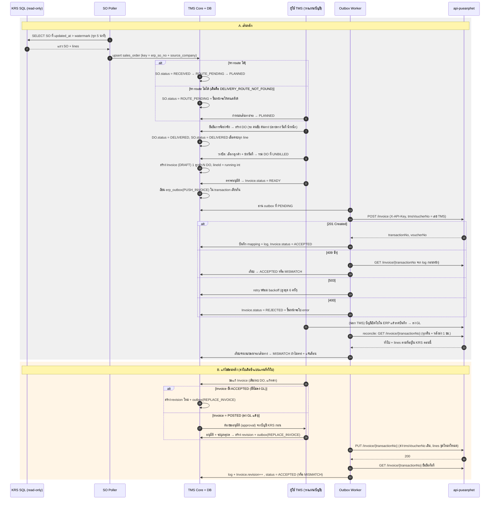
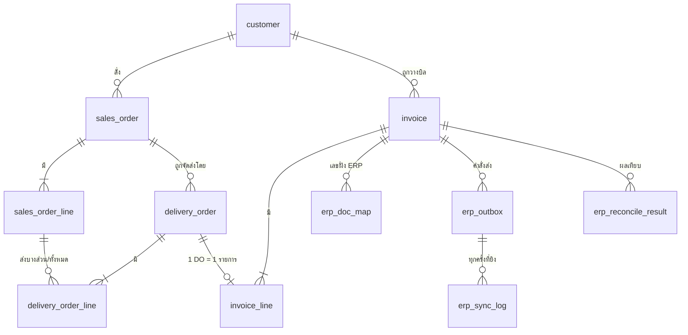
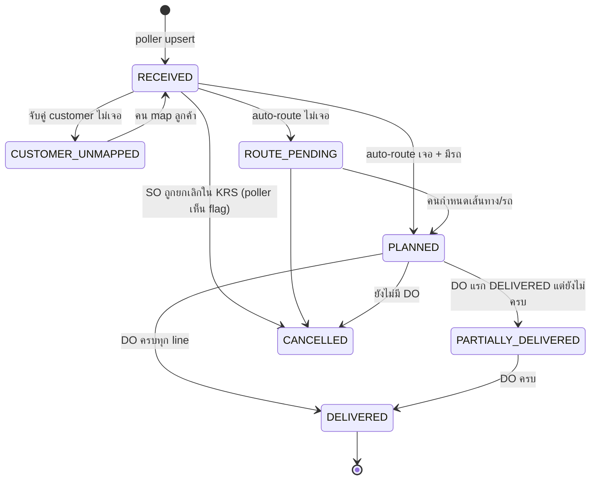
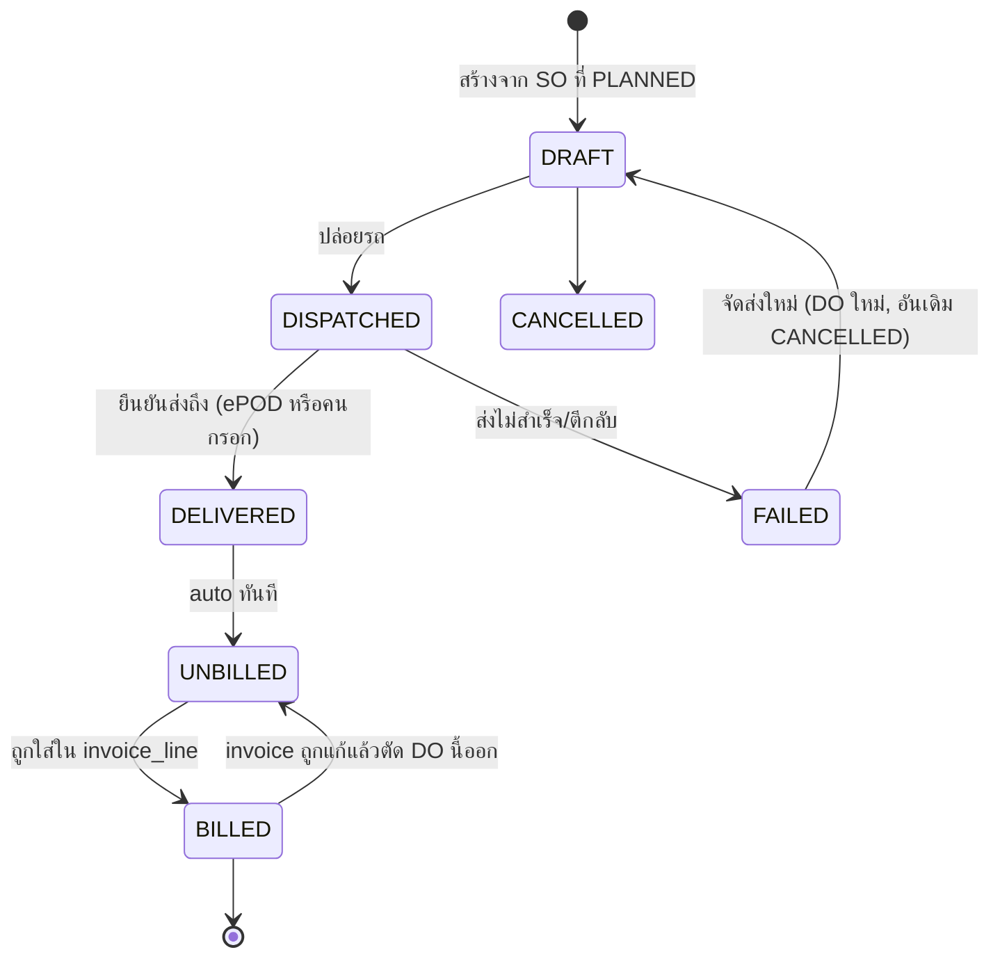
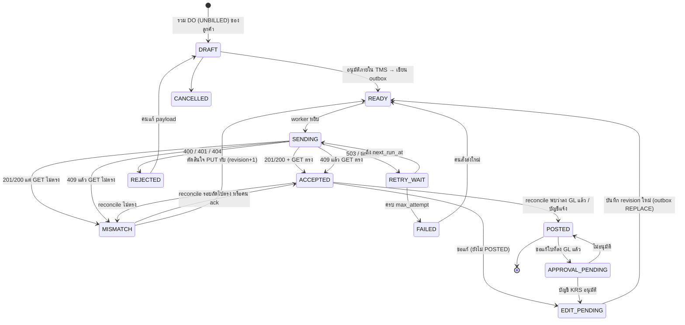

# เอกสารออกแบบ TMS × KRS Integration

Oct 14, 2026 · @wei

TMS ใหม่รับ SO จากฐานข้อมูล KRS แบบ read-only, ออก DO เอง, รวม DO เป็น Invoice (1 ลูกค้า ต่อ 1 ใบ) แล้วส่งเข้า KRS ผ่าน api-pueanphet เท่านั้น โดยวาง KRS เป็น **ERP adapter ตัวแรก** ของ adapter layer ที่ต่อ ERP อื่นได้ในอนาคต เอกสารนี้ยังไม่มีโค้ด ทีมพัฒนานำไปแตก task ต่อได้ทันที

## 1. ขอบเขต ข้อสมมติ และวิธีอ่านเอกสาร

ทุกหัวข้อแยกป้ายกำกับ 2 แบบ:

- **\[KRS\]** = ข้อเท็จจริงที่ยืนยันจากระบบจริงแล้ว (ตาม prompt) ห้ามเปลี่ยนโดยไม่ถามทีม KRS
- **\[เสนอ\]** = ข้อเสนอการออกแบบของเอกสารนี้ ทีมปรับได้

**ข้อเท็จจริง \[KRS\] ที่ผูกการออกแบบทั้งหมด**

| หัวข้อ | ข้อเท็จจริง |
| --- | --- |
| ฐานข้อมูล | SQL Server ชื่อ `db_PPACC66` เป็นของบริษัทภายนอก ห้ามแก้ schema ห้ามเขียนตรง |
| ช่องทางเขียน | ทุกการเขียนผ่าน `https://api-pueanphet.krs.co.th/api` + header `X-API-Key` เท่านั้น |
| Endpoint ที่มี | `POST /invoice` (201), `PUT /invoice/{transactionNo}` แทนที่ทั้งใบ (200), `GET /invoice/{transactionNo}` |
| Error code | 400 payload ผิด · 401 key ผิด · 404 ไม่พบ · 409 `tmsVoucherNo` ซ้ำ · 503 DB KRS ล่ม (retry) |
| เลขเอกสาร | KRS ออก `transactionNo` และ `voucherNo` (`SA-S{YYMM}-{NNNN}`) เอง ส่งมา = 400; TMS ส่ง `tmsVoucherNo` ใช้กันซ้ำ |
| ขนาด payload | สูงสุด 50 MB เคยมีใบจริง 446 รายการ |
| ฟิลด์ | รับเฉพาะฟิลด์ในสัญญา ส่งเกิน = 400; วันที่ `YYYY-MM-DD`; `lineId` ต้องเป็น int |
| GL | ใบจาก API ยังไม่ลง GL จนกว่าบัญชีเปิดใบแล้วกดบันทึกใน ERP |
| พฤติกรรม ERP | เมื่อบัญชีกดบันทึก โปรแกรมเขียนรายการใหม่ทั้งหมด อาจหายหรือฟิลด์รถ/เส้นทางว่าง (เคส 79 รายการ 2,054,000 → 30 รายการ 780,000) |

**ข้อสมมติ \[เสนอ\] ที่ได้จากคำตอบของคุณ** (ถ้าเปลี่ยน ให้แก้หัวข้อที่อ้างถึง)

| ข้อสมมติ | ผลต่อการออกแบบ |
| --- | --- |
| SO: TMS อ่านจาก SQL Server ตรงแบบ read-only (ไม่เขียน ไม่แก้ schema) | ต้องมี read-only login แยก + poller ที่ไม่เดาชื่อตาราง ให้ KRS ยืนยัน view/ตาราง (หัวข้อ 2, 10) |
| SO อยู่บริษัท NSF ส่วน Invoice ออกในบริษัท PP | ต้องมีตาราง mapping บริษัท/ลูกค้าระหว่าง NSF ↔ PP และ `custOrSuppCode` ฝั่ง PP (หัวข้อ 6, 10) |
| DO ต้องส่งเข้า KRS ด้วย | api-pueanphet **ยังไม่มี endpoint DO** → ออกแบบเป็น adapter method ที่ปิดไว้ก่อน (feature flag) และส่ง DO ผ่าน `flowNo/flowDate` ในรายการ Invoice ไปพลาง (หัวข้อ 2, 10) |
| 1 Invoice = 1 ลูกค้า รวมได้หลาย SO / หลาย DO | ตรงกับหัวเอกสาร API ที่มี `custOrSuppCode` เดียว; รอบวางบิลเป็น config ต่อลูกค้า (หัวข้อ 3, 4) |
| ERP อื่นยังไม่กำหนด | core TMS ไม่รู้จัก KRS โดยตรง คุยผ่าน `ErpAdapter` interface (หัวข้อ 2) |

**นอกขอบเขตเอกสารนี้:** อัลกอริทึม VRP/จัดเส้นทาง, แอป ePOD ของคนขับ, GPS/DLT compliance, WMS — เอกสารนี้ครอบคลุมเฉพาะเส้นทางข้อมูล SO → DO → Invoice → ERP และหน้าจอที่รองรับเส้นทางนั้น (ภาพรวมตลาด TMS ที่ research ไว้ใช้กำหนดสถาปัตยกรรมเป็น modular/API-first ตามแนว Locus/NOSTRA Connector)

## 2. สถาปัตยกรรมภาพรวม \[เสนอ\]

หลักการเดียวที่กำกับทุกส่วน: **TMS core ไม่ import อะไรจาก KRS** — SO เข้ามาผ่าน `pullSalesOrders()` และ Invoice ออกไปผ่าน `pushInvoice()` ของ `ErpAdapter` เท่านั้น เมื่อต่อ ERP ตัวที่สอง เขียน adapter ใหม่โดยไม่แตะ domain

&#91;embedded content: สถาปัตยกรรมภาพรวม · TMS core + ERP adapter layer + KRS\]

ลูกศรทึบคือการเรียกปกติ ลูกศรประคือการอ่านฐานข้อมูล KRS แบบ SELECT เท่านั้น และ `pushDeliveryOrder()` ยังปิดด้วย feature flag จนกว่า KRS จะมี endpoint DO

**ErpAdapter interface** (ชื่อเสนอ ทีมปรับได้)

| Method | ใช้เมื่อ | KrsAdapter ทำอะไร |
| --- | --- | --- |
| `pullSalesOrders(since)` | poller ทุก N นาที (เสนอ 5 นาที) | `SELECT` จาก view/ตาราง SO ของ NSF ที่ KRS ยืนยัน โดยใช้ watermark = `updated_at`/running number ล่าสุด |
| `pushInvoice(invoice)` | Invoice สถานะ `READY` ถูกส่งครั้งแรก | `POST /invoice` คืน `transactionNo`, `voucherNo` |
| `replaceInvoice(invoice, externalId)` | แก้ไขย้อนหลัง | `PUT /invoice/{transactionNo}` แทนที่ทั้งใบ |
| `fetchInvoice(externalId)` | reconcile และหลัง 409 | `GET /invoice/{transactionNo}` |
| `pushDeliveryOrder(do)` | ปิดไว้ (flag `erp.krs.doSync=false`) | ยังไม่มี endpoint — ดูหัวข้อ 10 |
| `healthCheck()` | ก่อน batch ส่ง | `GET` ใบที่รู้จักแล้ว 1 ใบ ถ้า 503 หยุด batch |

**ส่วนประกอบและเหตุผล**

| ส่วน | หน้าที่ | เหตุผล |
| --- | --- | --- |
| Outbox table + worker | ทุกคำสั่งส่งออก ERP ถูกเขียนลง `erp_outbox` ใน transaction เดียวกับการเปลี่ยนสถานะเอกสาร worker ค่อยหยิบไปส่ง | กันเคส TMS เปลี่ยนสถานะแล้วแต่ยิง API ไม่ออก และทำ retry ได้โดยไม่กระทบ UI |
| Sync log | เก็บ payload/response ตัวเต็มทุกครั้งที่ยิง (หัวข้อ 4) | แก้ปัญหา "ส่งซ้ำหรือไม่ซ้ำแยกไม่ออก" |
| Reconcile job | ดึง `GET` มาเทียบกับ TMS ตามรอบ (หัวข้อ 8) | แก้ปัญหา ERP เขียนทับรายการ |
| Read-only SO poller | ใช้ SQL login ที่มีสิทธิ์ `SELECT` บน view ที่ KRS เปิดให้เท่านั้น ไม่ใช้ `sa` | ปฏิบัติตามข้อห้ามเขียนตรง และลด blast radius |

**ข้อควรระวังเรื่องอ่าน SQL ตรง:** แม้จะอ่านอย่างเดียว schema อาจเปลี่ยนโดย KRS ไม่บอก จึงให้ poller ทำงานผ่าน **view ที่ KRS สร้างให้** (เสนอชื่อ `vw_TMS_SalesOrder`) ไม่ query ตารางจริงโดยตรง และถ้า view หาย/คอลัมน์หาย ให้ poller ติดสถานะ `SOURCE_ERROR` แล้วแจ้งเตือน ไม่ใช่เงียบ

**ที่มาของสถาปัตยกรรมจาก research TMS 2026**

ไม่ได้ถอดแบบจากระบบเดียว และไม่ได้ตั้งเป้าเทียบ "ดีที่สุดในตลาด" (Oracle OTM / SAP TM) เพราะจุดแข็งของกลุ่มนั้นคือการค้าข้ามประเทศ ศุลกากร และการผูกกับ ERP ค่ายตัวเอง ซึ่งไม่ใช่โจทย์นี้ ขณะที่ข้อเสียของกลุ่มนั้น (ติดตั้งนาน, UI ยากสำหรับหน้างาน, ไม่เหมาะ last-mile) คือสิ่งที่ต้องหลีกเลี่ยง แนวที่ใช้คือ **Hybrid Composable** ตาม research: ERP เป็นแกนบัญชี, TMS เป็นระบบปฏิบัติการที่คุยกันผ่าน API แล้วหยิบโครงสร้างมาเป็นรายโมดูล

| โมดูล | ถอดโครงจาก | หยิบมา | ไม่เอา |
| --- | --- | --- | --- |
| โครงรวม / integration | Locus, Infios (MercuryGate) | Modular, API-first, core ไม่รู้จัก ERP ใดโดยตรง | ขนาดและ feature ระดับ enterprise |
| ลำดับขั้น Order → Plan → Execute → Settle | Manhattan Active, Blue Yonder (เฉพาะลำดับขั้น) | SO → วางแผน → DO → วางบิล/กระทบยอด (Freight Audit ใน research = reconcile ของเรา) | WMS convergence, AI agents |
| รถร่วม / GPS ต่างค่าย | NOSTRA Logistics Connector | ตัวกลางดึงข้อมูลหลายค่ายมารวมจอเดียว = adapter pattern เดียวกับที่ใช้กับ ERP | ทำแผนที่/GIS เอง |
| หน้างานคนขับ / ePOD (เฟสถัดไป) | Logis Boy, Cartrack | Offline mode, ใบค้างต้องเห็นเหตุผล, UX เรียบ — research ชี้ว่าโครงการล้มที่ frontline adoption ไม่ใช่อัลกอริทึม | ฮาร์ดแวร์ |
| DLT compliance (เฟสถัดไป) | EyeFleet, GPS iAM | ต่อกล่อง GPS ที่รับรองแล้วผ่าน connector | สร้างเอง |

หลักคิด 3 ข้อ: (1) ลอก *ลำดับขั้นและขอบเขตโมดูล* ที่ตลาดเห็นตรงกัน ไม่ลอก feature (2) ความต่างจากตลาดคือจุดขาย — ลูกค้าไทยขนาดกลางที่ใช้ ERP เฉพาะทางอย่าง KRS คือกลุ่มที่ผู้เล่นใหญ่ไม่ลงมาเล่น และ adapter + reconcile แก้ปัญหาที่เขาเจอจริง (3) core เล็กแต่มี seam ชัด — ส่วนที่ผู้เล่นใหญ่เก่ง (VRP หลายร้อยตัวแปร, control tower) เว้นเป็น interface ไว้ต่อภายหลัง ไม่สร้างในเฟสแรก

## 3. Sequence diagram: SO → DO → Invoice → KRS \[เสนอ\]

เส้นหลัก (A) รับ SO เข้ามาก่อนเสมอแม้หาเส้นทางไม่เจอ, ออก DO ตอนส่งจริง, รวม DO เป็น Invoice แล้วส่งผ่าน outbox; เส้นแก้ไข (B) ใช้ `PUT` แทนที่ทั้งใบ แต่ถ้าใบลง GL แล้วต้องผ่านการอนุมัติก่อน เขียนเป็น Mermaid เพื่อให้ทีมคัดลอกไปไว้ใน repo ได้

จุดที่ต้องสังเกต: (1) การเปลี่ยนสถานะเอกสารกับการเขียน outbox อยู่ใน DB transaction เดียวกันเสมอ ไม่มีกรณี "สถานะเปลี่ยนแต่ไม่ได้ส่ง" (2) ทุกครั้งที่ KRS ตอบ 200/201 TMS จะ `GET` กลับมาเทียบทันทีหนึ่งครั้ง เพื่อจับเคสที่ API รับแล้วแต่ข้อมูลในฐาน KRS ไม่ตรง (3) ขั้นที่บัญชีกดบันทึกใน ERP อยู่นอกการควบคุมของ TMS จึงต้องพึ่ง reconcile เท่านั้น

## 4. Data model ฝั่ง TMS \[เสนอ\]

9 ตารางหลัก: 3 ตารางเอกสาร (+ lines), 1 ตารางลูกค้า/บริษัท, 1 ตาราง mapping เลขเอกสารกับ ERP, 1 outbox, 1 sync log และ 1 ตาราง reconcile ทุกตารางที่เกี่ยวกับ ERP มีคอลัมน์ `erp_code` (ค่า `KRS`) เพื่อรองรับ ERP ที่สองโดยไม่แก้ schema

**customer** — ลูกค้า/คู่ค้า 1 แถวต่อรหัสฝั่ง PP ที่ใช้วางบิล

| คอลัมน์ | ชนิด | หมายเหตุ |
| --- | --- | --- |
| `id` | uuid PK |  |
| `erp_code` | text | `KRS` |
| `erp_cust_code` | text | = `custOrSuppCode` ที่ API ต้องการ (บริษัท PP) |
| `erp_cust_name`, `address`, `delivery_address` | text | ค่า default ที่จะใส่หัว Invoice |
| `so_company`, `so_cust_code` | text | รหัสลูกค้าตามที่ปรากฏใน SO ของ NSF ใช้จับคู่ตอน poll — **ต้องให้ KRS ยืนยันว่ารหัสสองบริษัทตรงกันหรือไม่** |
| `billing_cycle` | enum | `PER_DO` / `WEEKLY` / `MONTHLY` / `MANUAL` |
| `payment_in_day` | int | ใส่ `paymentInDay` |
| `sale_person`, `sale_name` | text | ใส่ `salePerson`, `saleName` |

**sales\_order** — SO ที่ดึงมาจาก KRS (snapshot ฝั่ง TMS, ไม่เขียนกลับ)

| คอลัมน์ | ชนิด | หมายเหตุ |
| --- | --- | --- |
| `id` | uuid PK |  |
| `erp_code`, `source_company` | text | `KRS`, `NSF` |
| `erp_so_no` | text | เลข SO ฝั่ง KRS; **unique(erp\_code, source\_company, erp\_so\_no)** |
| `erp_so_date`, `erp_updated_at` | date, timestamp | `erp_updated_at` ใช้เป็น watermark ของ poller |
| `customer_id` | uuid FK → customer | null ได้ถ้าจับคู่ไม่เจอ → status `CUSTOMER_UNMAPPED` |
| `origin_text`, `dest_text` | text | ต้นทาง/ปลายทางตามที่ SO ระบุ |
| `requested_date` | date |  |
| `status` | enum | ดูหัวข้อ 5 |
| `route_id`, `planned_vehicle_id` | uuid null | ว่างจน PLANNED |
| `raw_payload` | jsonb | แถวดิบจาก SQL เก็บไว้ตรวจย้อนหลัง |
| `created_at`, `updated_at` | timestamp |  |

**sales\_order\_line** — `id`, `sales_order_id` FK, `erp_line_no` int, `item_code`, `description`, `qty_ordered` numeric, `qty_delivered` numeric (คำนวณจาก DO), `unit`, `weight_kg` numeric null, `unit_price` numeric null

**delivery\_order** — ออกโดย TMS ตอนจัดส่งจริง 1 แถว = 1 เที่ยว

| คอลัมน์ | ชนิด | หมายเหตุ |
| --- | --- | --- |
| `id` | uuid PK |  |
| `do_no` | text unique | เลข TMS เช่น `DO-2610-00042` → ไปเป็น `flowNo` |
| `do_date` | date | → `flowDate` |
| `sales_order_id` | uuid FK | 1 DO อ้าง 1 SO (ถ้าต้องรวมหลาย SO ในเที่ยวเดียว ให้ออกหลาย DO) |
| `customer_id` | uuid FK | copy จาก SO ตอนสร้าง เพื่อ query ตอนวางบิลเร็ว |
| `vehicle_plate` | text | → `carId` |
| `driver_name` | text | → `carPerson` |
| `origin`, `destination` | text | → `frWay`, `toWay` |
| `weight_kg`, `trips` | numeric, int | ใช้คำนวณ `mainQuantity` ตามหน่วยที่คิดเงิน |
| `billing_unit` | enum | `TRIP` / `TON` / `KM` — กำหนดว่า `mainQuantity` คืออะไร |
| `unit_price` | numeric | ราคาต่อหน่วย ณ ตอนส่ง (จาก rate card) |
| `status` | enum | ดูหัวข้อ 5 |
| `invoice_line_id` | uuid null FK | ว่าง = ยังไม่วางบิล (`UNBILLED`) |
| `pod_ref` | text null | เลขอ้างอิงหลักฐานส่ง (นอกขอบเขต) |

**delivery\_order\_line** — `id`, `delivery_order_id`, `sales_order_line_id`, `qty`, `unit`

**invoice** — 1 ใบ = 1 ลูกค้า รวมหลาย DO

| คอลัมน์ | ชนิด | หมายเหตุ |
| --- | --- | --- |
| `id` | uuid PK |  |
| `tms_voucher_no` | text unique | → `tmsVoucherNo` เช่น `TMS-INV-2610-0007` ออกครั้งเดียวไม่เปลี่ยนแม้แก้ใบ |
| `revision` | int | เริ่ม 1, +1 ทุกครั้งที่ PUT สำเร็จ |
| `customer_id` | uuid FK |  |
| `voucher_date`, `due_date` | date |  |
| `payment_in_day` | int |  |
| `cust_name`, `address`, `delivery_address`, `sale_person`, `sale_name`, `entry_by` | text | snapshot ตอนออกใบ ไม่ตามลูกค้าที่แก้ทีหลัง |
| `line_count`, `total_amount` | int, numeric | คำนวณเก็บไว้ ใช้เทียบตอน reconcile |
| `status` | enum | ดูหัวข้อ 5 |
| `gl_posted_at` | timestamp null | เวลาที่ reconcile พบว่าลง GL แล้ว หรือบัญชีแจ้ง |
| `locked` | bool | true เมื่อ POSTED |
| `created_by`, `approved_by` | text |  |

**invoice\_line** — `id`, `invoice_id`, `line_id` int (running 1..N ต่อใบ → `lineId`), `delivery_order_id` FK unique (1 DO อยู่ได้ 1 รายการเท่านั้น), `main_quantity`, `main_units`, `unit_price`, `amount` (คำนวณ), `item_code`, `description`, `account_code` null; ฟิลด์รถ/เส้นทาง **ไม่** copy มาไว้ตรงนี้ แต่ join จาก DO ตอน build payload เพื่อไม่ให้มีสองแหล่งความจริง

**erp\_doc\_map** — คู่เลขเอกสาร TMS ↔ ERP (ตารางที่ prompt ระบุว่าต้องมี)

| คอลัมน์ | ชนิด | หมายเหตุ |
| --- | --- | --- |
| `id` | uuid PK |  |
| `erp_code` | text | `KRS` |
| `doc_type` | enum | `INVOICE` (รองรับ `DELIVERY_ORDER` ในอนาคต) |
| `tms_doc_id`, `tms_doc_no` | uuid, text | `invoice.id`, `tms_voucher_no` |
| `erp_transaction_no` | text | จาก response — ใช้เป็น path ของ PUT/GET |
| `erp_voucher_no` | text | เช่น `SA-S2610-0012` |
| `erp_company` | text | `PP` |
| `first_accepted_at`, `last_replaced_at` | timestamp |  |
| unique |  | `(erp_code, doc_type, tms_doc_no)` และ `(erp_code, erp_transaction_no)` |

**erp\_outbox** — คิวคำสั่งส่ง

| คอลัมน์ | ชนิด | หมายเหตุ |
| --- | --- | --- |
| `id` | uuid PK |  |
| `erp_code` | text |  |
| `operation` | enum | `PUSH_INVOICE` / `REPLACE_INVOICE` / `FETCH_INVOICE` / `PUSH_DO` |
| `doc_type`, `tms_doc_id` |  |  |
| `idempotency_key` | text unique | `{tms_voucher_no}:{revision}` — กันสร้างคำสั่งซ้ำ |
| `status` | enum | `PENDING` / `IN_FLIGHT` / `DONE` / `FAILED_RETRYABLE` / `FAILED_FINAL` |
| `attempt`, `max_attempt`, `next_run_at` | int, int, timestamp | backoff |
| `last_error` | text |  |

**erp\_sync\_log** — ทุกครั้งที่ยิง API 1 แถว (prompt ข้อ 4)

| คอลัมน์ | ชนิด | หมายเหตุ |
| --- | --- | --- |
| `id` | bigserial PK |  |
| `outbox_id` | uuid FK |  |
| `attempt_no` | int | ครั้งที่ |
| `method`, `url` | text |  |
| `request_headers` | jsonb | ตัด `X-API-Key` ออกก่อนเก็บ |
| `request_body` | jsonb | payload ตัวเต็ม (ใบ 446 รายการ ≈ หลายร้อย KB — ใช้ TOAST/compress ได้) |
| `response_status` | int | 201/200/400/401/404/409/503/timeout |
| `response_body` | jsonb | ตัวเต็ม |
| `duration_ms` | int |  |
| `sent_at` | timestamp |  |
| index |  | `tms_voucher_no`, `erp_transaction_no`, และ GIN บน `request_body` สำหรับค้นด้วยเลข DO (`flowNo`) / SO |

**erp\_reconcile\_result** — ผลการเทียบแต่ละรอบ: `id`, `invoice_id`, `run_at`, `source` (`AFTER_PUSH` / `NIGHTLY` / `MANUAL`), `tms_line_count`, `erp_line_count`, `tms_total`, `erp_total`, `diff` jsonb (รายการที่หาย/ฟิลด์ที่ต่าง), `result` enum `MATCH` / `MISMATCH` / `ERP_UNREACHABLE`, `acknowledged_by`, `acknowledged_at`

**เหตุผลการออกแบบที่สำคัญ**

- `tms_voucher_no` ออกครั้งเดียวและไม่เปลี่ยนเมื่อแก้ใบ เพราะ KRS ใช้มันกันซ้ำ (409) และ `PUT` ต้องส่งเลขเดิม
- `revision` + `idempotency_key` ทำให้กดส่งซ้ำกี่ครั้งก็ได้แค่ 1 คำสั่งต่อ revision
- ฟิลด์รถ/เส้นทางมีที่เดียวคือ DO; invoice\_line แค่อ้าง DO → reconcile เทียบได้ตรง ๆ และแก้ DO แล้วใบยังถูก
- `raw_payload` บน SO เก็บแถวดิบ เพราะเราไม่ควบคุม schema ของ KRS หาก mapping ผิดจะย้อนดูได้

## 5. State machine ของแต่ละเอกสาร \[เสนอ\]

กติกาเดียวกันทั้ง 3 เอกสาร: ไม่มีสถานะ "ปฏิเสธแล้วหาย" — ทุกใบที่เข้ามาต้องอยู่ในสถานะใดสถานะหนึ่งที่คนเห็นบนหน้าจอได้ และทุกการเปลี่ยนสถานะบันทึกใน `doc_status_history` (doc\_type, doc\_id, from, to, by, reason, at)

**SO (sales\_order)**

| สถานะ | ความหมาย | ใครทำให้เปลี่ยน |
| --- | --- | --- |
| `RECEIVED` | รับเข้ามาแล้ว ยังไม่วางแผน | poller |
| `CUSTOMER_UNMAPPED` | รหัสลูกค้าฝั่ง NSF จับคู่กับ PP ไม่ได้ | poller → คนเคลียร์ |
| `ROUTE_PENDING` | หาเส้นทางไม่เจอ (แทน DELIVERY\_ROUTE\_NOT\_FOUND เดิม) | auto-route → คนเคลียร์ |
| `PLANNED` | มีรถ/เส้นทาง/วันที่แล้ว | คนวางแผน |
| `PARTIALLY_DELIVERED` / `DELIVERED` | มี DO สถานะ DELIVERED บางส่วน / ครบ | ระบบคำนวณจาก DO |
| `CANCELLED` | KRS ยกเลิก — ถ้ามี DO แล้วห้ามเปลี่ยน ให้ขึ้นแจ้งเตือนแทน | poller |

ข้อสังเกต: SO ที่ KRS แก้หลังจาก TMS วางแผนแล้ว (ปริมาณเปลี่ยน, ที่อยู่เปลี่ยน) poller จะ **ไม่ overwrite** แต่บันทึก `erp_changed_after_plan = true` + diff แล้วแสดงในหน้าใบค้างให้คนตัดสินใจ

**DO (delivery\_order)**

`BILLED` DO ห้ามแก้ฟิลด์รถ/คนขับ/เส้นทาง/น้ำหนัก ถ้าต้องแก้ → แก้ผ่านเส้นแก้ไข Invoice (หัวข้อ 3 B) ซึ่งจะสร้าง revision และ PUT ให้อัตโนมัติ

**Invoice**

| สถานะ | ความหมาย | locked? |
| --- | --- | --- |
| `DRAFT` | ร่าง แก้ได้อิสระ | no |
| `READY` | อนุมัติแล้ว รอ worker ส่ง | yes (เนื้อหา) |
| `SENDING` / `RETRY_WAIT` | กำลังยิง / รอ backoff | yes |
| `ACCEPTED` | KRS รับแล้ว (มี transactionNo) และ GET ครั้งแรกตรง | yes |
| `MISMATCH` | ข้อมูลใน KRS ไม่ตรง TMS (จำนวน/ยอด/รถ/เส้นทาง) | yes — ต้องคนตัดสิน |
| `REJECTED` | 400/401/404 ต้องคนแก้ | no (กลับ DRAFT) |
| `FAILED` | retry ครบแล้วยังไม่ผ่าน (503 ยาว) | yes |
| `POSTED` | ลง GL แล้ว — ห้ามแก้โดยไม่ผ่าน approval | yes (hard) |
| `APPROVAL_PENDING` / `EDIT_PENDING` | ขั้นขออนุมัติ / กำลังแก้ revision ใหม่ | yes |

การรู้ว่า `POSTED` เมื่อไร: api-pueanphet ไม่มีฟิลด์บอกว่าลง GL แล้ว (ตามสัญญาที่ให้มา) → ทางเลือกคือ (ก) ขอให้ KRS เพิ่มฟิลด์ใน response ของ `GET` (ข) บัญชีกดปุ่ม "ลงบัญชีแล้ว" ใน TMS (ค) ตั้งกฎเวลา เช่น หลัง voucherDate 7 วันถือว่า POSTED — เสนอ (ก) เป็นหลัก ใช้ (ข) ชั่วคราว ดูหัวข้อ 10

## 6. Field mapping: SO → DO → Invoice line → API \[KRS ฟิลด์ / เสนอที่มา\]

ชื่อฟิลด์ API และฟิลด์บังคับเป็น **\[KRS\]** ส่วน "มาจากไหน" เป็น **\[เสนอ\]** ฟิลด์ที่ไม่อยู่ในสัญญาห้ามส่ง (400) ดังนั้น payload builder ต้อง whitelist ฟิลด์ ไม่ใช่ serialize object ทั้งก้อน

**หัวเอกสาร (บังคับทุกฟิลด์)**

| ฟิลด์ API \[KRS\] | ชนิด/รูปแบบ | มาจาก \[เสนอ\] | หมายเหตุ |
| --- | --- | --- | --- |
| `tmsVoucherNo` | text | `invoice.tms_voucher_no` | ออกครั้งเดียว ส่งเลขเดิมทั้ง POST และ PUT |
| `voucherDate` | `YYYY-MM-DD` | `invoice.voucher_date` | วันวางบิล (default = วันที่กด READY) |
| `dueDate` | `YYYY-MM-DD` | `voucher_date + customer.payment_in_day` | คำนวณตอนออกใบ ไม่คำนวณตอนส่ง |
| `paymentInDay` | int | `customer.payment_in_day` | snapshot ลง invoice |
| `custOrSuppCode` | text | `customer.erp_cust_code` (บริษัท PP) | **ต้องยืนยันกับ KRS ว่ารหัสเป็นของ PP ไม่ใช่ NSF** |
| `custOrSuppName` | text | `invoice.cust_name` | snapshot |
| `address` | text | `invoice.address` | ที่อยู่ออกใบกำกับ |
| `deliveryAddress` | text | `invoice.delivery_address` | ถ้าหลาย DO ปลายทางต่างกัน ใช้ที่อยู่หลักของลูกค้า (ปลายทางจริงอยู่ที่ `toWay` ราย line) |
| `salePerson` | text | `customer.sale_person` | รหัสพนักงานขาย — ต้องเป็นรหัสที่มีใน KRS |
| `saleName` | text | `customer.sale_name` |  |
| `entryBy` | text | `invoice.created_by` หรือค่าคงที่ `TMS` | ถาม KRS ว่าต้องเป็น user ที่มีใน ERP หรือไม่ |
| `lines[]` | array | จาก `invoice_line` join `delivery_order` | อย่างน้อย 1 รายการ |

**รายการ (1 รายการ = 1 DO)**

| ฟิลด์ API \[KRS\] | บังคับ | ชนิด | มาจาก \[เสนอ\] | ต้นทางเดิม |
| --- | --- | --- | --- | --- |
| `lineId` | ไม่ | int | `invoice_line.line_id` (running 1..N) | TMS |
| `mainQuantity` | ใช่ | numeric | `delivery_order.trips` หรือ `weight_kg` ตาม `billing_unit` | DO |
| `mainUnits` | ใช่ | text | map จาก `billing_unit`: `TRIP`→`เที่ยว`, `TON`→`ตัน`, `KM`→`กม.` — ค่า string จริงต้องตรง master หน่วยของ KRS | DO |
| `unitPrice` | ใช่ | numeric | `delivery_order.unit_price` | rate card ณ วันส่ง |
| `flowNo` | ใช่ | text | `delivery_order.do_no` | DO |
| `flowDate` | ใช่ | `YYYY-MM-DD` | `delivery_order.do_date` | DO |
| `carId` | ใช่ | text | `delivery_order.vehicle_plate` | DO ← รถที่ PLANNED ใน SO |
| `carPerson` | ใช่ | text | `delivery_order.driver_name` | DO |
| `frWay` | ใช่ | text | `delivery_order.origin` | DO ← `sales_order.origin_text` |
| `toWay` | ใช่ | text | `delivery_order.destination` | DO ← `sales_order.dest_text` |
| `itemCode` | ไม่ | text | `invoice_line.item_code` (เช่นรหัสบริการขนส่ง) | config ต่อ billing\_unit |
| `description` | ไม่ | text | `"{do_no} {origin}→{destination} SO {erp_so_no}"` | สร้างตอน build |
| `accountCode` | ไม่ | text | `invoice_line.account_code` | ให้ KRS กำหนด default |
| ส่วนลด / ยอดเงิน | ไม่ |  | **ไม่ส่ง** ให้ KRS คำนวณ | — แต่ TMS คำนวณ `amount` เก็บไว้เทียบ |

**สายการไหลของข้อมูลหลักตั้งแต่ SO**

| ข้อมูล | SO (จาก KRS) | DO (TMS ออก) | Invoice line | API |
| --- | --- | --- | --- | --- |
| ลูกค้า | `so_cust_code` (NSF) | `customer_id` | หัวใบ | `custOrSuppCode` (PP) |
| ต้นทาง/ปลายทาง | `origin_text`/`dest_text` | `origin`/`destination` (แก้ได้ตอนส่งจริง) | join DO | `frWay`/`toWay` |
| ปริมาณ | `qty_ordered` | `weight_kg`, `trips` | `main_quantity` | `mainQuantity` |
| ราคา | `unit_price` (ถ้ามีใน SO) | `unit_price` จาก rate card | `unit_price` | `unitPrice` |
| วันที่ | `requested_date` | `do_date` | — | `flowDate` |
| รถ/คนขับ | — | `vehicle_plate`, `driver_name` | join DO | `carId`, `carPerson` |
| เลขอ้างอิง | `erp_so_no` | `do_no` | `line_id` | `flowNo`, `lineId` |

**กฎ validation ก่อนเข้า outbox** (กัน 400 ตั้งแต่ฝั่ง TMS)

- ทุกฟิลด์บังคับไม่ว่าง; `lineId` เป็น int; วันที่ format ตรง; `tmsVoucherNo` ไม่ซ้ำใน TMS
- `custOrSuppCode`, `salePerson`, `mainUnits` ต้องอยู่ใน master list ที่ sync/กรอกจาก KRS (ตาราง `erp_master_code`)
- payload JSON ไม่เกิน 50 MB; ถ้าเกิน แบ่งใบ (ไม่ควรเกิดถ้า 446 รายการยังพอ)
- ไม่มี key นอก whitelist (unit test ต่อ schema)

## 7. Retry, idempotency และการจัดการ error \[เสนอ บนพื้นฐาน error code ของ KRS\]

หลักการ: **retry เฉพาะเมื่อแน่ใจว่าคำขอยังไม่เกิดผล** (503, timeout ก่อนได้ response) และทุกกรณีที่ไม่แน่ใจให้ `GET` มาดูก่อน ไม่ยิง POST ซ้ำสุ่ม ๆ

| Response \[KRS\] | ความหมาย | TMS ทำอะไร \[เสนอ\] | สถานะ Invoice |
| --- | --- | --- | --- |
| `201` (POST) / `200` (PUT) | สำเร็จ | บันทึก `erp_doc_map`, log, แล้ว `GET` ทันทีเทียบ 1 ครั้ง | `ACCEPTED` หรือ `MISMATCH` |
| `409` tmsVoucherNo ซ้ำ | เคยส่งสำเร็จแล้ว (เช่น response หายระหว่างทาง) | หา `transactionNo` จาก `erp_doc_map`; ถ้าไม่มี (POST แรกที่ response หาย) ให้ขอ KRS endpoint ค้นด้วย `tmsVoucherNo` — ดูหัวข้อ 10; แล้ว `GET` เทียบ | `ACCEPTED` / `MISMATCH` ไม่ retry POST |
| `503` DB KRS ล่ม | ชั่วคราว | retry แบบ exponential backoff: 1, 2, 5, 15, 30, 60 นาที (6 ครั้ง) + jitter; หยุด batch ทั้งคิวเมื่อ `healthCheck()` ยังไม่ผ่าน | `RETRY_WAIT` → `FAILED` เมื่อครบ |
| timeout / connection reset | ไม่รู้ว่าถึงหรือไม่ | **ไม่ POST ซ้ำทันที** → `GET` ด้วย transactionNo ถ้ามี; ไม่มี → รอ 2 นาทีแล้ว POST ใหม่ (ถ้าถึงแล้วจะได้ 409 ซึ่งจัดการได้) | `RETRY_WAIT` |
| `400` payload ผิด | ข้อมูลผิด แก้ที่ TMS | ไม่ retry; เก็บ response body ตัวเต็ม (มักบอกฟิลด์) ขึ้นหน้าจอใบ error | `REJECTED` → `DRAFT` |
| `401` key ผิด | config ผิด | หยุด worker ทั้งหมด แจ้ง admin ทันที ไม่ retry | คงสถานะ `READY` |
| `404` (PUT/GET) | transactionNo ไม่มีใน KRS | ใบอาจถูกลบฝั่ง ERP → ขึ้น MISMATCH ให้คนตัดสิน (ส่ง POST ใหม่ = เลขใหม่, ต้องให้บัญชีรับรู้) | `MISMATCH` |

**Idempotency 3 ชั้น**

1. **ชั้นคำสั่ง** — `erp_outbox.idempotency_key = tms_voucher_no:revision` unique → UI กดส่งซ้ำกี่ครั้งก็ได้แค่คำสั่งเดียว
2. **ชั้น worker** — หยิบงานด้วย `SELECT ... FOR UPDATE SKIP LOCKED` + สถานะ `IN_FLIGHT` พร้อม `lease_until` กันสอง worker ส่งใบเดียวกันพร้อมกัน (lease หมดแล้วค่อยหยิบใหม่)
3. **ชั้น KRS** — `tmsVoucherNo` ซ้ำ = 409 เป็นตาข่ายสุดท้าย

**ลำดับการส่งและ concurrency**

- ส่งทีละใบต่อลูกค้า (serialize ด้วย `customer_id`) เพื่อไม่ให้ PUT revision 2 แซง POST revision 1
- worker หลายตัวได้ แต่จำกัด concurrency รวม 3 ต่อ KRS (ถาม KRS เรื่อง rate limit — หัวข้อ 10)
- `REPLACE_INVOICE` ของ revision N จะถูกสร้างได้ต่อเมื่อ revision N-1 อยู่ที่ `DONE`/`FAILED_FINAL` แล้ว (ไม่ให้สอง PUT ของใบเดียวซ้อนกัน)

**Log ทุกครั้ง** — `erp_sync_log` 1 แถวต่อ 1 HTTP call รวม `GET` ที่ใช้เทียบ; ค้นได้ด้วยเลข SO / DO (`flowNo` ใน body) / `tmsVoucherNo` / `transactionNo`; เก็บอย่างน้อย 24 เดือน (ตามรอบตรวจบัญชี) แล้วค่อย archive

## 8. งานกระทบยอด (reconcile) กับ KRS \[เสนอ\]

Reconcile คือกลไกเดียวที่จับเคส "ERP เขียนทับรายการ" ได้ เพราะเหตุการณ์นั้นเกิดนอก TMS จึงต้องรันทั้งแบบทันทีหลังส่งและแบบรอบเวลา และผลเทียบต้องชี้ได้ว่า **รายการไหน** หาย ไม่ใช่แค่ยอดไม่ตรง

**ทำเมื่อไร**

| รอบ | เวลา | ใบที่เทียบ | เหตุผล |
| --- | --- | --- | --- |
| `AFTER_PUSH` | ทันทีหลัง 201/200 และอีกครั้งหลัง 60 นาที | ใบที่เพิ่งส่ง | จับเคส API รับแต่ DB ไม่ตรง และเคสบัญชีเปิดใบทันที |
| `NIGHTLY` | ทุกคืน 02:00 (นอกเวลาบัญชีทำงาน) | ทุกใบ `ACCEPTED`/`MISMATCH` ที่ `voucher_date` ภายใน 90 วัน | จับการเขียนทับที่เกิดระหว่างวัน |
| `PRE_CLOSE` | วันทำการสุดท้ายของเดือน 17:00 | ทุกใบของเดือนนั้น | ก่อนปิดงวดบัญชี |
| `MANUAL` | ปุ่มบนหน้าจอ | ใบที่เลือก | หลังบัญชีแก้แล้วอยากยืนยัน |

รอบ NIGHTLY ใบละ 1 `GET` — 300 ใบ/เดือน × 3 เดือน ≈ 900 calls/คืน ควรถาม KRS เรื่อง rate limit (หัวข้อ 10) หรือขอ endpoint list แบบ `GET /invoice?since=`

**เทียบอะไรบ้าง** (ทุกข้อจาก `GET /invoice/{transactionNo}` เทียบกับ TMS)

| ระดับ | ฟิลด์ | ตรง = | ไม่ตรง → |
| --- | --- | --- | --- |
| หัวใบ | `tmsVoucherNo`, `custOrSuppCode`, `voucherDate`, `dueDate` | เท่ากันทุกตัว | `MISMATCH` ระดับ `HEADER` |
| จำนวนรายการ | `len(lines)` vs `invoice.line_count` | เท่ากัน | `MISMATCH` ระดับ `LINE_COUNT` (เคส 79→30) |
| ยอดรวม | Σ(`mainQuantity`×`unitPrice`) vs `invoice.total_amount` | ต่างไม่เกิน 0.01 | `MISMATCH` ระดับ `TOTAL` (เคส 2,054,000→780,000) |
| รายการต่อรายการ | จับคู่ด้วย `flowNo` (เลข DO): `flowDate`, `carId`, `carPerson`, `frWay`, `toWay`, `mainQuantity`, `unitPrice` | ทุกฟิลด์เท่ากัน ไม่มีค่าว่าง | `MISMATCH` ระดับ `LINE_FIELD` + ระบุ DO และฟิลด์ที่ต่าง/ว่าง |
| รายการเกิน | `flowNo` ใน KRS ที่ไม่มีใน TMS | ไม่มี | `MISMATCH` ระดับ `EXTRA_LINE` (บัญชีเพิ่มเอง) |
| GL | ฟิลด์บอกการลงบัญชี (ถ้า KRS เพิ่มให้) | — | ตั้ง `POSTED` |

จับคู่รายการด้วย `flowNo` ไม่ใช่ `lineId` เพราะ ERP เขียนรายการใหม่ทั้งหมดตอนบันทึก `lineId` อาจถูกออกใหม่

**แจ้งใคร อย่างไร**

| ระดับ | แจ้ง | ช่องทาง | SLA ตอบสนอง |
| --- | --- | --- | --- |
| `LINE_COUNT`, `TOTAL` (มีผลต่อเงิน) | หัวหน้าบัญชี KRS + ผู้ดูแล TMS | Email + LINE/Teams webhook ทันที, สรุปอีกครั้ง 08:00 | 1 วันทำการ |
| `LINE_FIELD`, `EXTRA_LINE` | ผู้ดูแล TMS, แอดมินขนส่ง | หน้าจอ "ไม่ตรงกับ KRS" + สรุปเช้า | 3 วันทำการ |
| `ERP_UNREACHABLE` ติดกัน 2 รอบ | ผู้ดูแลระบบทั้งสองฝั่ง | ทันที | — |
| ครบเดือน | ผู้บริหาร/บัญชี | รายงานสรุป: ส่ง N ใบ, ตรง N, ไม่ตรง N, แก้แล้ว N | — |

**ปิดงาน MISMATCH ได้ 3 ทาง** (บันทึกคนและเหตุผลทุกครั้ง)

1. **KRS ถูก, TMS ผิด** → แก้ DO/Invoice ใน TMS ให้ตรง (ผ่านเส้นแก้ไข ถ้า POSTED ต้องอนุมัติ)
2. **TMS ถูก, KRS ผิด** → สั่ง `REPLACE_INVOICE` (PUT ทับ) — ถ้า POSTED แล้ว **ต้อง**ให้บัญชี KRS อนุมัติ เพราะ PUT จะทำให้หัวใบไม่ตรง GL
3. **ยอมรับความต่าง** → `acknowledged` พร้อมเหตุผล (เช่น บัญชีใส่ส่วนลดเองโดยตั้งใจ) ใบกลับเป็น `ACCEPTED` และ reconcile รอบถัดไปจะไม่แจ้งซ้ำถ้า diff เหมือนเดิม (เก็บ hash ของ diff)

## 9. หน้าจอที่ต้องมี \[เสนอ\]

หน้าจอกลุ่ม "งานค้าง" ทั้ง 4 ใช้โครงเดียวกัน: ตารางกรอง + แถบนับจำนวนที่หัวเมนู + เปิดดูรายละเอียดด้านข้าง + ปุ่ม action ที่เปลี่ยนสถานะได้โดยตรง เพื่อให้คนรู้ว่า "ค้างเพราะอะไร" ภายในคลิกเดียว

| # | หน้าจอ | ใครใช้ | แสดงอะไร | Action |
| --- | --- | --- | --- | --- |
| 1 | **ใบ SO รอกำหนดเส้นทาง** (`ROUTE_PENDING`, `CUSTOMER_UNMAPPED`) | ฝ่ายวางแผน | เลข SO, ลูกค้า, ต้นทาง/ปลายทางตามใบ, วันที่ต้องการ, เหตุผล (ไม่เจอ route / ลูกค้าไม่ map), อายุที่ค้าง | เลือกเส้นทางจาก master หรือสร้างใหม่, map ลูกค้า, กำหนดรถ → `PLANNED` |
| 2 | **ใบค้าง / ใบ error** (Invoice `REJECTED`, `FAILED`, `RETRY_WAIT`, outbox `FAILED_FINAL`) | ผู้ดูแล TMS, บัญชี | เลขใบ, ลูกค้า, ยอด, สถานะ, response ล่าสุด (400 แสดงข้อความ KRS), จำนวนครั้งที่ลอง, ครั้งถัดไป | แก้ไขแล้วส่งใหม่, สั่งส่งใหม่ทันที, ยกเลิก, ดู log ทุกครั้งที่ยิง |
| 3 | **ใบที่ไม่ตรงกับ KRS** (`MISMATCH`) | บัญชี KRS, ผู้ดูแล TMS | ตารางสองคอลัมน์ TMS vs KRS: จำนวนรายการ, ยอด, รายการที่หาย/เกิน/ฟิลด์ว่าง (highlight), เวลาที่พบ, รอบที่พบ | PUT ทับ (ขออนุมัติถ้า POSTED), แก้ใน TMS, ยอมรับพร้อมเหตุผล, reconcile ใหม่ |
| 4 | **ขออนุมัติแก้ใบที่ลงบัญชีแล้ว** (`APPROVAL_PENDING`) | หัวหน้าบัญชี | ใบเดิม vs ร่างใหม่ (diff), ผู้ขอ, เหตุผล | อนุมัติ / ไม่อนุมัติ พร้อมความเห็น |
| 5 | **วางบิล** | บัญชี/แอดมินขนส่ง | เลือกลูกค้า + ช่วงวันที่ → รายการ DO `UNBILLED` ติ๊กเลือก, ยอดรวมสด, preview payload ที่จะส่ง | สร้าง DRAFT, อนุมัติเป็น READY |
| 6 | **ค้นหา log การส่ง** | ทุกฝ่ายที่ตรวจย้อนหลัง | ค้นด้วยเลข SO / DO / tmsVoucherNo / transactionNo → timeline ทุกครั้งที่ยิง (เวลา, method, status, ครั้งที่) เปิดดู request/response ตัวเต็ม | ดาวน์โหลด JSON |
| 7 | **Dashboard สถานะเชื่อมต่อ KRS** | ผู้ดูแลระบบ | health ล่าสุด, คิว outbox (pending/in-flight/failed), SO poll ล่าสุดกี่นาทีที่แล้ว, จำนวน MISMATCH เปิดอยู่, อัตราสำเร็จ 7 วัน | หยุด/เริ่ม worker, สั่ง poll ทันที, สั่ง reconcile ทั้งเดือน |

**รายละเอียดที่ควรมีในทุกหน้า**

- ตัวนับที่เมนู (badge) ของหน้า 1–4 เพื่อไม่ให้ใบค้างเงียบเหมือนระบบเดิม
- ทุก action ที่เปลี่ยนสถานะ ต้องกรอกเหตุผลเมื่อเป็นการ override (ยอมรับ diff, PUT ทับใบ POSTED, ยกเลิก)
- Role: `planner` (หน้า 1, 5), `tms_admin` (ทุกหน้า), `krs_accounting` (หน้า 2–4 อ่าน + อนุมัติ), `viewer`
- Export CSV ของทุกตารางสำหรับส่งให้ KRS ตอนคุยปัญหา

## 10. ความเสี่ยงและคำถามที่ต้องถามทีม KRS ก่อนเริ่มพัฒนา

คำถาม 3 ข้อแรกเป็นตัวปลดล็อก — ถ้ายังไม่ได้คำตอบ ส่วน SO poller, DO sync และการรู้สถานะ GL จะเขียนโค้ดจริงไม่ได้ ส่วนที่เหลือทำคู่ขนานได้ (core, outbox, invoice, หน้าจอ)

**คำถามถึงทีม KRS** (ติ๊กเมื่อได้คำตอบ)

- [ ] **SO source:** ขอชื่อ view/ตาราง SO ของบริษัท NSF ใน `db_PPACC66` (หรือฐานข้อมูลอื่นถ้า NSF แยกฐาน) พร้อมคอลัมน์: เลข SO, วันที่, รหัสลูกค้า, ต้นทาง/ปลายทาง, รายการ, สถานะยกเลิก, `updated_at` — และขอ **read-only login** แยก; ถ้า KRS ไม่สะดวกเปิดฐาน ขอเป็น `GET /salesorder?since=` แทน
- [ ] **รหัสลูกค้า NSF ↔ PP:** รหัสลูกค้าใน SO (NSF) กับ `custOrSuppCode` ที่ใช้ใน Invoice (PP) เป็นรหัสเดียวกันหรือไม่ ถ้าไม่ มีตาราง mapping ฝั่ง KRS ไหม
- [ ] **DO endpoint:** ต้องการให้ DO ไปเก็บใน KRS เป็นเอกสารประเภทไหน (ใบส่งของ / ใบกำกับภายใน) และจะเปิด `POST /deliveryorder` ให้ได้ไหม ถ้าไม่ ยอมรับว่า DO ปรากฏแค่ใน `flowNo/flowDate` ของรายการ Invoice หรือไม่
- [ ] **สถานะลง GL:** ขอเพิ่มฟิลด์ใน response ของ `GET /invoice/{transactionNo}` ที่บอกว่าใบนี้ถูกบันทึก/ลง GL แล้ว (เช่น `postedAt`, `glStatus`) — ถ้าไม่ได้ จะใช้ปุ่ม "ลงบัญชีแล้ว" ใน TMS ชั่วคราว
- [ ] **ค้นด้วย tmsVoucherNo:** ขอ `GET /invoice?tmsVoucherNo=` สำหรับเคส POST สำเร็จแต่ response หาย (ตอนนี้ 409 บอกแค่ว่าซ้ำ แต่ไม่บอก transactionNo)
- [ ] **พฤติกรรมเขียนทับ:** ตอนบัญชีกดบันทึกใบที่มาจาก API ฟิลด์รถ/เส้นทาง (`carId`…`toWay`) อยู่ในตารางเดียวกับรายการหรือตารางลูก? มีทางตั้งค่าให้ ERP ไม่ล้างฟิลด์เหล่านี้ไหม — ถ้าแก้ที่ต้นเหตุได้ reconcile จะเบาลงมาก
- [ ] **PUT หลังลง GL:** เมื่อ `PUT` ใบที่ลง GL แล้ว ฝั่ง KRS จะ (ก) ปฏิเสธ (ข) รับแต่ GL ไม่เปลี่ยน (ค) กลับรายการ GL ให้ — เพื่อให้ TMS รู้ว่าควร block หรือเตือน
- [ ] **Master codes:** ค่าที่ KRS ยอมรับสำหรับ `mainUnits`, `salePerson`, `entryBy`, `itemCode`, `accountCode` (ขอ list หรือ endpoint)
- [ ] **Rate limit / timeout:** api-pueanphet รับกี่ request ต่อนาที, timeout ฝั่ง server กี่วินาที, มี maintenance window ไหม (กระทบ reconcile กลางคืน)
- [ ] **Staging:** มี API + ฐานทดสอบแยกจาก production ไหม ถ้าไม่มี จะทดสอบ POST/PUT กับใบจริงอย่างไร
- [ ] **ยกเลิกใบ:** ไม่มี `DELETE /invoice` — ถ้า TMS ต้องยกเลิกใบที่ส่งไปแล้ว ให้ทำอย่างไร (PUT ให้ lines ว่าง? หรือแจ้งบัญชีทำ credit note)
- [ ] **SO ที่ KRS แก้หลังส่ง:** ถ้า SO ถูกแก้/ยกเลิกใน KRS หลัง TMS วางแผนแล้ว KRS แจ้งได้ไหม หรือ TMS ต้องตรวจจาก `updated_at` อย่างเดียว

**ความเสี่ยง**

| ความเสี่ยง | โอกาส | ผลกระทบ | แนวทางลด |
| --- | --- | --- | --- |
| KRS ไม่เปิดฐานข้อมูลให้อ่านตรง หรือเปลี่ยน schema โดยไม่แจ้ง | ปานกลาง | SO ไม่เข้า TMS | poller ผ่าน view + `SOURCE_ERROR` alert; เตรียม adapter แบบ API pull เป็นแผนสำรอง |
| ERP เขียนทับรายการต่อไปแม้หลังขึ้นระบบใหม่ | สูง (เกิดแล้ว) | ยอดบัญชีไม่ตรง TMS | reconcile 4 รอบ + หน้าจอ MISMATCH; ผลักดันแก้ที่ต้นเหตุ (คำถามข้อ 6) |
| ไม่มีทางรู้สถานะ GL จาก API | สูง | PUT ทับใบที่ลง GL โดยไม่รู้ | ปุ่ม "ลงบัญชีแล้ว" + กฎเวลา + approval ทุก PUT ที่อายุเกิน N วัน |
| POST สำเร็จแต่ response หาย → ไม่มี transactionNo | ต่ำ | ใบค้าง 409 ไม่มีทาง GET | ขอ endpoint ค้นด้วย tmsVoucherNo; ระหว่างนี้ให้คนกรอก transactionNo จาก ERP ในหน้าใบ error |
| ใบใหญ่ (400+ รายการ) ทำให้ PUT ช้า/timeout | ปานกลาง | retry ซ้ำซ้อน | timeout client 120 วินาที, ไม่ POST ซ้ำก่อน GET, แนะนำรอบวางบิลถี่ขึ้นเพื่อลดขนาดใบ |
| รหัสลูกค้า/พนักงานขายไม่ตรง master ของ PP | สูงช่วงแรก | 400 เป็นจำนวนมาก | validate กับ `erp_master_code` ก่อนเข้า outbox; หน้าจอ map ลูกค้า |
| ไม่มี staging ของ KRS | ปานกลาง | ทดสอบบน production | ใช้ `tmsVoucherNo` prefix `TEST-` + ลูกค้าทดสอบที่ KRS ตกลง แล้วให้บัญชีลบ; หรือ mock server จาก contract |
| ERP ตัวที่สองมี concept เอกสารต่างจาก KRS (เช่น ไม่มี PUT แทนทั้งใบ) | ไม่ทราบ | adapter interface ต้องเปลี่ยน | ให้ `replaceInvoice` คืน capability flag; core รองรับทั้ง replace-whole และ append-credit-note ตั้งแต่ออกแบบ |

**ลำดับการพัฒนาที่เสนอ**

1. ยืนยันคำถาม 1–5 กับ KRS + ขอ API key staging
2. Core: customer, SO, DO, Invoice + state machine + หน้าวางบิล (ไม่ต้องรอ KRS)
3. KrsAdapter ขาส่ง: outbox, POST/PUT/GET, sync log, หน้าใบ error — ทดสอบกับ mock จาก contract นี้ก่อน
4. Reconcile + หน้า MISMATCH + การแจ้งเตือน
5. SO poller (เมื่อได้ view) + หน้ารอกำหนดเส้นทาง
6. DO sync (เมื่อ KRS มี endpoint) + approval flow สำหรับใบ POSTED
