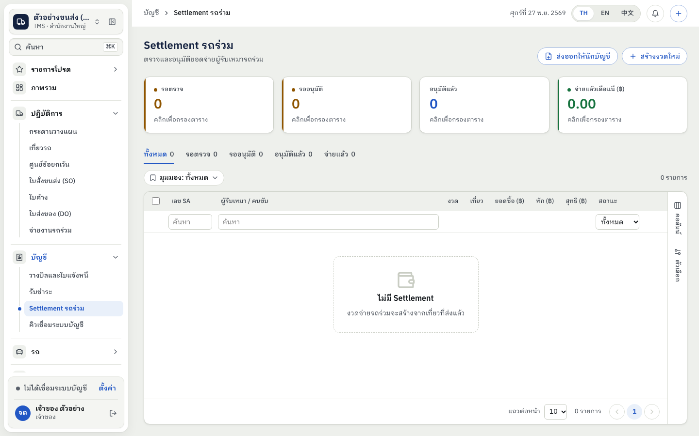

# จ่ายรถร่วม (ใบสำคัญจ่าย)

ฟีเจอร์นี้อยู่ในแพ็กเกจที่มี "Settlement รถร่วม" · ยอดหัก ณ ที่จ่ายที่แสดงเป็น**ประมาณการ** — หนังสือรับรองการหักภาษี ณ ที่จ่าย (50 ทวิ) ออกจากโปรแกรมบัญชีของคุณ

## ขั้นตอน

1. เปิดเมนู **บัญชี → Settlement รถร่วม** แล้วกด **สร้างงวดใหม่**
2. เลือก "ผู้รับเหมาและงวด" ติ๊กเที่ยวที่รอจ่าย เพิ่ม "รายการหัก" (ถ้ามี) และกรอก "เลขใบแจ้งหนี้ของผู้รับเหมา"
3. กด **สร้างร่าง** — ใบอยู่ในสถานะ รอตรวจ
4. ผู้อนุมัติกด **อนุมัติ**
5. หลังโอนเงิน กด **บันทึกจ่าย** กรอกวิธีจ่าย วันที่จ่าย และเลขอ้างอิง · พิมพ์ด้วย **พิมพ์ใบสำคัญจ่าย**

> ผู้เตรียมใบสำคัญจ่าย อนุมัติใบนั้นไม่ได้ และผู้อนุมัติ บันทึกจ่ายใบนั้นเองไม่ได้ — ต้องเป็นคนละคนกัน

## ลิงก์ให้ผู้รับเหมาตรวจยอด

ผู้รับเหมาเปิดลิงก์ตรวจยอดแต่ละรายการ และกด **ยอมรับ** หรือ **โต้แย้ง** ได้ · ออกลิงก์ใหม่ด้วย **ออกลิงก์ใหม่** · ลิงก์ค่าเที่ยวของรถร่วมแสดงยอดรอรับเงินและเที่ยวที่ยังไม่เข้างวด

## สถานะ

รอตรวจ → รออนุมัติ → อนุมัติแล้ว → จ่ายแล้ว (หรือ มีรายการโต้แย้ง / ยกเลิก)

## สิทธิ์

สร้าง: เจ้าของ ผู้ดูแลระบบ ผู้จ่ายงาน ผู้วางบิล บัญชี · อนุมัติ: เจ้าของ ผู้ดูแลระบบ ผู้จัดการ บัญชี ผู้อนุมัติ · บันทึกจ่าย: เจ้าของ ผู้ดูแลระบบ บัญชี
