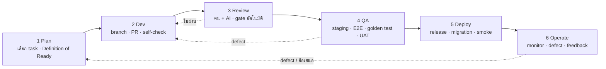

# 10 — Loop วิศวกรรม: Plan → Dev → QA → Deploy → Operate

> ร่าง 10 พ.ย. 2569 · ใช้ตั้งแต่ ST0 · ทบทวนท้ายทุก stage พร้อม `04-risks.md`
> เอกสารนี้บอก "ทำงานกันอย่างไร" — เนื้องานอยู่ใน `01-phase0-backlog.md`, วิธีทดสอบอยู่ใน `03-test-plan.md`, การขึ้นใช้งานจริงกับลูกค้าอยู่ใน `09-pilot-rollout.md`

## 0. ภาพรวม

หน่วยงานที่วิ่งผ่าน loop = **1 task ใน backlog = 1 branch = 1 PR = API + ข้อมูล + UI + test ครบ** (`CLAUDE.md`) · รอบใหญ่ = **stage** (ST0–ST9) จบด้วยเดโมและ retro · รอบปฏิทิน = **สัปดาห์** (planning จันทร์, รายงานศุกร์)

| บทบาท | ใครในเฟส 0 | หน้าที่ใน loop |
|---|---|---|
| เจ้าของสินค้า (PO) | Wei | จัดลำดับ backlog, ตอบ `05-decisions-needed.md`, รับเดโม, ตัดสิน "ผู้สมัครเพิ่ม", ติดต่อนักบัญชี/ทนาย/KRS/tenant นำร่อง |
| หัวหน้าเทคนิค (TL) | *ยังไม่ระบุ* | ถือ ADR, review ทุก PR ที่แตะ billing/settlement/ภาษี/RLS, ตัดสินเทคนิคที่ไม่อยู่ใน ADR, เจ้าของ release |
| นักพัฒนา (Dev) | *ยังไม่ระบุ* (ใช้ Claude Code ช่วย) | รับ task → ส่ง PR ที่ผ่าน Definition of Done |
| QA | Dev อีกคน (สลับกัน) จนกว่าจะมี QA จริง | ทดสอบบน staging ตามเกณฑ์ตรวจรับ, ดูแล E2E, จัด UAT |
| AI agent (Claude Code) | — | ทำงานตาม task ภายใต้ `CLAUDE.md`; ห้ามตัดสินเรื่องที่ขัดกันเอง; เสนอเข้า "ผู้สมัครเพิ่ม" |
| ผู้ตรวจภายนอก | นักบัญชีของ tenant นำร่อง, ทนาย | เซ็นรับ golden case ภาษี, ข้อความ PDPA |

## 1. Plan

**1.1 ระดับ stage (ต้น stage, 1 ประชุม ≤ 2 ชม.)**
- อ่านเป้าหมาย/เกณฑ์ "เสร็จ stage เมื่อ" ใน backlog; ยืนยันว่า dependency ของ stage พร้อม (คำตอบคนนอก, ADR ไม่มีข้อเปิดที่ขวาง)
- จัดลำดับ task ใน stage; ติดป้าย task ที่ต้องมี TL review (แตะ billing/settlement/ภาษี/RLS/auth)
- ประมาณการใหม่ถ้าความเร็วจริงของ stage ก่อนต่างจากแผน > 30% (PLAN §6 ข้อ 3)

**1.2 ระดับสัปดาห์ (จันทร์ ≤ 45 นาที)**
- เลือก task ตามลำดับ ไม่เกินความจุ (3.5 วันทำงานสุทธิ/คน/สัปดาห์)
- ทุก task ที่หยิบต้องผ่าน **Definition of Ready**:
  - [ ] มีในรายการ backlog เฟส 0 (หรือ PO อนุมัติจาก "ผู้สมัครเพิ่ม" แล้ว ระบุว่าแลกกับอะไร)
  - [ ] เกณฑ์ตรวจรับในตารางอ่านแล้วเข้าใจตรงกัน ถ้ามีคำว่า "ตามคำตอบนักบัญชี/KRS" คำตอบนั้นต้องมีแล้วหรือใช้ค่า default ที่ PO เซ็นรับ
  - [ ] อ้างอิง docs/spec ที่เกี่ยวข้องถูกเปิดอ่าน และไม่มีข้อขัดกันที่ยังไม่อยู่ใน `00a`/`00b` (ถ้ามี → หยุด เพิ่มรายการ ถาม PO)
  - [ ] ระบุตารางใหม่/field ใหม่ที่จะเกิด (เพื่อเตรียม RLS + isolation test)
  - [ ] ระบุว่าแตะ billing/settlement/ภาษีหรือไม่ (→ golden test + TL review)
- บันทึก task ที่หยิบใน `PROGRESS.md` §"สัปดาห์นี้"

**1.3 งานที่ไม่อยู่ใน backlog** → เขียนเข้า `01-phase0-backlog.md` §5 "ผู้สมัครเพิ่ม" พร้อมขนาดหยาบ รอ PO ตัดสินตอน planning สัปดาห์ถัดไป — ไม่เริ่มทำก่อน

## 2. Dev

**2.1 Branch และ commit**
- `main` = deploy staging อัตโนมัติ เสมอเขียว · branch ชื่อ `st<stage>/<task-id>-<สั้น>` เช่น `st1/ST1-T04-user-roles` · ไม่มี branch อายุเกิน 5 วันทำงาน (แตก task ถ้าใหญ่)
- commit message ภาษาอังกฤษหรือไทยก็ได้ ขึ้นต้นด้วย task id: `ST1-T04: add role catalogue and permission guard`
- hotfix: `hotfix/<เรื่อง>` จาก tag ล่าสุดของ production → merge กลับ `main`

**2.2 ลำดับทำงานใน task (เหมือนกันทุกคนและทุก AI agent)**
1. อ่าน task + เกณฑ์ตรวจรับ + อ้างอิง docs/spec; เขียน "แผน 5–10 บรรทัด" ลงใน PR description ก่อนเขียนโค้ด (ตาราง/field, endpoint, UI, test ที่จะมี)
2. เขียน test ของเกณฑ์ตรวจรับก่อนหรือพร้อมโค้ด (integration test กับ PostgreSQL จริง)
3. schema: migration ย้อนกลับได้ + RLS policy + เพิ่มตารางลง isolation suite — CI fail ถ้าตารางมี `tenant_id` แต่ไม่มี policy
4. API: อยู่ใต้ `/v1`, problem+json, idempotency สำหรับ POST ที่สร้างเอกสาร, OpenAPI อัปเดตอัตโนมัติจาก decorator
5. UI: ใช้ pattern จาก `packages/ui`; ข้อความผ่าน i18n key (ไทยครบ; EN ใส่ได้ถ้าสะดวก, ไม่บังคับในเฟส 0 ตาม D-11)
6. งานที่แตะเงิน/ภาษี: ใช้ `packages/domain` เท่านั้น (ห้ามคำนวณใน controller/UI); golden test ต้องเขียว
7. self-check ตาม **Definition of Done** (§3.1) แล้วเปิด PR

**2.3 กติกาเฉพาะสำหรับ AI agent**
- ทำทีละ task; ไม่แก้ไฟล์นอกขอบเขต task เว้นแต่จำเป็นและระบุใน PR
- พบเอกสารขัดกัน/ไม่ชัด → หยุด, เขียนคำถามลง PR และ `PROGRESS.md` §"คำถามค้าง", ไม่เดา
- ห้ามแต่งกฎภาษี, ห้ามเปลี่ยน state machine โดยไม่มีแหล่งอ้างอิงใน docs/spec/research
- ทุก PR ของ agent ต้องมีคน approve อย่างน้อย 1 คน (TL ถ้าแตะเรื่องเสี่ยง)

## 3. Review (gate ก่อนเข้า QA)

**3.1 Definition of Done ของ PR** (เป็น checklist ใน PR template `plan/templates/pull-request.md`)
- [ ] CI เขียวทั้งหมด: lint, typecheck, unit, integration, tenant-isolation suite, OpenAPI diff gate, build, CVE scan
- [ ] เกณฑ์ตรวจรับของ task มี test อัตโนมัติรองรับ (ชี้ไฟล์ test ใน PR)
- [ ] ตาราง/field ใหม่: `tenant_id` + RLS + อยู่ใน isolation suite; เงินเป็น `numeric(14,2)`; เวลาเป็น `timestamptz`
- [ ] การยกเลิก/override/อนุมัติ มีเหตุผล + audit log
- [ ] ข้อความไทยครบ ไม่มี hard-code string ใน UI
- [ ] UI ตรงต้นแบบ `design/prototype/` อย่างเคร่งครัด — แนบภาพเทียบ "ต้นแบบ | ของจริง" ที่ 1440 px (และ 390 px หน้า public); ส่วนที่ต่างต้องอยู่ในข้อยกเว้นของ `design/README.md`
- [ ] OpenAPI เปลี่ยนแบบไม่ breaking (หรือมี ADR/การอนุมัติ)
- [ ] แตะ billing/settlement/ภาษี → golden test เขียว + TL approve
- [ ] migration ย้อนกลับได้ และทดสอบ `down` แล้ว
- [ ] PR description: แผน, สิ่งที่ทำ, วิธีทดสอบด้วยมือบน staging, screenshot UI (ถ้ามี), ข้อที่ยังค้าง

**3.2 ขั้นตอน review**
1. **gate อัตโนมัติ** (CI) ต้องเขียวก่อนคนดู
2. **AI review** (Claude Code `/code-review` หรือเทียบเท่า) หา bug/ช่องโหว่ — ผู้เขียนตอบทุกข้อ (แก้หรือให้เหตุผล)
3. **คน review** 1 คน (TL สำหรับเรื่องเสี่ยง): ดูว่าตรง docs/spec, ชื่อตาม T-15, ไม่มี business logic หลุดจาก `packages/domain`, test ทดสอบของจริงไม่ใช่ mock ทั้งหมด
4. squash-merge เข้า `main` → deploy staging อัตโนมัติ → ย้ายการ์ดไป "QA"
- เป้าหมาย: PR รอ review ไม่เกิน 1 วันทำงาน; PR เกิน 600 บรรทัด diff ต้องแตก

## 4. QA

**4.1 ต่อ PR บน staging (ภายใน 1 วันหลัง merge)**
- QA (ไม่ใช่ผู้เขียน) ทำตาม "วิธีทดสอบด้วยมือ" ใน PR + เกณฑ์ตรวจรับ + ลองกรณีผิดปกติในตาราง spec ข้อ 8 ของโมดูลนั้น
- ตรวจ 4 เรื่องเสมอ: ข้ามสิทธิ์ (role ที่ไม่ควรเห็น), ข้าม tenant (บัญชี tenant B), มือถือสำหรับหน้า public, **เปิดต้นแบบเทียบทีละหน้า** (ความต่างนอกข้อยกเว้น = defect S3)
- ผล: ผ่าน → การ์ดไป "Done" · defect → เปิด issue ติดป้าย `defect` + ระดับ (S1 ข้อมูลผิด/เงินผิด/รั่วข้าม tenant · S2 ใช้งานไม่ได้ · S3 ใช้งานได้แต่ผิด · S4 เล็กน้อย) ส่งกลับ Dev; S1/S2 แก้ก่อนงานใหม่

**4.2 ต่อ stage (ก่อนเดโม)**
- รัน E2E ทั้ง 8 เส้นทาง (`03-test-plan.md` §3) บน staging ด้วย seed สด
- golden test ภาษีครบชุดที่มี ณ ตอนนั้น (ST5 ขึ้นไป) + ตรวจ PDF ด้วยตาเทียบตัวอย่างเอกสารจริง
- ทดสอบ migration จากฐานข้อมูลของ stage ก่อน (ไม่ใช่ฐานเปล่า) และ rollback 1 ขั้น
- ตรวจ NFR ตามรอบ: ST1 ความปลอดภัย auth, ST3 ประสิทธิภาพกระดานวางแผน (200 คัน), ST5 PDF 100 ใบ, ST9 ชุดเต็ม
- เดโมตามบทใน backlog ให้ PO; ผลและ defect ที่พบบันทึกใน `PROGRESS.md` §stage

**4.3 UAT และผู้ตรวจภายนอก** (ST5 ขึ้นไป) — ตามบทบาทใน `03-test-plan.md` §5; นักบัญชีเซ็นรับ golden case เป็นลายลักษณ์อักษร (อีเมล/PDF) เก็บไว้ใน `plan/sign-offs/`

## 5. Deploy

**5.1 สภาพแวดล้อม**
| env | มาจาก | ข้อมูล | ใคร deploy | ใช้ทำอะไร |
|---|---|---|---|---|
| dev (เครื่อง) | branch | docker compose + seed | Dev | พัฒนา |
| staging | `main` ทุก merge | seed + ข้อมูลทดสอบปิดชื่อ, reset ได้ | อัตโนมัติ | QA, เดโม, UAT ภายใน |
| production | tag `vX.Y.Z` จาก `main` | ข้อมูลจริง (tenant นำร่อง) | TL กด (manual approval) | ลูกค้านำร่อง |

**5.2 รอบ release**
- ST0–ST6 (ยังไม่มีลูกค้า): production ยังไม่มี; staging คือปลายทาง
- ตั้งแต่เริ่มนำร่อง: release ประจำ **สัปดาห์ละ 1 ครั้ง** (เช่น อังคารเช้า นอกเวลาเร่งด่วนของขนส่ง = หลัง 10:00) + hotfix ได้ทุกเมื่อสำหรับ S1/S2
- ห้าม deploy production วันปิดงวด/วันออกใบวางบิลหลักของ tenant นำร่อง (ถาม tenant แล้วบันทึกใน `09-pilot-rollout.md`)

**5.3 ขั้นตอน release** (checklist เต็มใน `plan/templates/release-checklist.md`)
1. ตัด tag จาก `main` ที่ QA ผ่านครบ; เขียน release note ภาษาไทย (ผู้ใช้อ่านได้) + รายการ migration
2. backup ฐานข้อมูล production (อัตโนมัติก่อน migration) และยืนยันว่า restore ได้ (ซ้อมทุกเดือน — ST9)
3. รัน migration แบบ expand-only ก่อน (เพิ่มคอลัมน์/ตาราง), deploy โค้ด, ค่อย contract ใน release ถัดไป — ไม่มี migration ที่ลบ/เปลี่ยนชนิดคอลัมน์ใน release เดียวกับโค้ดที่ยังใช้
4. smoke test หลัง deploy: login, เปิดกระดานวางแผน, สร้าง SO ทดสอบใน tenant demo, ออก PDF 1 ใบ, `GET /v1/health`, ตรวจ error rate 15 นาที
5. ประกาศใน channel ของ tenant นำร่อง (ข้อความที่ PO อนุมัติ)
6. ถ้า smoke ไม่ผ่าน → rollback โค้ด (image ก่อนหน้า) + migration `down` 1 ขั้น ภายใน 15 นาที; บันทึก incident

## 6. Operate (ตั้งแต่มีลูกค้านำร่อง)

- Monitor: error rate, p95 latency ต่อ endpoint, คิว outbox/webhook ค้าง, MISMATCH ของ connector, job ล้มเหลว, พื้นที่ดิสก์/การ backup — แจ้งเตือนเข้าช่องทางทีม
- Defect จากลูกค้า → issue ติดป้าย `defect` + ระดับ S1–S4; S1 ตอบภายใน 1 ชม. แก้ภายใน 1 วัน, S2 ภายใน 3 วัน, S3/S4 เข้าคิว planning
- Incident: บันทึกเหตุ, ผลกระทบ, เวลา, สาเหตุ, การแก้ และ "สิ่งที่จะกันไม่ให้เกิดซ้ำ" (เป็น task ใน backlog) ภายใน 2 วันทำงาน
- Feedback/ข้อเสนอจากผู้ใช้ → "ผู้สมัครเพิ่ม" ไม่ทำทันที
- ทุกศุกร์: รายงานสถานะ (`PROGRESS.md` + ข้อความสั้นถึง PO): งานปิด/ค้าง, วันทำงานจริง vs ประมาณการ, คำตอบคนนอกที่ยังรอ, ความเสี่ยง R1/R2/R4/R5/R6, defect เปิดตามระดับ

## 7. เครื่องมือและบอร์ด

- บอร์ดงาน: ใช้ GitHub Projects (หรือ Linear) คอลัมน์ **Backlog → Ready → Doing → Review → QA → Done**; การ์ดชื่อ = task id ใน backlog; สถานะใน `PROGRESS.md` เป็นสรุปรายสัปดาห์ ไม่ใช่บอร์ดซ้ำ
- CI: GitHub Actions (ร่าง `plan/templates/ci.yml`); secret อยู่ใน secret store ของ CI/cloud ไม่อยู่ใน repo
- เอกสารการตัดสินใจ: ADR เพิ่มใน `02-tech-decisions.md` (ก่อน repo) → ย้ายไป `docs/adr/` ใน repo ตอน ST0
- เอกสารถึงคนนอก: `plan/06`–`08` และคำตอบเก็บในไฟล์เดียวกัน

## 8. จังหวะประจำ

| เมื่อไร | อะไร | ใคร | ผลลัพธ์ |
|---|---|---|---|
| ทุกวัน (async) | อัปเดตการ์ดบนบอร์ด; blocker เขียนใน channel | ทุกคน | ไม่มี task ค้างเงียบ > 1 วัน |
| จันทร์ | planning สัปดาห์ (§1.2) | PO + TL + Dev | รายการ task ที่หยิบ ใน `PROGRESS.md` |
| ศุกร์ | รายงานสถานะ (§6) + ทบทวน `PROGRESS.md` §"คำถามค้าง" | TL เขียน PO อ่าน | สถานะสัปดาห์ + รายการที่ PO ต้องตอบ |
| ท้าย stage | เดโม + retro 1 ชม. + ทบทวน risk + re-estimate | ทุกคน | บันทึกใน `PROGRESS.md` §stage, ปรับ `PLAN.md` |
| ทุกเดือน (เมื่อมี production) | ซ้อม restore backup, ตรวจ CVE ค้าง, ทบทวนสิทธิ์เข้าถึง production | TL | บันทึกผล |

## 9. สิ่งที่ต้องเตรียมก่อน loop นี้เดินได้ (ผูกกับ PLAN §1.1)

- [ ] ระบุ TL และ Dev (ข้อ 8)
- [ ] ที่เก็บโค้ด + CI + บอร์ด (ข้อ 9) และ branch protection บน `main` (ต้อง PR + CI เขียว + 1 approve)
- [ ] staging (ข้อ 10) — ก่อนหน้านั้น QA ทำบนเครื่อง Dev ด้วย docker compose ได้ชั่วคราว
- [ ] ย้าย `plan/templates/*` เข้า `.github/` ใน ST0-T02
- [ ] PO ตกลงจังหวะประชุม §8 และช่องทางสื่อสารทีม
