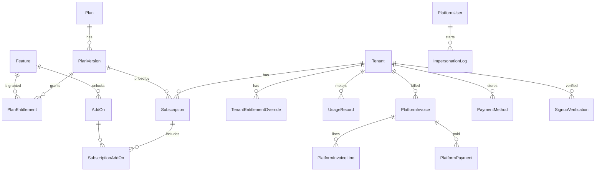
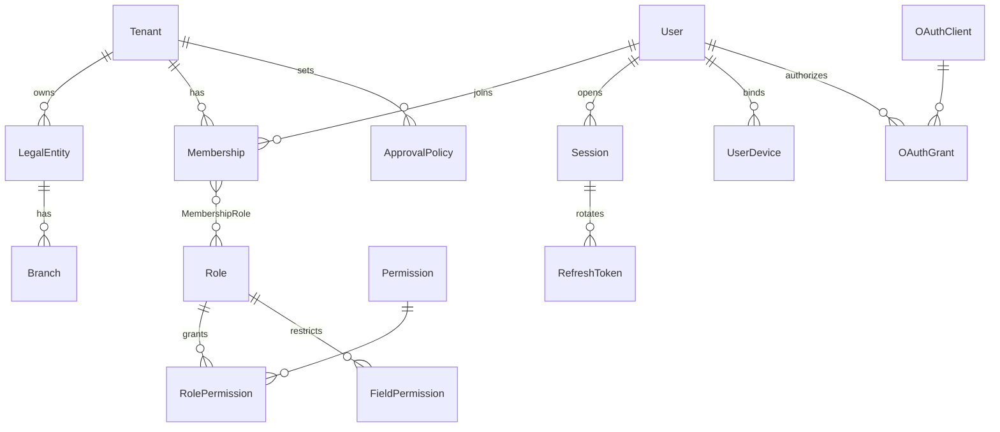
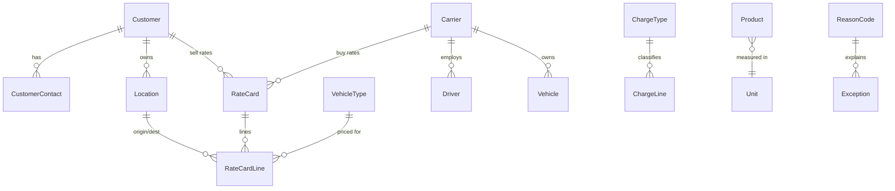
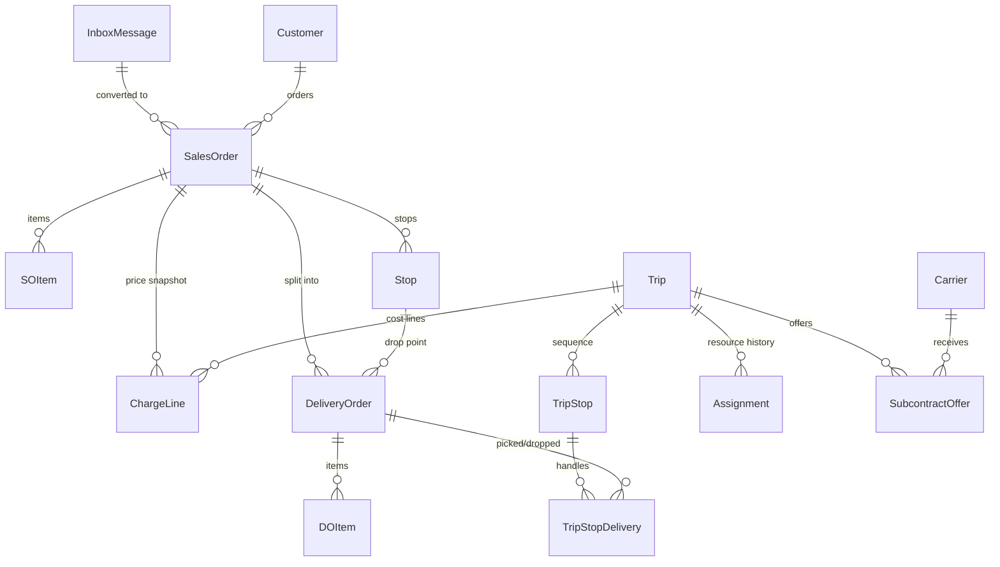
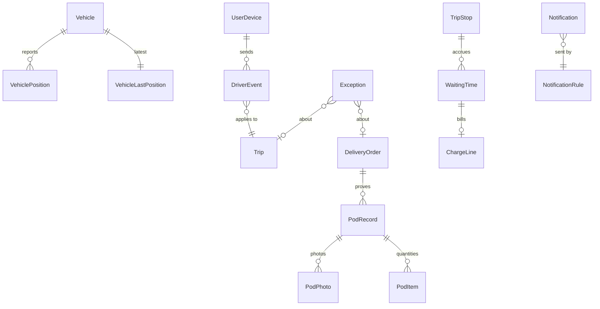
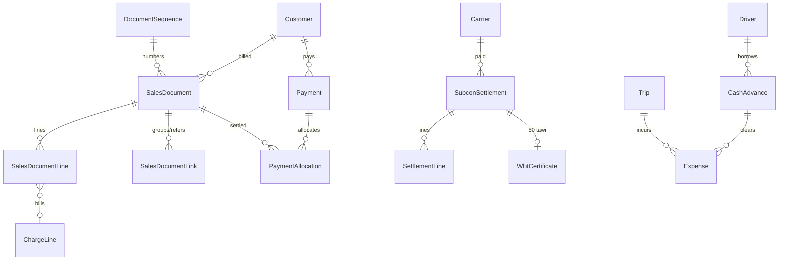
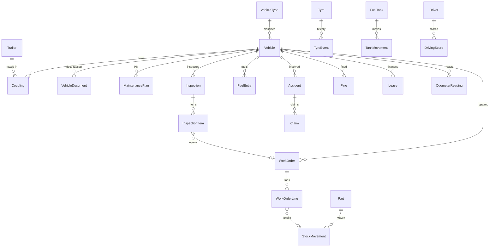
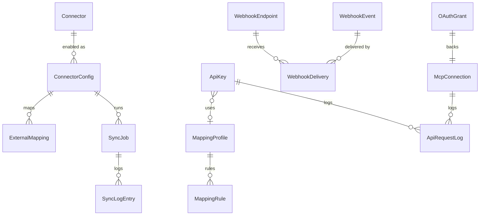

# 10 — Data model (DM)

> ⚠️ **ลำดับความสำคัญ (10 พ.ย. 2569):** ไฟล์นี้เขียนโดยไม่ได้อ่าน `docs/` (v2) เมื่อเนื้อหาขัดกับ `docs/` ให้ยึด `docs/` — ดู `plan/00-source-of-truth.md` และรายการจุดที่ขัดกันใน `plan/00a-reconcile-architecture.md`, `plan/00b-reconcile-requirements.md` · ป้าย P0/P1/P2 ในไฟล์นี้เป็นมาตราส่วนของ spec ไม่ใช่ "เฟส 0" ของแผนพัฒนา

> สถานะ: ร่าง v0.1 · 9 พ.ย. 2569
> ขอบเขต: entity หลักทุกโดเมน, ความสัมพันธ์, enum สถานะ, กติกา multi-tenant, ชนิดข้อมูล, การเก็บ/ลบข้อมูล
> แหล่ง: `research/one-platform.md` §2.3, `research/decisions.md`, `research/tms-product-learning.md` §3, `research/thai-tax-docs-research.md` §1.7 §5 §6.1, `research/tms-api-benchmark.md` §9, `research/ai-mcp-plan.md` §3, `research/design-briefs.md` รอบ 1–17
> เอกสารนี้เป็น **โครงข้อมูลเชิงตรรกะ** สำหรับเขียน Prisma schema — ชื่อ field ใน spec เป็น camelCase (Prisma) และ map เป็น snake_case ใน DB ด้วย `@map/@@map`; ฟิลด์ที่ระบุไว้คือ "ฟิลด์หลัก" ไม่ใช่รายการครบทุกคอลัมน์ รายละเอียดฟอร์มและกฎตรวจอยู่ในไฟล์โมดูล 01–09

---

## 1. หลักการ

| รหัส | กติกา | ป้าย |
|---|---|---|
| DM-001 | ฐานข้อมูลเดียว **shared schema** ทุก tenant อยู่ตารางเดียวกัน แยกด้วย `tenantId` + Postgres Row Level Security (RLS) — ไม่ทำ DB/schema ต่อ tenant | [DECISION] |
| DM-002 | ทุกตารางข้อมูลของ tenant มี `tenantId uuid NOT NULL` และ FK ไป `Tenant.id`; ทุก unique key ทางธุรกิจต้องขึ้นต้นด้วย `tenantId` | [DECISION] |
| DM-003 | ตาราง platform (แพ็กเกจ, tenant, ใบกำกับที่เราออก, ทีมเรา) **ไม่มี RLS ตาม tenant** และเข้าถึงได้เฉพาะ service ฝั่ง Platform Console/cron | [DECISION] |
| DM-004 | Primary key เป็น `uuid` แบบ **UUIDv7** (เรียงตามเวลา, index ไม่กระจาย) สร้างฝั่ง app; API แสดงเป็น opaque id มี prefix (`ord_`, `trp_`, `do_`, `inv_` …) โดยเข้ารหัส uuid เป็น base32 | [PROPOSED] |
| DM-005 | เงินเป็น `numeric(14,2)` สกุล THB เท่านั้นในเฟส P0–P1; ราคาต่อหน่วยที่ต้องละเอียด (ราคาน้ำมัน/ลิตร, ต้นทุนเฉลี่ยอะไหล่) ใช้ `numeric(14,4)`; ห้ามใช้ float กับเงินและปริมาณ | [DECISION] |
| DM-006 | ปริมาณเป็น `numeric`: น้ำหนัก กก. `numeric(12,3)`, ปริมาตร ลบ.ม. `numeric(12,3)`, จำนวนสินค้า `numeric(14,3)`, ลิตร `numeric(10,3)`, ระยะทาง กม. `numeric(10,2)`, เลขไมล์ `numeric(10,1)`, % `numeric(5,2)` | [PROPOSED] |
| DM-007 | เวลาเป็น `timestamptz` เก็บ UTC แสดงผลตาม `Tenant.timezone` (ค่าเริ่มต้น `Asia/Bangkok`); วันที่ทางบัญชี/ภาษี (วันที่เอกสาร, ครบกำหนด, วันหมดอายุเอกสารรถ) เป็น `date` ตามเวลาไทย | [DECISION] |
| DM-008 | เหตุการณ์จากอุปกรณ์ (แอปคนขับ, GPS, ลิงก์รถร่วม) เก็บ **2 เวลา**: `occurredAt` (เวลาบนเครื่อง ณ เกิดเหตุ) และ `receivedAt` (เวลา server รับ) — รายงาน/ค่ารอ/OTIF ใช้ `occurredAt`; ตรวจทุจริต/ล่าช้าในการส่งใช้ส่วนต่าง | [DECISION] |
| DM-009 | **ราคา snapshot**: ราคา/อัตรา/VAT/หัก ณ ที่จ่ายที่ใช้กับงาน ถูก copy ลง `ChargeLine` ตอนสร้าง/ยืนยัน SO — แก้ rate card ภายหลังไม่กระทบงานเดิม; ชื่อเหตุผล (reason) และที่อยู่จุดส่งก็ snapshot เช่นกัน | [DECISION] |
| DM-010 | **สถานะเอกสาร ≠ สถานะซิงก์** (D3): เอกสารมี `status` ของตัวเอง; สถานะซิงก์อยู่ใน `ExternalMapping.status` แยกต่อ connector — ห้ามเพิ่มคอลัมน์ syncStatus ในตารางเอกสาร | [DECISION] |
| DM-011 | เอกสารภาษีที่ **ออกแล้ว (issued) แก้ไขไม่ได้** — ห้าม UPDATE ฟิลด์ทางภาษีและห้ามลบ; แก้ด้วยใบลดหนี้/ใบเพิ่มหนี้ หรือยกเลิก (คง record, ไม่ reuse เลข) แล้วออกใบใหม่อ้างถึงใบเดิม | [FACT] ม.86/9, 86/10, กค 0811/พ.9254 |
| DM-012 | ลบข้อมูลทั่วไปเป็น **soft delete** (`deletedAt`); การลบจริง (purge) ทำโดย retention job เท่านั้น (D7) — ดู §7 | [DECISION] |
| DM-013 | Optimistic locking: ตารางที่แก้ไขได้มี `version int` เพิ่มทุก UPDATE; API คืน `ETag` = version และรับ `If-Match` (412 เมื่อไม่ตรง) | [DECISION] |
| DM-014 | สถานะทุก state machine มี **timestamp ต่อสถานะ** ในตาราง (เช่น `dispatchedAt`, `deliveredAt`) + ประวัติเต็มใน `StatusHistory` | [PROPOSED] |
| DM-015 | Entity ที่เปิด custom fields เก็บค่าใน `customFields jsonb` (key = API key ของ field); schema API/MCP/webhook generate จาก `CustomFieldDefinition` (D6) | [DECISION] |
| DM-016 | Entity ที่เปิดผ่าน Open API มี `externalRef varchar(100)` (nullable) unique ต่อ `(tenantId, externalRef)` เพื่อ upsert ด้วย id ภายนอก และ `source` (ที่มา) | [DECISION] |
| DM-017 | ข้อความหลายภาษาที่ tenant ตั้งเอง (ชื่อ role, reason, custom field label) เก็บเป็น `jsonb {"th":"…","en":"…","zh":"…"}`; ข้อมูลธุรกิจ (ชื่อลูกค้า ที่อยู่) เก็บภาษาเดียวตามที่กรอก + ช่อง `nameEn` ที่จำเป็นต่อเอกสาร | [PROPOSED] |
| DM-018 | ข้อมูลส่วนบุคคลอ่อนไหว (เลขบัตรประชาชน, เลขใบขับขี่, เลขบัญชีธนาคาร, secret ของ connector/webhook) เข้ารหัสระดับ field (AES-256-GCM, key จาก KMS) + เก็บ `…Last4` ไว้ค้นหา/แสดง | [PROPOSED] |

---

## 2. Multi-tenant

### 2.1 ชั้นของตาราง

| ชั้น | ตัวอย่าง | `tenantId` | RLS | ใครเข้าถึง |
|---|---|---|---|---|
| **Platform** | `Plan`, `PlanVersion`, `Feature`, `PlanEntitlement`, `AddOn`, `Coupon`, `Tenant`, `PlatformUser`, `PlatformSetting`, `Connector`, `Permission`, `OAuthClient` | ไม่มี (หรือมีเป็น FK อ้างอิงลูกค้า เช่น `PlatformInvoice.tenantId`) | ไม่มี | role DB `tms_platform` (Console, billing cron) |
| **Platform ↔ tenant** | `Subscription`, `TenantEntitlementOverride`, `UsageRecord`, `PlatformInvoice`, `PlatformPayment`, `PaymentMethod`, `ImpersonationLog`, `SignupVerification` | มี | มี policy อ่านอย่างเดียวให้ tenant (หน้า "แพ็กเกจของฉัน"); เขียนได้เฉพาะ `tms_platform` | ทั้งสองฝั่ง |
| **Global identity** | `User`, `Session`, `RefreshToken`, `OtpChallenge` | ไม่มี (`User` ข้ามบริษัทได้) | ไม่มี — เข้าถึงผ่าน auth service เท่านั้น | auth service |
| **Tenant** | ทุกตารางที่เหลือ (master, orders, execution, billing, fleet, integration, AI, audit) | มี `NOT NULL` | มี | role DB `tms_app` |

### 2.2 รูปแบบ RLS (DM-020)

```sql
-- ทำกับทุกตารางชั้น Tenant (migration helper สร้างให้อัตโนมัติ)
ALTER TABLE sales_order ENABLE ROW LEVEL SECURITY;
ALTER TABLE sales_order FORCE ROW LEVEL SECURITY;   -- บังคับแม้เป็นเจ้าของตาราง
CREATE POLICY tenant_isolation ON sales_order
  USING      (tenant_id = current_setting('app.tenant_id', true)::uuid)
  WITH CHECK (tenant_id = current_setting('app.tenant_id', true)::uuid);
```

- DM-021: ทุก request เปิด transaction แล้ว `SET LOCAL app.tenant_id = '<uuid>'` (และ `app.user_id`, `app.request_id` สำหรับ audit) ผ่าน Prisma client extension ตัวเดียว — ห้าม service เรียก Prisma client ที่ไม่ผ่าน extension
- DM-022: ถ้าไม่ได้ set `app.tenant_id` → `current_setting(...,true)` เป็น NULL → policy ไม่คืนแถวใดเลย (fail closed)
- DM-023: role `tms_app` ไม่มี `BYPASSRLS` และไม่ใช่เจ้าของตาราง; role `tms_platform` (มี BYPASSRLS) ใช้เฉพาะ Platform Console, cron นับ usage, retention job — ทุก query ข้าม tenant ของ role นี้ต้องเขียน `AuditLog`
- DM-024: Prisma extension ใส่ `tenantId` ใน `where`/`data` ให้อัตโนมัติอีกชั้น (defense in depth) — RLS คือชั้นที่สอง ไม่ใช่ชั้นเดียว
- DM-025: Read replica/รายงาน/MCP ใช้ role และ RLS เดียวกัน; materialized view สำหรับรายงานต้องมี `tenant_id` และถูกอ่านผ่าน view ที่กรอง `tenant_id`
- DM-026: Background job ทุกตัว (queue) ต้องพก `tenantId` ใน payload และ set context เหมือน request; job ข้าม tenant (เช่น ปิดงวด usage) วน tenant ทีละราย
- DM-027: ไฟล์ใน object storage ใช้ key `t/{tenantId}/{kind}/{yyyy}/{mm}/{uuid}.{ext}`; การออก signed URL ตรวจ `FileObject.tenantId` ก่อนเสมอ
- DM-028: Cache (Redis) ทุก key ขึ้นต้น `t:{tenantId}:`

### 2.3 Unique key ทางธุรกิจ (ตัวอย่าง)

| ตาราง | Unique | หมายเหตุ |
|---|---|---|
| ทุกเอกสารมีเลข | `(tenantId, docType?, docNo)` | เลขซ้ำข้าม tenant ได้ |
| `Customer`, `Carrier`, `Vendor`, `Location`, `Product`, `Driver` | `(tenantId, code)` WHERE `deletedAt IS NULL` | partial unique ให้ใช้รหัสเดิมซ้ำได้หลังลบ |
| `Vehicle`, `Trailer` | `(tenantId, plateNormalized)` WHERE `deletedAt IS NULL` | `plateNormalized` = ตัด space/ขีด + จังหวัด เช่น `710457กทม` |
| `Membership` | `(tenantId, userId)` | |
| `Role` | `(tenantId, code)` | |
| ทุก entity ที่มี `externalRef` | `(tenantId, externalRef)` WHERE NOT NULL | |
| `ExternalMapping` | `(tenantId, connectorConfigId, entityType, localId)` และ `(…, externalId)` | |
| `DriverEvent` | `(tenantId, clientEventId)` | idempotent ingest |
| `DocumentSequence` | `(tenantId, legalEntityId, branchId, docType, periodKey)` | |
| `Tenant` | `(taxId, branchCode)` WHERE `mode='live' AND status NOT IN ('pending_verification','cancelled')` | เลขซ้ำยังสร้าง tenant `pending_verification` ได้ (decisions §2) |

### 2.4 Sandbox (DM-029) [PROPOSED]

Sandbox ของ Open API = **tenant แยกอีกแถว** (`Tenant.mode='sandbox'`, `sandboxOfTenantId` ชี้ tenant จริง) — ได้ RLS แยกขาดโดยไม่ต้องเพิ่มคอลัมน์ mode ทุกตาราง; key `tk_test_` ผูกกับ tenant sandbox; ไม่นับ usage/ไม่ออกบิล; ข้อมูล sandbox ลบได้ทั้งชุดเมื่อผู้ใช้กด "ล้างข้อมูลทดสอบ"

### 2.5 การทดสอบการแยก tenant
ต้องมี test อัตโนมัติทุกตาราง (generate จาก Prisma DMMF): สร้างข้อมูลใน tenant A แล้วใช้ context tenant B ทำ SELECT/UPDATE/DELETE ต้องได้ 0 แถว และ INSERT ด้วย `tenantId` ของ A ต้องถูก policy ปฏิเสธ — รายละเอียดใน 11-nfr.md §3

---

## 3. คอลัมน์มาตรฐาน

| ชุด | คอลัมน์ | ชนิด | หมายเหตุ |
|---|---|---|---|
| **STD** (ทุกตาราง tenant ที่แก้ไขได้) | `id` | uuid PK | UUIDv7 |
| | `tenantId` | uuid NOT NULL | FK `Tenant` |
| | `createdAt` / `createdBy` | timestamptz / uuid | `createdBy` = `User.id` หรือ null ถ้าเป็น system; ประเภทผู้กระทำอยู่ใน `AuditLog` |
| | `updatedAt` / `updatedBy` | timestamptz / uuid | |
| | `deletedAt` / `deletedBy` | timestamptz null / uuid null | soft delete |
| | `version` | int NOT NULL default 1 | optimistic lock |
| **CF** (entity ที่เปิด custom fields) | `customFields` | jsonb NOT NULL default `'{}'` | SO, DO, Trip, Stop, Customer, Location, Vehicle, Driver, Carrier, SalesDocument (ใบแจ้งหนี้) — ตามรอบ 12 |
| **EXT** (entity ที่เปิด API) | `externalRef` | varchar(100) null | id/เลขฝั่งระบบลูกค้า |
| | `source` | enum `record_source` | manual · csv · api · connector · ai_inbox · mcp · driver_app · carrier_link · portal · system |
| **BR** (ข้อมูลที่ผูกสาขา) | `legalEntityId`, `branchId` | uuid | เอกสารภาษีบังคับ; อื่น ๆ ใช้กรองสิทธิ์สาขา |
| **APPEND** (log/เหตุการณ์) | `id`, `tenantId`, `createdAt` (+ `occurredAt`/`receivedAt` ถ้ามาจากอุปกรณ์) | | ไม่มี update/delete/version; สิทธิ์ DB เป็น INSERT+SELECT |

สัญลักษณ์ในตาราง entity: ✓ = บังคับ, "STD+CF+EXT" = มีชุดคอลัมน์มาตรฐานนั้น, `→ X` = FK ไป X

---

## 4. ชนิดข้อมูลและกติกาค่า

| เรื่อง | กติกา |
|---|---|
| ข้อความสั้น | `varchar(n)` ระบุความยาว: รหัส 30, ชื่อ 200, ที่อยู่บรรทัด 255, หมายเหตุ `text` (≤ 4,000 ตัวอักษรตรวจที่ API) |
| อีเมล | `citext` |
| โทรศัพท์ | E.164 `varchar(16)` เช่น `+66812345678`; แสดง `081-234-5678` |
| เลขผู้เสียภาษี | `char(13)` ตรวจ checksum mod 11; รหัสสาขา `char(5)` default `'00000'` ([FACT] ประกาศอธิบดีฯ ฉบับที่ 39 ข้อ 8–9) |
| ทะเบียนรถ | `plateNo varchar(20)` + `plateProvince varchar(40)` + `plateNormalized` (generated column) |
| พิกัด | PostGIS `geography(Point,4326)` สำหรับ `Location`, `VehiclePosition`, จุดเกิดเหตุ; ความแม่นยำ `accuracyM numeric(7,1)` [PROPOSED] |
| ช่วงเวลา | `tstzrange` เมื่อต้องกันชน (การพ่วงหาง, การจองรถ) + exclusion constraint (`btree_gist`) |
| Enum | Postgres enum สำหรับสถานะที่ระบบควบคุม; รายการที่ tenant ตั้งเอง (reason, หมวดค่าใช้จ่าย) เป็นตาราง master |
| JSON | `jsonb` เฉพาะ: snapshot, customFields, config, payload ของ event/log — ห้ามเก็บข้อมูลที่ต้อง join/aggregate บ่อยใน jsonb |
| เงินใน API | string ทศนิยม 2 ตำแหน่ง `{ "amount": "1250.00", "currency": "THB" }` (api-benchmark §9.1) |
| การปัดเศษ | VAT/WHT คำนวณต่อบรรทัดแล้วรวม หรือรวมแล้วคำนวณ — ตั้งต่อ tenant (`TenantSetting.taxRounding = line|document`, ค่าเริ่มต้น `document`) ปัด half-up 2 ตำแหน่ง [PROPOSED] |
| ปี พ.ศ. | เก็บเป็นวันที่สากลเสมอ; พ.ศ. เป็นเรื่องการแสดงผลและการ import (ดู 11-nfr §6) |

---

## 5. Entity catalogue

### 5.1 Platform และการเรียกเก็บเงินของแพลตฟอร์ม



**Plan** — แพ็กเกจ (ชั้น Platform)
| ฟิลด์ | ชนิด | บังคับ | หมายเหตุ |
|---|---|---|---|
| code | varchar(40) unique | ✓ | `starter`, `growth`, `business`, `enterprise` |
| name | jsonb i18n | ✓ | |
| status | `plan_status` | ✓ | draft · active · archived |
| isPublic | bool | ✓ | แสดงบนหน้าราคา |
| tierRank | int | ✓ | ใช้เทียบอัปเกรด/ดาวน์เกรด |

**PlanVersion** — ราคาและโควตา ณ เวลาหนึ่ง; **published แล้วแก้ไม่ได้** แก้ = สร้างเวอร์ชันใหม่ ลูกค้าเดิมคงเวอร์ชันเดิม (D8)
| ฟิลด์ | ชนิด | บังคับ | หมายเหตุ |
|---|---|---|---|
| planId | → Plan | ✓ | |
| versionNo | int | ✓ | unique `(planId, versionNo)` |
| pricingUnit | enum | ✓ | `per_active_vehicle_month` (decisions §1) |
| unitPriceMonthly | numeric(14,2) | ✓ | ก่อน VAT |
| annualDiscountPct | numeric(5,2) | | |
| minimumMonthly | numeric(14,2) | | ขั้นต่ำต่อเดือน |
| volumeDiscountRules | jsonb | | `[{"from":51,"to":100,"pct":10},{"from":101,"pct":20}]` |
| trialDays | int | | ค่าเริ่มต้น 30 [PROPOSED] |
| effectiveFrom / effectiveTo | timestamptz | ✓ / | |
| status | `plan_version_status` | ✓ | draft · published · retired |

**Feature** — key ฟีเจอร์ (`subcontract.dispatch`, `api.write`, `custom_fields.per_entity`, `pod.storage_gb`, `ai.credits`)
| ฟิลด์ | ชนิด | บังคับ | หมายเหตุ |
|---|---|---|---|
| key | varchar(80) PK | ✓ | |
| category, name | varchar / jsonb | ✓ | หมวดในตาราง feature matrix |
| kind | enum | ✓ | boolean · limit · metered |
| unit | varchar(20) | | vehicles, gb, req_per_min, fields, credits |
| isBasic | bool | ✓ | true = ฟีเจอร์พื้นฐานตาม D4 (ePOD, วางบิล, เอกสารภาษี, settlement, 50 ทวิ) — trigger ปฏิเสธการ publish `PlanVersion` ที่ปิดฟีเจอร์นี้ |

**PlanEntitlement**: `planVersionId`, `featureKey`, `mode` (included · addon · not_available), `limitValue numeric` (null = ไม่จำกัด) — unique `(planVersionId, featureKey)`
**AddOn**: `code`, `name`, `featureKey`, `pricingModel` (flat_monthly · per_unit_monthly · one_time), `unitPrice numeric(14,2)`, `status`
**SubscriptionAddOn**: `subscriptionId`, `addOnId`, `quantity`, `unitPriceSnapshot`, `startedAt`, `endedAt`
**Coupon**: `code` unique, `discountType` (percent · amount), `value`, `durationMonths`, `maxRedemptions`, `redeemedCount`, `validUntil`

**Tenant** — บริษัทลูกค้า 1 ราย (`id` คือ `tenantId` ของทุกตาราง)
| ฟิลด์ | ชนิด | บังคับ | หมายเหตุ |
|---|---|---|---|
| displayName | varchar(200) | ✓ | |
| taxId / branchCode | char(13) / char(5) | ✓ | ของนิติบุคคลหลักตอนสมัคร (รายละเอียดอยู่ `LegalEntity`) |
| status | `tenant_status` | ✓ | pending_verification · trialing · active · past_due · read_only · suspended · cancelled (decisions §5) |
| statusChangedAt | timestamptz | ✓ | cron ใช้คำนวณวันเปลี่ยนสถานะ |
| verificationStatus | enum | ✓ | auto_vat · pending_manual · approved · rejected |
| mode | enum | ✓ | live · sandbox |
| sandboxOfTenantId | → Tenant | | |
| timezone / defaultLocale | varchar | ✓ | `Asia/Bangkok` / `th` |
| trialEndsAt | timestamptz | | |
| cancelledAt / purgeScheduledAt / purgedAt | timestamptz | | purge = cancelledAt + 90 วัน [PROPOSED] |
| rateLimitProfile | varchar(20) | ✓ | ค่าจากแพ็กเกจ, Console ปรับได้ |
| apiDisabled / aiDisabled | bool | ✓ | สวิตช์ปิดราย tenant จาก Console |
| salesOwnerId | → PlatformUser | | |
| signupMeta | jsonb | | จำนวนรถโดยประมาณ, โปรแกรมบัญชีที่ใช้, utm |
| dataRegion | varchar(20) | ✓ | ค่าเริ่มต้นตาม [OPEN] data residency (11-nfr NFR-OPEN-1) |

**SignupVerification**: `tenantId`, `provider` (rd_tin · rd_vat · dbd · manual), `result` (match · mismatch · not_found · error), `matchedName`, `responseRaw jsonb` (ลบหลัง 90 วัน), `reviewedBy → PlatformUser`, `reviewedAt`, `reason`

**Subscription**
| ฟิลด์ | ชนิด | บังคับ | หมายเหตุ |
|---|---|---|---|
| tenantId | → Tenant | ✓ | มี subscription สถานะไม่ใช่ ended ได้ 1 ตัว (partial unique) |
| planVersionId | → PlanVersion | ✓ | |
| status | `subscription_status` | ✓ | trialing · active · past_due · cancelled · ended |
| billingCycle | enum | ✓ | monthly · yearly |
| currentPeriodStart / End | timestamptz | ✓ | |
| cancelAtPeriodEnd | bool | ✓ | |
| couponId, discountPct | | | |
| defaultPaymentMethodId | → PaymentMethod | | |
| nextBillingAt | timestamptz | | |

> `Tenant.status` = สิทธิ์การใช้งาน (guard อ่านตัวนี้), `Subscription.status` = สถานะการเงิน; cron เป็นผู้ sync `Tenant.status` จากวันครบกำหนดตาม `PlatformSetting`

**TenantEntitlementOverride**: `tenantId`, `featureKey`, `mode` (enable · disable · set_limit), `limitValue`, `reason` (≥ 10 ตัวอักษร) ✓, `approvedBy → PlatformUser` ✓, `validFrom`, `validTo`
- สิทธิ์จริง = `PlanEntitlement(version) ∪ SubscriptionAddOn ∪ Override − (Tenant.status ∈ {read_only, suspended} → เฉพาะอ่าน/ชำระเงิน/export)` คำนวณใน guard ตัวเดียว และ cache 60 วินาที

**UsageRecord** — นับการใช้ต่อเดือน
| ฟิลด์ | ชนิด | บังคับ | หมายเหตุ |
|---|---|---|---|
| tenantId, metric, period | → / enum / char(7) | ✓ | unique `(tenantId, metric, period)`; period `2026-11` (ค.ศ.) |
| metric | `usage_metric` | ✓ | active_vehicles · pod_storage_gb · api_calls · mcp_calls · sms · line_messages · ai_credits · custom_fields |
| value | numeric(14,3) | ✓ | |
| isFinal | bool | ✓ | true หลังปิดงวด (วันที่ 1 ของเดือนถัดไป 00:30 น.) |
| computedAt | timestamptz | ✓ | |

**UsageVehicle** — รายการรถที่ถูกนับเป็น active (หน้า "รายการรถที่ถูกนับ")
`tenantId`, `period`, `plateNormalized`, `vehicleId?`, `ownership` (own · subcontract), `firstClosedEntityType/Id`, `closedAt` — unique `(tenantId, period, plateNormalized)`; นับจาก **ทะเบียนบน Trip/DO ที่ปิดสถานะ** ไม่ใช่ master รถ (decisions §1)

**PlatformInvoice** — ใบกำกับภาษี/ใบเสร็จที่ **เรา** ออกให้ลูกค้า (แยกจาก `SalesDocument` ของลูกค้า)
| ฟิลด์ | ชนิด | บังคับ | หมายเหตุ |
|---|---|---|---|
| docType | enum | ✓ | invoice · tax_invoice_receipt · credit_note |
| docNo | varchar(30) unique | ✓ | sequence ของแพลตฟอร์ม ออกตอน issue |
| tenantId | → Tenant | ✓ | |
| buyerSnapshot | jsonb | ✓ | ชื่อ, taxId, branchCode, ที่อยู่ ณ วันออก |
| periodStart / periodEnd | date | ✓ | |
| subtotal, vatRate, vatAmount, total | numeric | ✓ | VAT 7% ค่าบริการซอฟต์แวร์ |
| status | `platform_invoice_status` | ✓ | draft · issued · paid · void |
| issuedAt, dueAt, paidAt | | | |
| pdfFileId, pdfSha256 | | ✓ เมื่อ issued | PDF render ณ วันออก เก็บใน bucket แยกที่ไม่ถูก purge (object lock) |
| refInvoiceId | → PlatformInvoice | | ใบลดหนี้อ้างใบเดิม |
| eTaxStatus | enum | | not_applicable · pending · submitted · accepted · rejected (เฟส P2) |

**PlatformInvoiceLine**: `featureKey/addOnId`, `description`, `quantity` (เช่น 37 คัน), `unitPrice`, `discount`, `amount`
**PlatformPayment**: `platformInvoiceId`, `method` (card · promptpay · bank_transfer), `provider` (opn · easyslip · manual), `providerChargeId`, `amount`, `status` (pending · succeeded · failed · review · refunded), `slipFileId`, `slipTransRef` (unique กันสลิปซ้ำ), `verifiedBy`, `paidAt`
**PaymentMethod**: `tenantId`, `provider`, `providerCustomerId`, `providerCardToken`, `brand`, `last4`, `expMonth/Year`, `isDefault` — **ห้ามเก็บ PAN/CVV**
**PlatformSetting**: `key` PK, `value jsonb`, `updatedBy` — เช่น `grace.pastDueDays=7`, `grace.readOnlyUntilDay=21`, `grace.suspendedUntilDay=60`, `retention.cancelledDays=90`, `signup.autoApprove=true`
**PlatformUser**: `email` unique, `name`, `role` (owner · sales · support · finance), `status`, `mfaEnabledAt` (บังคับ), `lastLoginAt`

---

### 5.2 องค์กร, ผู้ใช้, สิทธิ์ และการยืนยันตัวตน



**LegalEntity** — นิติบุคคลใน tenant (Business ขึ้นไปมีได้หลายราย)
| ฟิลด์ | ชนิด | บังคับ | หมายเหตุ |
|---|---|---|---|
| STD | | | |
| nameTh / nameEn | varchar(200) | ✓ / | ชื่อบนเอกสาร |
| taxId | char(13) | ✓ | unique `(tenantId, taxId)` |
| isVatRegistered / vatRegisteredAt | bool / date | ✓ | ไม่จด VAT → ออกใบกำกับภาษีไม่ได้ ([FACT] thai-tax §6.1) |
| logoFileId, signatureFileId, stampFileId | → FileObject | | สำหรับ A4 / 50 ทวิ |
| defaultBranchId | → Branch | | |

**Branch** — สาขาตาม ภ.พ.20: `legalEntityId` ✓, `branchCode char(5)` ✓ (`00000` = สำนักงานใหญ่), `name`, `address`, `pp20FileId`, `isHeadOffice` — unique `(tenantId, legalEntityId, branchCode)`; เอกสารภาษีผูก `branchId` ผู้ออกเสมอ ([FACT] ป.86/2542 ข้อ 15)

**TenantSetting**: `tenantId`, `key`, `value jsonb` — ภาษาเริ่มต้น, รูปแบบปี (พ.ศ./ค.ศ.), taxRounding, POD เริ่มต้น, ค่าแจ้งเตือน, onboarding checklist (`onboarding.steps`), AI รายฟีเจอร์ (ดู §5.10)

**User** — บุคคล 1 คน (ข้าม tenant ได้; ชั้น Global identity)
| ฟิลด์ | ชนิด | บังคับ | หมายเหตุ |
|---|---|---|---|
| email | citext unique | ต้องมี email หรือ phone อย่างน้อย 1 | |
| phoneE164 | varchar(16) unique | | คนขับมักใช้เบอร์อย่างเดียว |
| passwordHash | text | | argon2id; null ถ้าใช้ Google/OTP อย่างเดียว |
| googleSub | varchar(64) unique | | |
| emailVerifiedAt / phoneVerifiedAt | timestamptz | | |
| displayName, locale | | ✓ | locale: th · en · zh |
| status | `user_status` | ✓ | active · locked · disabled |
| totpSecretEnc / mfaEnabledAt | bytea / timestamptz | | |
| tokenVersion | int | ✓ | เพิ่มเมื่อถอนสิทธิ์/เปลี่ยนรหัส → บังคับ logout ทุก session |
| failedLoginCount / lockedUntil | | | |
| lastLoginAt | timestamptz | | |

**Membership**: STD, `userId` ✓, `status` (invited · active · suspended · removed), `branchScope uuid[]` (ว่าง = ทุกสาขา), `defaultBranchId`, `invitedBy`, `joinedAt`, `lastActiveAt` — unique `(tenantId, userId)`; `MembershipRole(membershipId, roleId)`
**Invitation**: `tenantId`, `email/phone`, `roleIds uuid[]`, `tokenHash`, `expiresAt` (7 วัน), `acceptedAt`, `invitedBy`
**Role**: `tenantId` (null = แม่แบบระบบ), `code`, `name jsonb`, `isSystem`, `kind` (staff · driver · subcontractor · shipper) — role เริ่มต้นตาม 00-overview §3.1 ถูก copy ลง tenant ตอนสมัคร แก้ได้
**Permission** (Platform): `key` เช่น `orders.so.create`, `billing.invoice.issue`, `fleet.wo.approve`, `settings.api.manage`; `module`, `action` (view · create · update · delete · approve · export · manage)
**RolePermission**: `roleId`, `permissionKey`, `constraint jsonb` (เช่น `{"maxAmount":"5000.00"}`)
**FieldPermission**: `roleId`, `entityType`, `fieldPath` (`salesOrder.charges`, `trip.carrierCost`), `access` (hidden · read · write) — ใช้ซ่อนราคาขายจาก dispatcher/รถร่วม
**ApprovalPolicy**: `tenantId`, `subject` (work_order · dispatch_override · rate_card · settlement · credit_note · cash_advance), `level` int, `roleId`, `maxAmount numeric(14,2)` (null = ไม่จำกัด) — เช่น หัวหน้าช่าง ≤ 5,000.00, ผู้จัดการ ≤ 50,000.00
**ApprovalRequest**: STD, `subject`, `entityId`, `level`, `amount`, `requestedBy`, `status` (pending · approved · rejected · cancelled), `decidedBy`, `decidedAt`, `reason`

**Session**: `userId` ✓, `tenantId` (บริษัทที่เลือก), `membershipId`, `deviceId → UserDevice`, `ip`, `userAgent`, `createdAt`, `lastSeenAt`, `expiresAt`, `revokedAt`, `revokeReason`, `impersonationLogId`
**RefreshToken**: `sessionId`, `tokenHash` (SHA-256), `familyId`, `expiresAt`, `usedAt`, `revokedAt` — rotate ทุกครั้งที่ใช้; ใช้ token ที่ `usedAt` แล้วซ้ำ = reuse → revoke ทั้ง family
**OtpChallenge**: `purpose` (signup · login · reset_password · device_bind · phone_change · tax_doc_action), `channel` (sms · email), `targetHash`, `codeHash`, `attempts`, `expiresAt` (5 นาที), `consumedAt`, `ip`
**UserDevice** — การผูกเครื่องของแอปคนขับ
| ฟิลด์ | ชนิด | บังคับ | หมายเหตุ |
|---|---|---|---|
| tenantId, userId | | ✓ | |
| installationId | uuid | ✓ | สร้างตอนติดตั้งแอป เก็บใน secure storage |
| platform | enum | ✓ | ios · android · web |
| model, osVersion, appVersion | varchar | ✓ | |
| pushToken | text | | FCM/APNs |
| status | enum | ✓ | active · revoked · replaced |
| boundAt, lastSyncAt, revokedAt | timestamptz | | |
| pendingOutboxCount | int | | รายงานจากเครื่องตอน sync ใช้แสดงใน Console/หน้าคนขับ |

**OAuthClient** (Platform): `clientId`, `name`, `logoUrl`, `redirectUris text[]`, `type` (public · confidential), `registration` (static · dynamic), `status`
**OAuthGrant**: `tenantId`, `userId`, `clientId`, `scopes text[]`, `codeHash`, `codeChallenge` (PKCE S256), `refreshTokenHash`, `grantedAt`, `expiresAt`, `revokedAt` — ใช้กับ MCP (§5.8 `McpConnection`)

---

### 5.3 ข้อมูลหลัก (master data)



**Customer**
| ฟิลด์ | ชนิด | บังคับ | หมายเหตุ |
|---|---|---|---|
| STD+CF+EXT | | | |
| code | varchar(30) | ✓ | |
| partyType | enum | ✓ | juristic · individual · foreign |
| legalName / nameEn | varchar(200) | ✓ / | |
| taxId / branchCode | char(13) / char(5) | ✓ ถ้า juristic | |
| billingAddress | jsonb | ✓ | บรรทัด, ตำบล, อำเภอ, จังหวัด, รหัสไปรษณีย์ |
| status | enum | ✓ | active · inactive (รอบ 1 ข้อ 8) |
| creditTermDays / creditLimit | int / numeric(14,2) | | |
| billingCycle | enum | ✓ | per_trip · weekly · semi_monthly · monthly; + `billingDay` |
| documentFlow | enum | ✓ | `billing_note_invoice` (วางบิล+ใบแจ้งหนี้ → ใบกำกับ/ใบเสร็จเมื่อรับเงิน) · `invoice_tax_invoice` (ใบแจ้งหนี้/ใบกำกับภาษีในใบเดียว) · `receipt_only` |
| freightTaxCategory / accessorialTaxCategory | `tax_category` | ✓ | ค่าเริ่มต้น exempt / vat7 ตามเงื่อนไขลูกค้า (รอบ 1 ข้อ 4) |
| expectsWht / whtRate | bool / numeric(5,2) | | ลูกค้าหัก ณ ที่จ่าย 1% |
| podProfile | jsonb | | รูป/ลายเซ็น/ชื่อผู้รับ/จำนวนจริง/สแกน = off · optional · required แยกกรณีสำเร็จ/ไม่สำเร็จ |
| waitingFreeMinutes / waitingRatePerHour | int / numeric(14,2) | | ค่ารอ |
| notifyConfig | jsonb | | แจ้งผู้รับ: รถออก / ETA 30 นาที / ส่งแล้ว × ช่องทาง |
| docEmail, salespersonUserId | | | |

**CustomerContact**: `customerId`, `name`, `role` (billing · operations · consignee), `phone`, `email`, `lineUserId`, `isPrimary`
**Location** (address book)
| ฟิลด์ | ชนิด | บังคับ | หมายเหตุ |
|---|---|---|---|
| STD+CF+EXT | | | |
| code, name | | ✓ | |
| customerId | → Customer | | null = สถานที่ทั่วไป/ของบริษัทเอง |
| kind | enum | ✓ | pickup · dropoff · both · depot · yard · workshop · fuel_station |
| address | jsonb | ✓ | |
| geo | geography(Point) | ✓ | ปักหมุด |
| geofenceRadiusM | int | ✓ | default 200 [PROPOSED] |
| openingHours | jsonb | | `[{"dow":1,"open":"08:00","close":"17:00"}]` |
| maxVehicleTypeId / restrictions | → VehicleType / jsonb | | รถเข้าได้สูงสุด, ความสูง, ช่วงห้ามวิ่ง |
| contactName / contactPhone | | | |

**Product**: STD, `code`, `name`, `unitId`, `weightPerUnitKg`, `volumePerUnitM3`, `handling text[]` (fragile · hazardous · temp_controlled), `customerId?`
**Unit**: `tenantId` (null = ระบบ), `code` (bag · pallet · piece · ton · kg · m3 · trip), `name jsonb`, `toKgFactor?`
**VehicleType**: STD, `code`, `name jsonb`, `class` (4w · 6w · 10w · trailer_combo · semi_trailer · reefer · other), `maxPayloadKg`, `maxVolumeM3`, `minLicenseClass`, `tyreLayoutCode` (ผังยาง), `isReefer`
**RateCard**: STD, `side` (sell · buy), `customerId?` (sell), `carrierId?` (buy; null = ทุกรถร่วม), `name`, `validFrom`, `validTo`, `status` (draft · pending_approval · active · expired · archived), `approvedBy`
**RateCardLine**
| ฟิลด์ | ชนิด | บังคับ | หมายเหตุ |
|---|---|---|---|
| rateCardId | → RateCard | ✓ | |
| originLocationId / originProvince | → Location / varchar | หนึ่งในสอง | key = (ต้นทาง, ปลายทาง, ประเภทรถ) |
| destLocationId / destProvince | | หนึ่งในสอง | |
| vehicleTypeId | → VehicleType | ✓ | |
| pricingModel | `pricing_model` | ✓ | flat_trip · per_km · per_ton · per_m3 · per_unit · per_day |
| unitPrice / minCharge | numeric(14,2) | ✓ / | |
| includedStops / extraStopPrice | int / numeric(14,2) | | "เกิน N จุดคิดเพิ่มต่อจุด" |
| distanceKm | numeric(10,2) | | ระยะอ้างอิง |
| fuelSurchargeRule | jsonb | | `{"baseline":"30.00","stepBaht":"1.00","pctPerStep":"1.00"}` |
| unique | | | `(rateCardId, origin*, dest*, vehicleTypeId)` |

**ChargeType** (ค่าบริการเสริม/ประเภทค่าใช้จ่าย): STD, `code`, `name jsonb`, `category` (freight · waiting · loading · unloading · overnight · extra_stop · fuel_surcharge · toll · cod_fee · damage · other), `calcMethod` (flat · per_hour · per_unit · percent), `defaultRate`, `freeHours`, `taxCategory` ✓, `whtApplicable`, `whtRate`, `appliesTo` (revenue · cost · both)
**Carrier** (รถร่วม — แยกจาก Driver)
| ฟิลด์ | ชนิด | บังคับ | หมายเหตุ |
|---|---|---|---|
| STD+CF+EXT | | | |
| code, name | | ✓ | |
| partyType | enum | ✓ | individual · juristic |
| taxIdEnc / taxIdLast4 | bytea / char(4) | ✓ | บุคคล = เลขบัตรประชาชน → เข้ารหัส (DM-018) |
| branchCode | char(5) | | |
| address | jsonb | ✓ | ใช้บน 50 ทวิ |
| phone, lineUserId | | | ส่งใบสั่งงานทาง LINE |
| bankName / bankAccountNoEnc / bankAccountName | | | |
| whtRate | numeric(5,2) | ✓ | default 1.00 ([FACT] ค่าขนส่ง 1%) |
| whtForm | enum | ✓ | pnd3 (บุคคล) · pnd53 (นิติบุคคล) — derive จาก partyType |
| parentCarrierId | → Carrier | | กลุ่มรถร่วม |
| tier | enum | | p1 · p2 · other (cascade) |
| maxTripsPerDay | int | | |
| status | enum | ✓ | active · inactive · blocked |

**Driver**
| ฟิลด์ | ชนิด | บังคับ | หมายเหตุ |
|---|---|---|---|
| STD+CF+EXT | | | |
| code | varchar(30) | ✓ | |
| employmentType | enum | ✓ | salaried · per_trip · subcontract (tms-product-learning M2) |
| carrierId | → Carrier | ✓ ถ้า subcontract | |
| userId | → User | | มีเมื่อใช้แอป |
| firstName / lastName / nickname | | ✓ / ✓ / | |
| phoneE164 | | ✓ | |
| nationalIdEnc / nationalIdLast4 | | | เก็บเฉพาะเมื่อจำเป็น (PDPA minimization) |
| licenseNoEnc / licenseClass / licenseExpiry | | ✓ class+expiry | ใช้กับกฎห้ามจ่ายงาน |
| photoFileId | → FileObject | | |
| defaultVehicleId | → Vehicle | | |
| status | enum | ✓ | active · inactive · suspended |
| privacyNoticeVersion / privacyNoticeAckAt | varchar / timestamptz | | จาก M10 |

**Vendor** (อู่/ร้าน/ปั๊ม/ประกัน/ลีสซิ่ง): STD, `code`, `name`, `taxId`, `branchCode`, `kinds text[]` (garage · tyre · parts · fuel · insurer · leasing · other), `creditTermDays`, `priceNote`, `status`
**ReasonCode**: STD, `category` (unplanned · delivery_failed · partial · rejected · no_signature · cancel · dispatch_override · waiting · pod_rejected · exception_close · odometer_edit), `code`, `label jsonb`, `requirePhoto`, `requireNote`, `autoReschedule`, `isSystem`, `active` — ใช้ snapshot ข้อความลงเอกสาร
**BankAccount** (ของ tenant): `legalEntityId`, `bankCode`, `accountNoEnc`, `accountName`, `glCode`, `isDefault`
**FileObject**
| ฟิลด์ | ชนิด | บังคับ | หมายเหตุ |
|---|---|---|---|
| tenantId, id | | ✓ | |
| kind | `file_kind` | ✓ | pod_photo · signature · signed_paper_do · vehicle_doc · receipt · slip · wo_invoice · accident_photo · pdf_render · import · export · avatar · other |
| objectKey, mime, sizeBytes, sha256 | | ✓ | |
| width / height | int | | หลังย่อ |
| ownerEntityType / ownerEntityId | | | |
| uploadedVia | enum | ✓ | web · driver_app · carrier_link · api · mcp · system |
| isImmutable | bool | ✓ | true กับ PDF เอกสารภาษีที่ออกแล้ว → bucket object-lock |
| retentionClass | enum | ✓ | operational · tax · platform_tax · temp (ดู §7) |
| deletedAt | | | |

**SavedView**: `tenantId`, `userId` (null = แชร์ทั้งบริษัท), `screen` (planning_board · so_list …), `name`, `config jsonb` (filter, คอลัมน์, เรียง)

---

### 5.4 รับงานและวางแผน (orders & planning)



**InboxMessage** (กล่องรับงาน)
| ฟิลด์ | ชนิด | บังคับ | หมายเหตุ |
|---|---|---|---|
| STD | | | |
| channel | enum | ✓ | line_oa · email · paste · upload · api · mcp |
| externalMessageId | varchar(200) | | unique `(tenantId, channel, externalMessageId)` กันซ้ำ |
| fromName / fromAddress | | | ชื่อ LINE / อีเมลผู้ส่ง |
| customerId | → Customer | | จับคู่ (AI หรือคน) |
| subject / bodyText | | | |
| attachmentFileIds | uuid[] | | |
| receivedAt | timestamptz | ✓ | |
| status | `inbox_status` | ✓ | pending_review · converted · not_order · duplicate · error |
| createdByMcpUserId | → User | | ป้าย "จาก MCP · ชื่อผู้ใช้" |
| convertedSoIds | uuid[] | | ข้อความเดียวได้หลาย SO |
| handledBy / handledAt | | | |

**SalesOrder (SO)**
| ฟิลด์ | ชนิด | บังคับ | หมายเหตุ |
|---|---|---|---|
| STD+CF+EXT+BR | | | `branchId` = สาขาที่จะออกเอกสาร |
| docNo | varchar(30) | ✓ | `SO-2611-0126`; unique `(tenantId, docNo)` |
| customerId | → Customer | ✓ | |
| customerPoNo | varchar(60) | | ค้นหาได้ |
| inboxMessageId | → InboxMessage | | |
| serviceType | enum | ✓ | ftl · ltl · charter_day |
| requestedVehicleTypeId | → VehicleType | | |
| requestedVehicleCount | int | ✓ | default 1 |
| pickupFrom / deliverBy | timestamptz | ✓ / | ช่วงเวลาหลัก (รายละเอียดอยู่ใน Stop) |
| totalWeightKg / totalVolumeM3 | numeric(12,3) | | รวมจาก SOItem |
| status | `so_status` | ✓ | §6 |
| pricingMode | enum | ✓ | rate_card · manual |
| rateCardLineId | → RateCardLine | | อ้างอิงที่มาเท่านั้น ตัวเลขอยู่ใน ChargeLine |
| manualPriceReason | text | ✓ ถ้า manual | |
| subtotal / vatAmount / totalAmount | numeric(14,2) | ✓ | รวมจาก ChargeLine (revenue) |
| editingLockBy / editingLockAt | uuid / timestamptz | | ป้าย "กำลังแก้ไขโดย…" หมดอายุ 5 นาที |
| confirmedAt / cancelledAt / completedAt | timestamptz | | |
| cancelReasonCodeId / cancelReason | | ✓ เมื่อยกเลิก | ≥ 10 ตัวอักษร |
| notesCustomer / notesInternal | text | | |

**SOItem**: `soId` ✓, `lineNo` ✓, `productId?`, `description` ✓, `qty numeric(14,3)` ✓, `unitId` ✓, `weightKg`, `volumeM3`, `pickupStopId`, `dropStopId`, `handling text[]`
**Stop** (จุดรับ/ส่งของ SO): STD+CF, `soId` ✓, `seq` ✓, `type` (pickup · dropoff) ✓, `locationId?`, `addressSnapshot jsonb` ✓ (ชื่อ, ที่อยู่, geo, ผู้ติดต่อ — copy จาก Location), `windowStart`, `windowEnd`, `instructions`, `podProfileOverride jsonb` — unique `(soId, seq)`

**ChargeLine** — บรรทัดราคา/ต้นทุน snapshot (ทุก SO/Trip มีทั้ง revenue และ cost line ตั้งแต่ร่าง — tms-product-learning B1)
| ฟิลด์ | ชนิด | บังคับ | หมายเหตุ |
|---|---|---|---|
| STD | | | |
| side | enum | ✓ | revenue · cost |
| soId / doId / tripId | uuid | อย่างน้อย 1 | revenue ผูก SO/DO, cost ผูก Trip (+ carrierId) |
| carrierId | → Carrier | | cost ของรถร่วม |
| chargeTypeId | → ChargeType | ✓ | |
| descriptionSnapshot | varchar(255) | ✓ | เช่น "ค่าขนส่ง อยุธยา → สระบุรี · พ่วง · 65 กม." |
| qty / unit / unitPrice / amount | numeric | ✓ | amount = round(qty × unitPrice, 2) − discount |
| discount | numeric(14,2) | | |
| taxCategorySnapshot | `tax_category` | ✓ | copy จากลูกค้า/ChargeType ณ เวลาสร้าง |
| whtRateSnapshot | numeric(5,2) | | |
| origin | enum | ✓ | rate_card · accessorial · waiting_time · manual · expense_rebill · fuel_surcharge |
| isSystemGenerated | bool | ✓ | ระบบ rebuild ได้เฉพาะบรรทัดที่ true; บรรทัดที่ผู้ใช้เพิ่มเองคงไว้ |
| rateSourceSnapshot | jsonb | | สำเนา RateCardLine ที่ใช้ |
| billedDocumentLineId | → SalesDocumentLine | | null = ยังไม่วางบิล |
| settledLineId | → SettlementLine | | สำหรับ cost |
| lockedAt | timestamptz | | ล็อกเมื่ออยู่ในเอกสารที่ issued |

**DeliveryOrder (DO)** — 1 DO ต่อ 1 จุดส่ง (ฐาน POD และวางบิล)
| ฟิลด์ | ชนิด | บังคับ | หมายเหตุ |
|---|---|---|---|
| STD+CF+EXT | | | |
| docNo | varchar(30) | ✓ | `DO-2611-0311` |
| soId | → SalesOrder | ✓ | |
| customerId | → Customer | ✓ | denormalize เพื่อกรอง/สิทธิ์ |
| pickupStopId / dropStopId | → Stop | ✓ | |
| currentTripId | → Trip | | เที่ยวปัจจุบัน (ประวัติใน TripStopDelivery) |
| status | `do_status` | ✓ | §6 |
| podStatus | `pod_status` | ✓ | none · submitted · accepted · rejected |
| billingStatus | `billing_status` | ✓ | not_ready · ready · billed · not_billable |
| plannedQtyTotal / deliveredQtyTotal | numeric(14,3) | | |
| consigneeName / consigneePhone | | | |
| plannedAt, dispatchedAt, pickedUpAt, arrivedAt, deliveredAt, failedAt, returnedAt, cancelledAt | timestamptz | | timestamp ต่อสถานะ (ค่า = `occurredAt` ของเหตุการณ์) |
| failedReasonCodeId / failedReasonText | | | snapshot |
| otifOnTime / otifInFull | bool | | คำนวณเมื่อปิด (รายงาน OTIF) |

**DOItem**: `doId`, `soItemId`, `productId`, `unitId`, `plannedQty` ✓, `deliveredQty`, `rejectedQty`, `rejectReasonCodeId` — จำนวนจริงจาก POD (Actual Quantity)

**Trip (เที่ยวรถ / ใบคุมรถ)**
| ฟิลด์ | ชนิด | บังคับ | หมายเหตุ |
|---|---|---|---|
| STD+CF+EXT+BR | | | |
| docNo | varchar(30) | ✓ | `TRP-2611-0045` |
| ownership | enum | ✓ | own · subcontract |
| vehicleId / trailerId / driverId / coDriverId | uuid | | ค่าปัจจุบัน — ประวัติใน Assignment |
| carrierId | → Carrier | ✓ ถ้า subcontract | |
| resourceSnapshot | jsonb | ✓ เมื่อ dispatch | ทะเบียน, ชื่อคนขับ, เบอร์ ณ เวลาออกวิ่ง (ใช้นับรถ active และพิมพ์ใบคุมรถ) |
| status | `trip_status` | ✓ | §6 |
| plannedStartAt / plannedEndAt | timestamptz | ✓ | ใช้วางบนกระดาน Gantt |
| plannedRange | tstzrange (generated) | | exclusion constraint กันรถคันเดียวซ้อนเวลา **ไม่บังคับ** (แสดงแดงแต่ไม่บล็อก — PL8) → ใช้ index gist เพื่อค้นหาชนเท่านั้น |
| capacityUsedKg / capacityUsedM3 | numeric(12,3) | | |
| plannedDistanceKm / actualDistanceKm | numeric(10,2) | | |
| startOdometerKm / endOdometerKm | numeric(10,1) | | |
| containerNo / sealNo | varchar(30) | | |
| dispatchedAt, acceptedAt, startedAt, completedAt, closedAt, cancelledAt | timestamptz | | |
| routeTrack | geography(LineString) | | เส้นทางย่อ (downsample) เก็บตาม retention งาน แม้จุดดิบถูกลบ |
| revenueAllocated / costTotal | numeric(14,2) | | คำนวณ (กำไรต่อเที่ยว) |

**TripStop**: STD, `tripId` ✓, `seq` ✓, `stopId?` (จุดของ SO), `locationId?`, `type` (pickup · dropoff · depot · fuel · rest), `addressSnapshot`, `plannedArriveAt`, `etaAt`, `arrivedAt`, `departedAt`, `arriveGeo`, `arriveDistanceM`, `outsideGeofenceReason`, `status` (`trip_stop_status`), `sealNo`, `loadPhotoFileIds` — unique `(tripId, seq)`
**TripStopDelivery**: `tripStopId`, `doId`, `action` (pickup · drop) — unique `(tripStopId, doId, action)`; DO หนึ่งอยู่ได้หลายเที่ยว (แตก leg) และเที่ยวหนึ่งมีหลาย DO
**Assignment** — ประวัติการจัดทรัพยากรเข้าเที่ยว + override กฎห้ามจ่ายงาน
| ฟิลด์ | ชนิด | บังคับ | หมายเหตุ |
|---|---|---|---|
| STD | | | |
| tripId | → Trip | ✓ | |
| resourceType / resourceId | enum / uuid | ✓ | vehicle · trailer · driver · co_driver · carrier |
| assignedAt / unassignedAt | timestamptz | ✓ / | |
| blockedRules | text[] | | กฎที่ติดตอนจัด: vehicle_in_repair · doc_expired · inspection_failed · license_expired · license_class_mismatch · overweight |
| overrideReason | text | ✓ ถ้ามี blockedRules | ≥ 10 ตัวอักษร |
| approvalRequestId | → ApprovalRequest | | overweight ต้องผ่านผู้จัดการ |

**SubcontractOffer** — ใบเสนองานรถร่วม (ลิงก์ LINE ไม่ต้อง login)
| ฟิลด์ | ชนิด | บังคับ | หมายเหตุ |
|---|---|---|---|
| STD | | | |
| offerNo | varchar(30) | ✓ | |
| tripId | → Trip | ✓ | |
| carrierId | → Carrier | ✓ | |
| cascadeLevel | int | ✓ | 1 = P1, 2 = P2 … |
| offeredPrice | numeric(14,2) | ✓ | |
| priceBasis | jsonb | | ราคา 5 ครั้งล่าสุด + rate card ที่ใช้ |
| selectionReason / score | text / jsonb | | ต้นทุน · ตรงเวลา · ความจุ (ตรวจย้อนหลังกันทุจริต) |
| accessLinkId | → AccessLink | ✓ | |
| channel | enum | ✓ | line · sms · email · copy_link |
| sentAt / expiresAt / viewedAt / respondedAt | timestamptz | | expiresAt default +48 ชม. |
| status | `offer_status` | ✓ | §6 |
| acceptedPlate / acceptedDriverName / acceptedDriverPhone | | ✓ เมื่อ accepted | สร้าง/จับคู่ Vehicle + Driver ของรถร่วมอัตโนมัติ |
| rejectReasonCodeId | | | |

**AccessLink** — ลิงก์ไม่ต้อง login (รถร่วม, ติดตามผู้รับ, อัปโหลด POD, ใบจ่ายเงินรถร่วม)
`tenantId`, `purpose` (subcon_offer · pod_upload · carrier_statement · tracking), `tokenHash` (SHA-256 ของ token 32 bytes), `subjectType/subjectId`, `expiresAt`, `maxUses?`, `useCount`, `lastUsedAt`, `lastUsedIp`, `revokedAt`, `requireOtp bool` (ใบจ่ายเงิน/50 ทวิ = true [PROPOSED])

---

### 5.5 ปฏิบัติการ (execution)



**VehiclePosition** — จุด GPS ดิบ (APPEND, ปริมาณสูง)
| ฟิลด์ | ชนิด | บังคับ | หมายเหตุ |
|---|---|---|---|
| tenantId, vehicleId | uuid | ✓ | PK `(tenantId, vehicleId, occurredAt)` |
| occurredAt / receivedAt | timestamptz | ✓ | DM-008 |
| source | enum | ✓ | driver_app · gps_provider · manual |
| tripId / driverId / deviceId | uuid | | |
| geo | geography(Point) | ✓ | |
| speedKmh / headingDeg / accuracyM | numeric | | |
| odometerKm / ignitionOn | numeric(10,1) / bool | | จากกล่อง GPS |
| eventFlags | smallint | | bit: overspeed, harsh_brake, idle, geofence_in/out |

- partition รายเดือนตาม `occurredAt` (pg_partman) + BRIN บน `occurredAt`; ไม่มี soft delete — ลบด้วยการ drop partition ตาม retention ([OPEN] DM-OPEN-1)
- ปริมาณประมาณ: 200 คัน × 1 จุด/30 วินาที × 14 ชม. ≈ 336,000 แถว/วัน/tenant ใหญ่สุด
**VehicleLastPosition**: `tenantId`, `vehicleId` PK, ค่าเดียวกับจุดล่าสุด + `tripId`, `etaNextStopAt`, `stale bool` — upsert ทุกจุดใหม่ ใช้กับแผนที่ติดตามและ API tracking

**DriverEvent** — เหตุการณ์จากแอปคนขับ/ลิงก์รถร่วม (offline-first inbox ฝั่ง server)
| ฟิลด์ | ชนิด | บังคับ | หมายเหตุ |
|---|---|---|---|
| tenantId | | ✓ | |
| clientEventId | uuid | ✓ | สร้างบนเครื่อง; unique `(tenantId, clientEventId)` → ส่งซ้ำได้ผลเดิม (idempotent) |
| deviceId / userId / driverId | uuid | ✓ / ✓ / | |
| type | `driver_event_type` | ✓ | trip_accept · trip_reject · inspection_submit · stop_arrive · stop_depart · load_confirm · pod_submit · delivery_failed · partial_delivery · waiting_start · waiting_end · expense_submit · issue_report · accident_report · position_batch · cash_return · trip_end |
| entityType / entityId | | ✓ | ส่วนใหญ่คือ trip / tripStop / do |
| occurredAt / receivedAt | timestamptz | ✓ | |
| geo / accuracyM | | | |
| seqOnDevice | bigint | ✓ | ลำดับบนเครื่อง ใช้เรียงเมื่อ occurredAt เท่ากัน |
| baseVersion | int | | version ของ entity ที่เครื่องเห็นตอนกด |
| payload | jsonb | ✓ | ตาม schema ต่อ type (มีรหัส schemaVersion) |
| fileIds | uuid[] | | รูปอัปโหลดแยก (multipart/resumable) แล้วอ้าง id |
| appVersion | varchar(20) | ✓ | |
| processingStatus | enum | ✓ | received · applied · duplicate · conflict · rejected |
| conflictDetail | jsonb | | เช่น DO ถูกยกเลิกก่อนเครื่องส่ง POD → เก็บ POD ไว้ + สร้าง Exception |
| appliedAt | timestamptz | | |

กติกา (รายละเอียดใน 04-execution): ประมวลผลเรียงตาม `(occurredAt, seqOnDevice)` ต่อ trip; เหตุการณ์ที่ถึงช้ากว่าสถานะปัจจุบันไม่ย้อนสถานะหลัก แต่ยังบันทึก timestamp ที่ขาด; ไม่ทิ้งข้อมูลจากเครื่องเด็ดขาด — conflict = เก็บ + Exception

**PodRecord**
| ฟิลด์ | ชนิด | บังคับ | หมายเหตุ |
|---|---|---|---|
| STD | | | |
| doId / tripStopId | uuid | ✓ / | |
| outcome | enum | ✓ | delivered · partial · failed |
| status | `pod_status` | ✓ | submitted · accepted · rejected (ขอใหม่) |
| receiverName / receiverRole | varchar | ตาม podProfile | |
| signatureFileId | → FileObject | ตาม podProfile | |
| capturedBy | enum | ✓ | driver_app · carrier_link · staff_upload · api |
| capturedAt / receivedAt | timestamptz | ✓ | occurredAt / receivedAt |
| geo / distanceFromStopM | | | เตือนเมื่อไกลจากจุด (ไม่บล็อก) |
| codAmount / codCollected | numeric(14,2) / bool | | |
| scannedCodes | text[] | | QR/barcode |
| reasonCodeId / reasonText | | ✓ ถ้า failed/partial | |
| aiCheckStatus | enum | ✓ | not_checked · pass · warn · fail |
| aiSuggestionId | → AiSuggestion | | checklist ผลตรวจ |
| reviewedBy / reviewedAt / rejectNote | | | |
| clientEventId | uuid | | ผูกกับ DriverEvent |

**PodPhoto**: `podRecordId` ✓, `fileId` ✓, `kind` (goods · signed_paper_do · damage · seal · other), `takenAt`, `geo`, `originalBytes`, `storedBytes`
**PodItem**: `podRecordId`, `doItemId`, `deliveredQty`, `rejectedQty`, `reasonCodeId`

**WaitingTime** (ค่ารอ/detention)
| ฟิลด์ | ชนิด | บังคับ | หมายเหตุ |
|---|---|---|---|
| STD | | | |
| tripStopId / doId | uuid | ✓ / | |
| startedAt / endedAt | timestamptz | ✓ / | จาก arrive/depart หรือ M14 |
| totalMinutes / freeMinutes / billableMinutes | int | ✓ | freeMinutes snapshot จากลูกค้า |
| ratePerHourSnapshot / amount | numeric(14,2) | | |
| status | enum | ✓ | calculated · approved · waived · billed |
| chargeLineId | → ChargeLine | | สร้างเมื่อ approved |
| evidenceFileIds | uuid[] | | |

**Exception** (ศูนย์ข้อยกเว้น)
| ฟิลด์ | ชนิด | บังคับ | หมายเหตุ |
|---|---|---|---|
| STD | | | |
| type | `exception_type` | ✓ | late_eta · off_route · long_stop · delivery_failed · pod_incomplete · pod_mismatch · inspection_failed · document_expired · overweight · geofence_mismatch · offline_conflict · sync_failed · odometer_anomaly · fuel_variance · other |
| severity | enum | ✓ | low · medium · high · critical |
| status | `exception_status` | ✓ | new · in_progress · resolved · closed |
| source | enum | ✓ | rule · gps · driver · ai · manual · integration |
| entityType / entityId, tripId, doId, vehicleId, driverId | uuid | | |
| detectedAt / slaDueAt | timestamptz | ✓ | SLA ตามประเภท (ตั้งค่าได้) |
| assigneeUserId | → User | | |
| dedupeKey | varchar(200) | ✓ | unique `(tenantId, dedupeKey)` WHERE status IN (new, in_progress) — กันเหตุซ้ำ |
| resolvedAt / resolutionCodeId / resolutionNote | | ✓ เมื่อปิด | |

**NotificationRule**: STD, `event` (trip.dispatched · stop.eta_30m · do.delivered · document.expiring · exception.created …), `audience` (user · role · driver · consignee · customer_contact · carrier), `channels text[]` (in_app · push · line · sms · email), `customerId?` (ตั้งต่อลูกค้า), `templateCode`, `enabled`
**Notification** (APPEND + สถานะ): `tenantId`, `ruleId?`, `recipientType`, `recipientId`/`recipientAddressHash`, `channel`, `templateCode`, `locale`, `payload jsonb`, `status` (`notification_status`), `providerMessageId`, `sentAt`, `deliveredAt`, `readAt`, `failedReason`, `costUnits` (นับ usage SMS/LINE), `relatedEntityType/Id`

---

### 5.6 บัญชีและการเงินของ tenant (billing)



**SalesDocument** — ตารางเดียวสำหรับเอกสารขายทุกประเภท (ใช้ state machine, เลขรัน, immutability, PDF ร่วมกัน) [PROPOSED]

| docType | ชื่อไทย | เป็นใบกำกับภาษี | หมายเหตุ |
|---|---|---|---|
| `billing_note` | ใบวางบิล | ไม่ | รวมใบแจ้งหนี้หลายใบผ่าน `SalesDocumentLink` |
| `invoice` | ใบแจ้งหนี้ | ไม่ | ฐานลูกหนี้ |
| `invoice_tax_invoice` | ใบแจ้งหนี้/ใบกำกับภาษี | ใช่ | ลูกค้าที่ต้องการใบกำกับตอนวางบิล |
| `tax_invoice_receipt` | ใบกำกับภาษี/ใบเสร็จรับเงิน | ใช่ | ออกเมื่อรับเงิน (tax point บริการ = รับเงิน [FACT] thai-tax §1.3) |
| `receipt` | ใบเสร็จรับเงิน | ไม่ | ค่าขนส่งยกเว้น VAT ล้วน ([FACT] ม.105) |
| `credit_note` | ใบลดหนี้ | ใช่ (ถ้าอ้างใบกำกับ) | อ้าง `refDocumentId` บังคับ |
| `debit_note` | ใบเพิ่มหนี้ | ใช่ (ถ้าอ้างใบกำกับ) | อ้าง `refDocumentId` บังคับ |

| ฟิลด์ | ชนิด | บังคับ | หมายเหตุ |
|---|---|---|---|
| STD+EXT | | | `customFields` เปิดเฉพาะ invoice types |
| docType | `sales_doc_type` | ✓ | |
| docNo | varchar(30) | ✓ เมื่อ issued | null ขณะ draft (เลขออกตอน issue เท่านั้น); unique `(tenantId, legalEntityId, docType, docNo)` |
| docDate | date | ✓ | วันที่บนเอกสาร (ภาษี) |
| legalEntityId / branchId | uuid | ✓ | ผู้ออก + สาขาที่ออก |
| sequenceId | → DocumentSequence | ✓ เมื่อ issued | |
| customerId | → Customer | ✓ | |
| sellerSnapshot / buyerSnapshot | jsonb | ✓ เมื่อ issued | ชื่อ, ที่อยู่, taxId, branchCode, branchLabel ("สำนักงานใหญ่"/"สาขาที่ 00001") |
| status | `sales_doc_status` | ✓ | §6 |
| dueDate / creditTermDays | date / int | | |
| subtotalVatable / subtotalZero / subtotalExempt | numeric(14,2) | ✓ | แยกตาม taxCategory |
| discountTotal | numeric(14,2) | ✓ | |
| vatRate / vatAmount | numeric(5,2) / numeric(14,2) | ✓ | |
| grandTotal | numeric(14,2) | ✓ | |
| whtExpected | numeric(14,2) | | ประมาณการที่ลูกค้าจะหัก |
| paidAmount / balance | numeric(14,2) | ✓ | อัปเดตจาก PaymentAllocation (ไม่ใช่ฟิลด์ภาษี จึงแก้ได้หลัง issued) |
| refDocumentId | → SalesDocument | ✓ ถ้า CN/DN/ใบแทน | |
| adjustReasonCodeId / adjustReasonText | | ✓ ถ้า CN/DN | [FACT] ต้องระบุสาเหตุโดยย่อ (ม.86/9, 86/10) |
| originalValue / correctValue / diffValue | numeric(14,2) | ✓ ถ้า CN/DN | มูลค่าเดิม / ที่ถูกต้อง / ผลต่าง |
| replacesDocumentId | → SalesDocument | | ใบใหม่ที่ออกแทนใบที่ยกเลิก — พิมพ์หมายเหตุอ้างเลข/วันที่เดิม |
| issuedAt / issuedBy | | ✓ เมื่อ issued | |
| cancelledAt / cancelledBy / cancelReason | | ✓ เมื่อ cancelled | ≥ 10 ตัวอักษร; ไม่ reuse เลข |
| pdfFileId / pdfSha256 / templateVersion | | ✓ เมื่อ issued | PDF render ครั้งเดียว ณ issue (immutable) — พิมพ์ซ้ำใช้ไฟล์เดิม |
| printCount / lastSentAt | | | |
| eTaxStatus | enum | | เฟส P2 |

- DM-050: trigger `BEFORE UPDATE` ปฏิเสธการแก้ฟิลด์ภาษี (ผู้ซื้อ, ยอด, บรรทัด, docNo, docDate) เมื่อ `status <> 'draft'`; `BEFORE DELETE` ปฏิเสธเสมอเมื่อเคย issued
- DM-051: `overdue` ไม่เก็บเป็นสถานะ — คำนวณ `dueDate < today AND balance > 0 AND status IN (issued, partially_paid)` และแสดงเป็น badge "เกินกำหนด" [PROPOSED]

**SalesDocumentLine**
| ฟิลด์ | ชนิด | บังคับ | หมายเหตุ |
|---|---|---|---|
| documentId / lineNo | | ✓ | |
| chargeLineId | → ChargeLine | | unique `(tenantId, chargeLineId)` WHERE เอกสารเป็นประเภทแจ้งหนี้และไม่ cancelled → **กันวางบิลซ้ำ** |
| doId / tripId | uuid | | อ้างอิงเพื่อพิมพ์และตรวจ |
| description | varchar(500) | ✓ | |
| qty / unit / unitPrice / discount / amount | numeric | ✓ | |
| taxCategory | `tax_category` | ✓ | vat7 · vat0 · exempt · out_of_scope |
| vatAmount | numeric(14,2) | ✓ | |
| whtRate | numeric(5,2) | | |

**SalesDocumentLink**: `fromDocumentId`, `toDocumentId`, `kind` (billing_note_contains · receipt_for · adjusts) — เช่น ใบวางบิล → ใบแจ้งหนี้, ใบกำกับ/ใบเสร็จ → ใบแจ้งหนี้ที่รับเงิน

**DocumentSequence**
| ฟิลด์ | ชนิด | บังคับ | หมายเหตุ |
|---|---|---|---|
| tenantId, legalEntityId, branchId, docType | | ✓ | |
| periodKey | varchar(7) | ✓ | `2569` · `2569-11` · `all` ตาม resetPolicy |
| pattern | varchar(60) | ✓ | เช่น `IV{BR}{YY}{MM}-{#####}` ตั้งเองได้ |
| yearEra | enum | ✓ | be · ce (ปีในเลขเอกสาร) |
| resetPolicy | enum | ✓ | yearly · monthly · never |
| nextNumber | bigint | ✓ | |
| numberingAuthority | enum | ✓ | tms · external (เมื่อ connector เป็นผู้ออกเลข — รอบ 1 ข้อ 9) |

- DM-052: จองเลขด้วย `SELECT … FOR UPDATE` ภายใน transaction เดียวกับการเปลี่ยนสถานะเป็น issued — rollback คืนเลขอัตโนมัติ จึงไม่มีเลขข้ามจากการล้มกลางทาง ([FACT] ต้องเรียงลำดับ ม.86/4(4); [OPINION] thai-tax §1.7)
- DM-053: series แยกตาม (นิติบุคคล × สาขา × ประเภท × งวด); ใบลดหนี้/เพิ่มหนี้มี series ของตัวเอง

**Payment** (รับชำระจากลูกค้า)
| ฟิลด์ | ชนิด | บังคับ | หมายเหตุ |
|---|---|---|---|
| STD+EXT | | | |
| paymentNo | varchar(30) | ✓ | |
| customerId / legalEntityId | | ✓ | |
| receivedAt | date | ✓ | |
| method | enum | ✓ | transfer · cheque · cash · promptpay · offset |
| bankAccountId | → BankAccount | | |
| reference / chequeNo / chequeDate | | | |
| amountReceived | numeric(14,2) | ✓ | เงินเข้าจริง |
| whtAmount / whtCertNo / whtCertFileId | | | 50 ทวิ ที่ลูกค้าหักเรา |
| feeAmount | numeric(14,2) | | ค่าธรรมเนียมโอน |
| status | `payment_status` | ✓ | draft · posted · voided |
| receiptDocumentId | → SalesDocument | | ใบเสร็จ/ใบกำกับ-ใบเสร็จที่ออกจากการรับเงินนี้ |

**PaymentAllocation**: `paymentId`, `documentId`, `amountApplied`, `whtApplied` — ผลรวม `amountApplied + whtApplied` ต่อ payment = `amountReceived + whtAmount + feeAmount`; ต่อเอกสาร ≤ `grandTotal`

**WhtCertificate** (50 ทวิ ที่ tenant ออกให้รถร่วม)
| ฟิลด์ | ชนิด | บังคับ | หมายเหตุ |
|---|---|---|---|
| STD | | | |
| certNo / bookNo | varchar(30) | ✓ | เลขลำดับบังคับ ([FACT] ม.50 ทวิ) จาก DocumentSequence `docType=wht_certificate` |
| legalEntityId | | ✓ | ผู้จ่าย |
| carrierId | → Carrier | ✓ | |
| payeeSnapshot | jsonb | ✓ | ชื่อ, ที่อยู่, เลขผู้เสียภาษี (เข้ารหัส), สาขา |
| formType | enum | ✓ | pnd3 · pnd53 |
| incomeTypeCode | varchar(10) | ✓ | ประเภทเงินได้ตามแบบ (ค่าขนส่ง) |
| paidDate | date | ✓ | |
| incomeAmount / whtRate / whtAmount | numeric | ✓ | |
| payerCondition | enum | ✓ | withheld · paid_on_behalf_always · paid_on_behalf_once |
| settlementId | → SubconSettlement | | |
| status | enum | ✓ | draft · issued · cancelled |
| pdfFileId / pdfSha256 | | ✓ เมื่อ issued | |

**SubconSettlement** (ใบสำคัญจ่ายรถร่วม)
| ฟิลด์ | ชนิด | บังคับ | หมายเหตุ |
|---|---|---|---|
| STD+EXT | | | |
| settlementNo | varchar(30) | ✓ | |
| carrierId / legalEntityId | | ✓ | |
| periodFrom / periodTo | date | ✓ | |
| carrierInvoiceNo | varchar(60) | | เลขใบแจ้งหนี้ของรถร่วม (กระทบยอด) |
| claimedAmount | numeric(14,2) | | ยอดที่รถร่วมเรียก |
| grossAmount / deductionTotal | numeric(14,2) | ✓ | |
| whtRate / whtAmount | numeric | ✓ | |
| netPayable / paidAmount | numeric(14,2) | ✓ | |
| checklist | jsonb | ✓ | pod_complete · rate_match · expense_evidence · deductions · doc_match (ตรวจแล้ว 4/5) |
| status | `settlement_status` | ✓ | §6 |
| sentToCarrierAt / carrierConfirmedAt / disputeReason | | | |
| approvedBy / approvedAt / paidAt / paymentMethod / paymentRef | | | |
| whtCertificateId | → WhtCertificate | | |

**SettlementLine**: `settlementId`, `kind` (trip_fee · extra_charge · waiting · deduction_advance · deduction_fuel · deduction_fine · deduction_damage · adjustment), `tripId?`, `chargeLineId?` (unique ขณะ settlement ไม่ cancelled — กันจ่ายซ้ำ), `amount` (ติดลบ = หัก), `disputed bool`, `note`

**CashAdvance** (เงินเบิกล่วงหน้า)
| ฟิลด์ | ชนิด | บังคับ | หมายเหตุ |
|---|---|---|---|
| STD | | | |
| advanceNo | varchar(30) | ✓ | |
| driverId / carrierId | uuid | หนึ่งในสอง | |
| tripId | → Trip | | |
| requestedAmount / approvedAmount | numeric(14,2) | ✓ / | |
| disbursedAt / method | | | |
| clearedAmount / returnedAmount / outstanding | numeric(14,2) | ✓ | outstanding = approved − cleared − returned |
| clearBy | date | | |
| status | `advance_status` | ✓ | §6 |

**Expense** (ค่าใช้จ่ายหน้างาน — M15, หน้าน้ำมันและค่าใช้จ่าย)
| ฟิลด์ | ชนิด | บังคับ | หมายเหตุ |
|---|---|---|---|
| STD | | | |
| expenseNo | varchar(30) | ✓ | |
| tripId / vehicleId / driverId / cashAdvanceId | uuid | | |
| category | → ChargeType หรือ enum | ✓ | fuel · toll · parking · loading · repair · fine · other |
| occurredAt / receivedAt | timestamptz | ✓ | |
| amount / vatAmount | numeric(14,2) | ✓ / | |
| vendorName / vendorTaxId | | | จาก OCR |
| receiptFileId | → FileObject | | |
| aiSuggestionId | → AiSuggestion | | OCR (ร่าง) |
| paidBy | enum | ✓ | driver_cash · advance · company · fleet_card |
| rebillToCustomer | bool | ✓ | true → สร้าง ChargeLine revenue |
| status | `expense_status` | ✓ | §6 |

---

### 5.7 รถและการบำรุงรักษา (fleet)



> ทรัพย์สินที่มีเอกสาร/PM ได้ทั้งรถและหาง ใช้คู่ `assetType` (vehicle · trailer) + `assetId`

**Vehicle**
| ฟิลด์ | ชนิด | บังคับ | หมายเหตุ |
|---|---|---|---|
| STD+CF+EXT | | | |
| plateNo / plateProvince / plateNormalized | | ✓ | "71-0457 กทม." |
| vehicleTypeId | → VehicleType | ✓ | |
| ownership | enum | ✓ | own · subcontract · leased · rented |
| carrierId | → Carrier | ✓ ถ้า subcontract | |
| brand / model / year / color | | | |
| vin / engineNo | varchar(30) | | เลขตัวถัง/เครื่อง |
| fuelType / tankCapacityL | enum / numeric(10,3) | | |
| maxPayloadKg / grossWeightKg | numeric(12,3) | ✓ / | กฎน้ำหนักเกิน |
| status | `vehicle_status` | ✓ | active · in_repair · parked · disposed |
| gpsProvider / gpsDeviceId | varchar | | GPS connector |
| currentOdometerKm | numeric(10,1) | | ค่าจาก OdometerReading ล่าสุดที่ผ่าน |
| homeBranchId / defaultDriverId | | | |
| acquiredAt / acquisitionCost / disposedAt | | | TCO |

**Trailer**: STD+CF, `plateNo/Province/Normalized` ✓, `kind` (flatbed · box · tank · container_chassis · lowbed · reefer), `axles`, `maxPayloadKg`, `ownership`, `status` (`vehicle_status`), `vin`
**Coupling** (ประวัติการพ่วง): STD, `tractorVehicleId` ✓, `trailerId` ✓, `coupledAt` ✓, `uncoupledAt`, `odometerKm`, `tripId?` — exclusion constraint: หาง 1 ตัวพ่วงได้ 1 หัวในช่วงเวลาเดียว และหัว 1 คันพ่วงหางได้ตามจำนวนที่ VehicleType อนุญาต
**VehicleDocument**
| ฟิลด์ | ชนิด | บังคับ | หมายเหตุ |
|---|---|---|---|
| STD | | | |
| assetType / assetId | | ✓ | |
| docType | `vehicle_doc_type` | ✓ | compulsory_insurance (พ.ร.บ.) · voluntary_insurance · road_tax · inspection (ตรอ.) · registration · permit (ใบอนุญาตประกอบการขนส่ง) · gps_certificate · other |
| docNo / issuerVendorId | | | |
| startDate / expiryDate | date | ✓ expiry | กฎห้ามจ่ายงานเมื่อหมดอายุ |
| premium / sumInsured | numeric(14,2) | | |
| fileId / aiSuggestionId | | | OCR |
| reminderDays | int[] | ✓ | default `{60,30,7}` |
| responsibleUserId | → User | | |

> สถานะ valid · expiring · expired **คำนวณ** จาก `expiryDate` (ไม่เก็บ); `DocumentReminderRule(tenantId, docType, reminderDays, channels, responsibleUserId)` เป็นค่าเริ่มต้นต่อประเภท

**MaintenancePlan**: STD, `assetType/assetId` หรือ `vehicleTypeId` (แม่แบบ), `name`, `trigger` (km · days · km_or_days), `intervalKm`, `intervalDays`, `lastDoneAt`, `lastDoneKm`, `nextDueAt`, `nextDueKm`, `checklist jsonb`, `active`
**WorkOrder**
| ฟิลด์ | ชนิด | บังคับ | หมายเหตุ |
|---|---|---|---|
| STD | | | |
| woNo | varchar(30) | ✓ | `WO-2611-0012` |
| assetType / assetId | | ✓ | |
| kind | enum | ✓ | pm · corrective · accident · inspection_defect · tyre |
| source | enum | ✓ | manual · pm_schedule · inspection · accident · driver_report |
| maintenancePlanId / accidentId | | | |
| vendorId | → Vendor | | null = อู่ภายใน |
| priority | enum | ✓ | low · normal · high · critical |
| status | `wo_status` | ✓ | §6 |
| reportedAt / startedAt / completedAt | timestamptz | | downtime = completed − reported |
| odometerKm | numeric(10,1) | | |
| estimatedCost / actualCost | numeric(14,2) | | |
| approvalRequestId | → ApprovalRequest | | ตามวงเงิน ApprovalPolicy |
| vendorInvoiceNo / vendorInvoiceFileId / aiSuggestionId | | | OCR ใบแจ้งหนี้อู่ |

**WorkOrderLine**: `workOrderId`, `kind` (part · labor · external_service · tyre), `partId?`, `tyreId?`, `description`, `qty`, `unitCost numeric(14,4)`, `amount`, `taxCategory`, `stockMovementId?`
**InspectionTemplate**: STD, `vehicleTypeId?`, `items jsonb` (`[{code,label,isCritical,requirePhotoOnDefect}]`), `version`
**Inspection** (ตรวจรถก่อนออก — M7)
| ฟิลด์ | ชนิด | บังคับ | หมายเหตุ |
|---|---|---|---|
| STD | | | |
| vehicleId / trailerId / driverId / tripId | | ✓ / / ✓ / | |
| templateId / templateVersion | | ✓ | |
| occurredAt / receivedAt | timestamptz | ✓ | |
| result | enum | ✓ | pass · pass_with_defects · fail |
| criticalFail | bool | ✓ | true → กฎห้ามจ่ายงาน |
| defectCount | int | ✓ | |
| odometerKm / geo / signatureFileId | | | |
| clientEventId | uuid | | |

**InspectionItem**: `inspectionId`, `itemCode`, `labelSnapshot`, `isCritical`, `result` (ok · defect · na), `note`, `photoFileIds`, `defectStatus` (open · wo_created · resolved · deferred), `workOrderId`
**Tyre**
| ฟิลด์ | ชนิด | บังคับ | หมายเหตุ |
|---|---|---|---|
| STD | | | |
| serialNo | varchar(40) | ✓ | unique `(tenantId, serialNo)` |
| brand / model / size | | ✓ | |
| condition | enum | ✓ | new · retread |
| purchaseCost / vendorId / purchasedAt | | | |
| status | `tyre_status` | ✓ | in_stock · mounted · retreading · scrapped |
| currentAssetType / currentAssetId / currentPosition | | | ตำแหน่งตามผังยาง เช่น `R2-LO` |
| treadDepthMm / minTreadMm | numeric(4,1) | | แจ้งเตือนเมื่อต่ำกว่าเกณฑ์ |
| retreadCount / totalKm / costPerKm | | | costPerKm = (ต้นทุน + หล่อดอก + ซ่อม) / totalKm |

**TyreEvent**: `tyreId`, `type` (install · remove · rotate · retread · inspect · repair · scrap), `occurredAt`, `assetId`, `fromPosition`, `toPosition`, `odometerKm`, `treadDepthMm`, `cost`, `workOrderId`
**Part**: STD, `code` ✓, `name` ✓, `unitId`, `onHandQty numeric(14,3)`, `reorderPoint`, `reorderQty`, `avgCost numeric(14,4)` (moving average), `bin`, `defaultVendorId`
**StockMovement** (APPEND): `partId`, `type` (receive · issue_wo · return · adjust), `qty` (+/−), `unitCost`, `totalCost`, `workOrderId?`, `vendorId?`, `refDocNo`, `occurredAt`, `balanceAfter` — แก้ด้วยรายการ adjust เท่านั้น
**FuelEntry**
| ฟิลด์ | ชนิด | บังคับ | หมายเหตุ |
|---|---|---|---|
| STD | | | |
| vehicleId | → Vehicle | ✓ | |
| driverId / tripId | | | |
| source | enum | ✓ | station · company_tank · fleet_card_import · driver_app |
| fuelTankId | → FuelTank | ✓ ถ้า company_tank | |
| occurredAt | timestamptz | ✓ | |
| liters / pricePerLiter / amount | numeric(10,3) / numeric(14,4) / numeric(14,2) | ✓ | |
| odometerKm / isFullTank | | | ใช้คำนวณ กม./ลิตร แบบ full-to-full |
| vendorId / stationName / receiptFileId / aiSuggestionId | | | |
| kmPerLiter / anomalyFlag | numeric(6,2) / bool | | |
| expenseId | → Expense | | ถ้ามาจาก M15 |

**FuelTank**: STD, `name`, `locationId`, `fuelType`, `capacityL`, `bookLevelL`, `lowLevelAlertL`, `varianceAlertPct`
**TankMovement** (APPEND): `tankId`, `type` (receive · dispense · dip_reading · adjust), `liters`, `pricePerLiter`, `vendorId`, `fuelEntryId`, `measuredLevelL`, `bookLevelL`, `varianceL`, `occurredAt` — variance เกินเกณฑ์ → Exception `fuel_variance`
**Accident**
| ฟิลด์ | ชนิด | บังคับ | หมายเหตุ |
|---|---|---|---|
| STD | | | |
| caseNo | varchar(30) | ✓ | |
| occurredAt / locationText / geo | | ✓ / ✓ / | |
| vehicleId / trailerId / driverId / tripId | | ✓ / / / | |
| source | enum | ✓ | manual · driver_app · trip · gps_signal (รอบ 8) |
| description / injuries | text / bool | ✓ | |
| thirdParty | jsonb | | ชื่อ, ทะเบียน, ประกัน, โทร |
| policeReportNo | varchar(40) | | |
| fault | enum | | company · third_party · shared · unknown |
| driverDeductionAmount / deductionTarget | numeric / enum | | payroll_export · settlement · none |
| status | `accident_status` | ✓ | §6 |
| photoFileIds | uuid[] | | |

**Claim**: STD, `accidentId` ✓, `insurerVendorId` ✓, `policyDocumentId → VehicleDocument`, `claimNo`, `claimType` (own_damage · third_party · cargo), `deductible`, `claimedAmount`, `approvedAmount`, `receivedAmount`, `receivedAt`, `status` (`claim_status`) — 1 เคสมีหลายเคลม
**Fine**: STD, `vehicleId` ✓, `plateSnapshot`, `occurredAt` ✓, `kind` (speeding · no_parking · overweight · red_light · other), `issuer`, `ticketNo`, `amount` ✓, `dueDate`, `driverId`, `matchMethod` (auto_trip · manual), `tripId`, `payer` (driver_deduct · company), `status` (`fine_status`), `paidAt`, `deductionRef` — unique `(tenantId, issuer, ticketNo)`; จับคู่คนขับจาก Trip ที่ `plannedRange`/actual ครอบ `occurredAt`
**DrivingEvent** (APPEND): `vehicleId`, `driverId`, `type` (overspeed · harsh_brake · harsh_accel · idle · continuous_driving_4h), `occurredAt`, `value`, `geo`, `source`
**DrivingScore**: `tenantId`, `driverId`, `period char(7)`, `score numeric(5,2)` (0–100), `overspeedCount`, `harshBrakeCount`, `idleMinutes`, `continuous4hViolations`, `drivingHoursAvg`, `distanceKm`, `rank`, `computedAt` — unique `(tenantId, driverId, period)`
**Lease**: STD, `vehicleId` ✓, `lessorVendorId` ✓, `contractNo`, `startDate`, `endDate`, `installmentAmount`, `installmentsTotal`, `installmentsPaid`, `nextDueDate`, `outstandingBalance`, `status` (active · closed · defaulted)
**OdometerReading** (APPEND + approve): `vehicleId` ✓, `readingKm numeric(10,1)` ✓, `readAt` ✓, `source` (gps · manual · fuel · inspection · trip · work_order), `reason` (✓ ถ้า manual), `anomaly` (none · backward · jump), `acceptedBy` — ค่าที่ anomaly ≠ none ไม่อัปเดต `Vehicle.currentOdometerKm` จนกว่าจะยืนยัน

---

### 5.8 การเชื่อมต่อ (integration)



**Connector** (Platform catalogue): `code` (none · express · flowaccount · krs · peak · sap_b1 · generic_api · file_export), `name`, `kind` (accounting_api · erp · file_export · gps · messaging), `capabilities jsonb` (push_invoice, pull_payment, issue_numbers …), `status` — UI เรียง "ไม่เชื่อม" ก่อน แล้วตามตัวอักษร (D2)
**ConnectorConfig**
| ฟิลด์ | ชนิด | บังคับ | หมายเหตุ |
|---|---|---|---|
| STD | | | |
| connectorCode | → Connector | ✓ | unique `(tenantId, connectorCode, legalEntityId)` |
| legalEntityId | → LegalEntity | ✓ | 1 นิติบุคคล ↔ 1 company ใน ERP |
| status | enum | ✓ | disconnected · connected · error · paused |
| credentialsSecretRef | varchar(200) | | อ้าง secret manager — **ไม่เก็บ credential ใน DB** |
| settings | jsonb | | endpoint, company code, รูปแบบไฟล์ |
| syncFromDate | date | ✓ เมื่อ connected | กัน push ประวัติซ้ำ (I7) |
| autoPush / requireApproval | bool | ✓ | |
| numberingAuthority | enum | ✓ | tms · external |
| lastHealthCheckAt / lastError | | | |

**ExternalMapping** — สถานะซิงก์ต่อเอกสารต่อ connector (D3)
| ฟิลด์ | ชนิด | บังคับ | หมายเหตุ |
|---|---|---|---|
| tenantId, connectorConfigId | | ✓ | |
| entityType | enum | ✓ | customer · carrier · charge_type · sales_document · payment · settlement · wht_certificate · vehicle · location |
| localId | uuid | ✓ | |
| externalId / externalDocNo / externalVersion | varchar | | เลขฝั่ง ERP แสดงคู่กับเลข TMS |
| lastSyncedHash | char(64) | | SHA-256 ของ canonical payload — เท่าเดิม = ไม่ push |
| lastSyncedAt | timestamptz | | |
| status | `sync_status` | ✓ | pending · synced · mismatch · failed · rejected · awaiting_approval · retired |
| lastErrorCode / lastError | varchar / text | | |
| attempts / nextRetryAt | int / timestamptz | | |

**SyncJob**: STD, `connectorConfigId`, `direction` (push · pull), `entityType`, `trigger` (auto · manual · schedule · retry), `status` (`job_status`), `startedAt`, `finishedAt`, `total`, `succeeded`, `failed`, `requestedBy`
**SyncLogEntry** (APPEND): `syncJobId`, `externalMappingId`, `requestPayloadRedacted jsonb`, `responseRedacted jsonb`, `httpStatus`, `durationMs`, `errorCode` — แทน "ดูตัวอย่าง payload" ใน ตั้งค่า > การเชื่อมต่อ; เก็บ 90 วัน [PROPOSED]
**ApiKey**
| ฟิลด์ | ชนิด | บังคับ | หมายเหตุ |
|---|---|---|---|
| STD | | | |
| name | varchar(100) | ✓ | |
| prefix | varchar(16) | ✓ | `tk_live_8f3a` / `tk_test_…` แสดงใน UI; unique |
| secretHash | char(64) | ✓ | HMAC-SHA256(pepper, secret) — secret แสดงครั้งเดียว |
| mode | enum | ✓ | live · test |
| scopes | text[] | ✓ | `orders:read`, `orders:write`, `tracking:read`, `pod:read`, `invoices:read`, `master:write`, `webhooks:manage` … |
| ipAllowlist | cidr[] | | |
| customerId | → Customer | | key แบบจำกัดของผู้ส่งสินค้า (เห็นเฉพาะงานลูกค้ารายนั้น) |
| mappingProfileId | → MappingProfile | | |
| expiresAt | timestamptz | | 30/90/365 วัน หรือ null |
| status | `api_key_status` | ✓ | active · rotating · revoked · expired |
| rotatedFromId / graceUntil | | | key เก่าใช้ได้อีก 24 ชม. |
| lastUsedAt / lastUsedIp | | | |
| revokedAt / revokeReason | | | |
| rateLimitPerMin | int | | override จากแพ็กเกจ |

**WebhookEndpoint**: STD, `url` (https เท่านั้น) ✓, `description`, `events text[]` ✓, `secretEnc` ✓ (ต้องถอดได้เพื่อเซ็น → เข้ารหัส ไม่ใช่ hash), `previousSecretEnc` + `secretRollUntil` (24 ชม.), `extraHeadersEnc`, `mode`, `status` (`webhook_status`: active · disabled · failing), `consecutiveFailures`, `disabledAt`, `mappingProfileId?`
**WebhookEvent** (outbox, APPEND): `eventId` (`evt_…`), `type`, `schemaVersion`, `occurredAt`, `payload jsonb` (snapshot + previousAttributes), `requestId` — เก็บ 30 วัน (redeliver ได้)
**WebhookDelivery**: `endpointId`, `eventId`, `attempt`, `status` (pending · succeeded · failed · retrying · abandoned), `httpStatus`, `durationMs`, `responseExcerpt` (≤ 4 KB), `nextAttemptAt`, `deliveredAt` — retry 8 ครั้ง (1m, 5m, 30m, 2h, 6h, 12h, 24h, 24h)
**MappingProfile**: STD, `name`, `sourceType` (api_key · csv · connector · webhook_out), `direction` (inbound · outbound), `targetEntity`, `sampleFileId`, `status` (draft · active · archived), `version`
**MappingRule**: `profileId`, `seq`, `sourcePath`, `targetField` (รวม `customFields.<key>`), `transform` (none · trim · date_be_to_ce · date_format · unit_convert · lookup · constant · concat · split · regex), `transformArgs jsonb`, `required`, `defaultValue`, `aiSuggestionId?`
**ApiRequestLog** (APPEND, partition รายวัน)
| ฟิลด์ | ชนิด | บังคับ | หมายเหตุ |
|---|---|---|---|
| tenantId, requestId | | ✓ | `req_…` แสดงให้ลูกค้าแจ้ง support |
| channel | enum | ✓ | rest · mcp · webhook_in |
| apiKeyId / mcpConnectionId / userId | | | |
| method / path / toolName | | ✓ / ✓ / | toolName เมื่อเป็น MCP |
| operationKind | enum | ✓ | read · create · update · other (กราฟภาพรวม API) |
| statusCode / durationMs | int | ✓ | |
| ip / userAgent | | | |
| idempotencyKey | varchar(255) | | |
| requestBodyRedacted / responseBodyRedacted | jsonb | | ≤ 8 KB, ปิดบัง PII/secret |
| createdAt | timestamptz | ✓ | เก็บ 30 วัน (ตามแพ็กเกจ) |

**IdempotencyRecord**: `tenantId`, `key`, `method`, `path`, `bodyHash`, `status` (in_progress · completed), `responseStatus`, `responseBody`, `expiresAt` (24 ชม.) — unique `(tenantId, key, method, path)`
**McpConnection**: STD, `userId` ✓, `oauthGrantId` ✓, `clientName` (Claude Code · Claude.ai · ChatGPT · other), `scopes text[]`, `grantedAt`, `lastUsedAt`, `status` (active · revoked · expired), `revokedAt` — สิทธิ์จริง = สิทธิ์ role ผู้ใช้ ∩ scopes
**McpToolSetting**: `tenantId`, `toolName`, `enabled` — unique `(tenantId, toolName)`; ระดับของ tool (read · draft · write_confirm) กำหนดใน code โดยแพลตฟอร์ม tenant ปิดได้อย่างเดียว ไม่ยกระดับได้ (D5)

---

### 5.9 ฟิลด์เพิ่มเติม (custom fields)

**CustomFieldDefinition**
| ฟิลด์ | ชนิด | บังคับ | หมายเหตุ |
|---|---|---|---|
| STD | | | |
| entityType | enum | ✓ | sales_order · delivery_order · trip · stop · customer · location · vehicle · driver · carrier · sales_document |
| key | varchar(40) | ✓ | snake_case `^[a-z][a-z0-9_]{1,39}$`, **ล็อกหลังบันทึก**; unique `(tenantId, entityType, key)` |
| label | jsonb | ✓ | th ✓ / en / zh |
| dataType | `cf_type` | ✓ | text · textarea · integer · decimal · money · date · datetime · boolean · select · multi_select · phone · email · url · file (14 ประเภท) |
| options | jsonb | | select: `[{"value":"a","label":{"th":"…"}}]` |
| required / defaultValue | bool / jsonb | | |
| minValue / maxValue / maxLength / regex | | | |
| isUnique | bool | | unique ต่อ tenant+entity (ตรวจผ่าน projection table) |
| isSearchable | bool | | สร้าง projection สำหรับกรอง/เรียง |
| placements | text[] | | form · drawer · list_column · filter · a4_print · driver_app · tracking_page · export |
| roleRead / roleWrite | uuid[] | | ว่าง = ทุก role |
| apiReadable / apiWritable / inWebhook | bool | ✓ | |
| position | int | | |
| status | enum | ✓ | active · archived (ไม่ลบ เพื่อไม่ทำให้ข้อมูลเก่าหาย) |

การเก็บค่า:
- DM-060: ค่าอยู่ใน `<entity>.customFields jsonb` รูปแบบ `{"po_ref":"PO-45890","temp_c":-18,"cold_chain":true}` — ชนิดใน JSON: text/phone/email/url/select/date (`"2026-11-09"`)/datetime (ISO 8601) = string; integer/decimal = number; money = string ทศนิยม 2 ตำแหน่ง; boolean; multi_select = array of string; file = `FileObject.id`
- DM-061: ตรวจค่ากับ definition ที่ API/บริการ (ไม่ใช่ DB) แล้วตอบ 422 `custom_field_invalid`; ฟิลด์ที่ archived ยังอ่านได้แต่เขียนไม่ได้
- DM-062: GIN index `jsonb_path_ops` บน `customFields` ของทุก entity ที่เปิด → รองรับ `?custom_fields.po_ref=PO-45890` (equality/containment)
- DM-063: ฟิลด์ `isSearchable` หรือ `isUnique` → ระบบเขียน projection ลง **`CustomFieldValueIndex`** (`tenantId, entityType, fieldKey, entityId, valueText, valueNum numeric, valueDate timestamptz`) ใน transaction เดียวกัน พร้อม btree `(tenantId, entityType, fieldKey, valueText|valueNum|valueDate)` → กรองช่วง/เรียง/unique ได้โดยไม่ต้องสร้าง index ราย tenant [PROPOSED]; เปิด `isSearchable` ภายหลัง = job backfill
- DM-064: โควตาจำนวนฟิลด์ต่อ entity ตาม `Feature custom_fields.per_entity` (5 / 20 / ไม่จำกัด ตามต้นแบบ — ตัวเลขจริงจาก PlanVersion)

---

### 5.10 AI

**AiSuggestion** — ทุกผลจาก AI เป็นร่าง (D5)
| ฟิลด์ | ชนิด | บังคับ | หมายเหตุ |
|---|---|---|---|
| STD | | | |
| feature | enum | ✓ | order_intake · ocr_expense · ocr_wo_invoice · ocr_vehicle_doc · pod_check · field_mapping · ask_data |
| targetEntityType / targetEntityId | | | เอกสารที่ถูกเติม (null จนกว่าจะยอมรับ) |
| inputRef | jsonb | ✓ | `{inboxMessageId}` / `{fileIds}` / `{mappingProfileId}` |
| proposed | jsonb | ✓ | ค่าที่เสนอ ตาม JSON schema ของ feature |
| fieldConfidence | jsonb | | ต่อช่อง: high · medium · low |
| evidence | jsonb | | ช่วงข้อความ/กรอบบนรูปที่อ่าน |
| overallConfidence | enum | ✓ | high · medium · low |
| status | `ai_suggestion_status` | ✓ | pending · accepted · edited_accepted · rejected · expired |
| finalValue | jsonb | | ค่าที่คนยืนยัน (วัดความแม่น = เทียบ proposed) |
| decidedBy / decidedAt | | | |
| model / promptVersion | varchar | ✓ | |
| aiUsageId | → AiUsage | | |
| initiatedVia | enum | ✓ | web · driver_app · mcp · system |

**AiUsage** (APPEND): `tenantId`, `feature`, `model`, `inputTokens`, `outputTokens`, `cachedTokens`, `credits numeric(10,3)`, `costUsd numeric(12,6)`, `userId`, `occurredAt` — สรุปรายเดือนเข้า `UsageRecord(metric=ai_credits)`
**AiQueryLog** (ถามข้อมูล): `tenantId`, `userId`, `question`, `answerSummary`, `dataRange jsonb`, `toolCalls jsonb`, `deniedForPermission bool`, `aiUsageId` — อ่านอย่างเดียว
ค่าตั้ง AI ราย tenant อยู่ใน `TenantSetting` (`ai.enabled`, `ai.features.<feature>`, `ai.maskPii`)

---

### 5.11 Audit และตารางระบบ

**AuditLog** (APPEND, partition รายเดือน)
| ฟิลด์ | ชนิด | บังคับ | หมายเหตุ |
|---|---|---|---|
| id, occurredAt | | ✓ | |
| tenantId | uuid | | null = การกระทำระดับ platform |
| actorType | enum | ✓ | user · platform_user · api_key · mcp · driver · carrier_link · system · ai |
| actorId / actorLabel | uuid / varchar | | label snapshot (ชื่อ ณ เวลานั้น) |
| impersonationLogId | → ImpersonationLog | | มีค่าเมื่อทีมเราใช้งานแทน |
| action | varchar(60) | ✓ | create · update · delete · issue · cancel · approve · reject · override · login · login_failed · export · print · permission_change · key_create · key_rotate · key_revoke · webhook_change · impersonate_start · settings_change · data_subject_request |
| entityType / entityId / entityLabel | | | เช่น `sales_document` / uuid / `IV0000125110001` |
| changes | jsonb | | diff `{field: [before, after]}` (ปิดบัง secret/PII เข้ารหัส) |
| reason | text | | บังคับสำหรับ cancel/override/approve/impersonate |
| requestId / ip / userAgent | | | |
| prevHash / hash | char(64) | ✓ | hash chain ต่อ tenant ต่อวัน ตรวจการแก้ไขย้อนหลัง [PROPOSED] |

- DM-070: role `tms_app` มีสิทธิ์ INSERT/SELECT เท่านั้น; ไม่มี UPDATE/DELETE; purge โดย drop partition ตาม retention
**ImpersonationLog**: `platformUserId` ✓, `tenantId` ✓, `actingAsMembershipId`, `reason` ✓ (≥ 10 ตัวอักษร), `ticketRef`, `startedAt`, `endedAt`, `ip`, `actionCount`
**StatusHistory** (APPEND): `tenantId`, `entityType`, `entityId`, `fromStatus`, `toStatus`, `occurredAt`, `actorType`, `actorId`, `reasonCodeId`, `reason`, `source` — แท็บ "กิจกรรม" ใน drawer อ่านจากตารางนี้ + AuditLog
**OutboxEvent** (transactional outbox): `tenantId`, `aggregateType`, `aggregateId`, `eventType`, `payload`, `createdAt`, `publishedAt` — เขียนใน transaction เดียวกับการเปลี่ยนข้อมูล แล้ว worker กระจายไป Webhook/Notification/Sync/Search
**Job** (งาน async): `tenantId`, `type` (import · export_accounting · invoice_run · pdf_batch · data_export · purge · backfill_cf), `status` (`job_status`), `progress jsonb {total,done,failed}`, `resultFileId`, `errors jsonb`, `requestedBy`, `idempotencyKey`, `expiresAt` (7 วัน)
**ImportBatch**: STD, `entityType`, `fileId`, `mode` (dry_run · commit), `status` (validating · validated · importing · completed · failed), `rowsTotal`, `rowsOk`, `rowsError`, `errorFileId`
**ReportSchedule**: STD, `reportCode`, `params jsonb`, `cron`, `timezone`, `channels text[]` (email · line), `recipients jsonb`, `format` (pdf · xlsx), `lastRunAt`, `enabled`
**DataSubjectRequest** (PDPA): STD, `subjectType` (driver · contact · consignee · user), `subjectRef`, `requestType` (access · rectify · erase · restrict · object · portability), `receivedAt`, `dueAt` (30 วัน), `status` (received · in_progress · completed · rejected), `resolution`, `exportFileId`

---

## 6. Enum catalogue

| Enum | ค่า (ลำดับ lifecycle) | ป้ายไทย |
|---|---|---|
| `tenant_status` | pending_verification → trialing → active → past_due → read_only → suspended → cancelled | รอยืนยัน · ทดลองใช้ · ใช้งาน · ค้างชำระ · อ่านอย่างเดียว · ระงับ · ยกเลิก |
| `subscription_status` | trialing · active · past_due · cancelled · ended | |
| `plan_status` / `plan_version_status` | draft · active · archived / draft · published · retired | |
| `platform_invoice_status` | draft · issued · paid · void | |
| `platform_payment_status` | pending · succeeded · failed · review · refunded | review = สลิปรอตรวจ |
| `user_status` | active · locked · disabled | |
| `membership_status` | invited · active · suspended · removed | |
| `record_source` | manual · csv · api · connector · ai_inbox · mcp · driver_app · carrier_link · portal · system | สร้างเอง · นำเข้า CSV · API · ERP · … |
| `inbox_status` | pending_review · converted · not_order · duplicate · error | รอตรวจ · สร้าง SO แล้ว · ไม่ใช่งาน · ซ้ำ · ผิดพลาด |
| `so_status` | draft → confirmed → partially_planned → planned → in_transit → delivered → completed; cancelled (นิยามและเงื่อนไขอยู่ที่ 03 §SO) | ร่าง · ยืนยัน · จัดรถบางส่วน · จัดรถแล้ว · กำลังขนส่ง · ส่งครบ · ปิดงาน · ยกเลิก |
| `do_status` | pending → assigned → picked_up → arrived → delivered / partially_delivered / failed → (failed → pending ส่งใหม่ หรือ failed_closed); cancelled (นิยามอยู่ที่ 03 §DO, การเปลี่ยนระหว่างวิ่งอยู่ที่ 04) | รอจัดรถ · อยู่ในเที่ยว · รับของแล้ว · ถึงจุดส่ง · ส่งสำเร็จ · ส่งบางส่วน · ส่งไม่สำเร็จ · ปิดไม่สำเร็จ · ยกเลิก |
| `pod_status` | none · submitted · accepted · rejected | ยังไม่มี · รอตรวจ · ผ่าน · ขอใหม่ |
| `billing_status` (DO) | not_ready → ready → billed; not_billable | ยังวางบิลไม่ได้ · พร้อมวางบิล · วางบิลแล้ว · ไม่เรียกเก็บ |
| `trip_status` | draft → planned → dispatched → accepted / rejected → in_progress → completed → closed; cancelled (03 §เที่ยวรถ + 04 §1) | ร่าง · วางแผนแล้ว · ส่งงานให้คนขับ · คนขับรับงาน · กำลังวิ่ง · จบเที่ยว · ปิดเที่ยว (ตรวจค่าใช้จ่ายครบ) · ยกเลิก |
| `trip_stop_status` | pending → arrived → departed; skipped · failed | |
| `offer_status` | draft → sent → viewed → accepted / rejected / expired / withdrawn | |
| `exception_status` | new → in_progress → resolved → closed | ใหม่ · กำลังจัดการ · แก้แล้ว · ปิด |
| `notification_status` | queued → sent → delivered → read; failed | |
| `sales_doc_status` | draft → issued → partially_paid → paid; cancelled (credit/debit note: draft → issued; cancelled) | ร่าง · ออกแล้ว (ล็อก) · ชำระบางส่วน · ชำระแล้ว · ยกเลิก (+ badge "เกินกำหนด" คำนวณ) |
| `tax_category` | vat7 · vat0 · exempt · out_of_scope | VAT 7% · VAT 0% · ยกเว้น · นอกขอบเขต |
| `payment_status` | draft → posted; voided | |
| `wht_cert_status` | draft → issued; cancelled | |
| `settlement_status` | draft → sent_to_carrier → (disputed ↔) → approved → paid; cancelled | ร่าง · ส่งให้รถร่วมตรวจ · โต้แย้ง · อนุมัติ · จ่ายแล้ว · ยกเลิก |
| `advance_status` | requested → approved → disbursed → clearing → cleared; rejected · cancelled | |
| `expense_status` | draft → submitted → approved → reimbursed; rejected | |
| `vehicle_status` | active · in_repair · parked · disposed | ใช้งาน · ซ่อม · จอด · จำหน่ายแล้ว |
| `wo_status` | draft → pending_approval → approved → in_progress → completed; cancelled | |
| `accident_status` | reported → claim_filed → insurer_approved → repairing → closed | แจ้งเหตุ · ยื่นเคลม · ประกันอนุมัติ · ซ่อม · ปิด (รอบ 6) |
| `claim_status` | draft → filed → approved / rejected → paid → closed | |
| `fine_status` | pending → paid / deducted; cancelled | รอชำระ · ชำระแล้ว · หักแล้ว |
| `tyre_status` | in_stock · mounted · retreading · scrapped | |
| `sync_status` | pending · synced · mismatch · failed · rejected · awaiting_approval · retired | รอส่ง · ซิงก์แล้ว · ไม่ตรง · ล้มเหลว · ถูกปฏิเสธ · รออนุมัติ · เลิกใช้ |
| `job_status` | pending → running → succeeded / failed / succeeded_with_errors | |
| `api_key_status` | active · rotating · revoked · expired | |
| `webhook_status` | active · failing · disabled | ใช้งาน · ล้มเหลวต่อเนื่อง · ปิด |
| `ai_suggestion_status` | pending → accepted / edited_accepted / rejected / expired | รอ · รับ · แก้แล้วรับ · ปฏิเสธ · หมดอายุ |
| `driver_event_processing` | received → applied / duplicate / conflict / rejected | |

> ทุก transition ที่อนุญาต (จาก → ไป · เงื่อนไข · ใครทำ) อยู่ในไฟล์โมดูล 01–09; enum ใหม่ต้องเพิ่มท้ายรายการ (API client ต้องรองรับค่าไม่รู้จัก — api-benchmark §9.7)

---

## 7. การเก็บและลบข้อมูล (retention)

| กลุ่มข้อมูล | ระหว่างใช้งาน | หลัง tenant `cancelled` | กลไก | ป้าย |
|---|---|---|---|---|
| เอกสารภาษีที่ tenant ออก (`SalesDocument` issued, `Payment`, `WhtCertificate`, PDF, `DocumentSequence`) | ไม่ลบตลอดที่ใช้งาน (ไม่ขึ้นกับ retention ของแพ็กเกจ) — หน้าที่เก็บ ≥ 5 ปีเป็นของลูกค้า | ส่ง export (PDF + CSV) อัตโนมัติวันยกเลิก + บันทึกหลักฐานการส่ง → purge วันที่ 90 | object lock บน PDF; purge job | [FACT] ม.87/3, 105 ทวิ · [PROPOSED] 90 วัน (decisions §5) |
| ข้อมูลปฏิบัติการ (SO, DO, Trip, POD + รูป, Exception, Expense, fleet) | ตามแพ็กเกจ 2 / 5 / 7 ปี นับจากปิดงาน | 90 วัน แล้ว purge | job รายวัน, soft delete → hard delete | [PROPOSED] decisions §4 |
| จุด GPS ดิบ `VehiclePosition` | [OPEN] DM-OPEN-1 (ข้อเสนอ 180 วัน; `Trip.routeTrack` เก็บตามงาน) | purge พร้อม tenant | drop partition | [OPEN] |
| `DriverEvent` | 180 วัน (หลัง applied) | 90 วัน | partition | [PROPOSED] |
| `ApiRequestLog` | 30 วัน | — | drop partition รายวัน | [PROPOSED] รอบ 11 |
| `WebhookEvent` / `WebhookDelivery` | 30 วัน | — | | [PROPOSED] api-benchmark §9.4 |
| `SyncLogEntry` | 90 วัน | — | | [PROPOSED] |
| `AuditLog`, `ImpersonationLog` | 2 ปี; เหตุการณ์ของเอกสารภาษี (issue/cancel/CN/DN) เก็บเท่าตัวเอกสาร | ตามระยะเดิม (แยกจากข้อมูลลูกค้า) | | [PROPOSED] decisions §5 |
| `AiSuggestion` input (ข้อความ/รูปต้นฉบับที่ไม่ใช่เอกสารในระบบ) | 90 วัน; ผล/สถานะเก็บตามข้อมูลปฏิบัติการ | — | | [PROPOSED] |
| `SignupVerification.responseRaw` | 90 วัน | — | | company-verification §7.2 |
| `IdempotencyRecord` / `OtpChallenge` | 24 ชม. / 24 ชม. | — | | |
| `Session` / `RefreshToken` หมดอายุแล้ว | 90 วัน | — | | |
| `PlatformInvoice` + PDF + `PlatformPayment` | 7 ปี (≥ 5 ปีตามกฎหมาย) | ไม่ลบเมื่อลูกค้ายกเลิก | bucket แยก object lock | [FACT] ≥ 5 ปี · [PROPOSED] 7 ปี |
| ข้อมูลส่วนบุคคลคนขับ/ผู้ติดต่อ | ตามข้อมูลปฏิบัติการ; คำขอลบ (DSR) → anonymize ชื่อ/เบอร์/รูป ยกเว้นที่อยู่บนเอกสารภาษี/50 ทวิ | purge พร้อม tenant | anonymize job | [PROPOSED] thai-tax §5.4 |

- DM-080: purge ทำงานแบบ dry-run ก่อน 7 วัน + log จำนวนแถว/ไฟล์ต่อ tenant; ลบไฟล์ใน object storage ก่อนแถวใน DB; ผลลัพธ์บันทึก `AuditLog(action=purge)` ระดับ platform
- DM-081: การลบ backup ตามรอบ backup (11-nfr §10) — ข้อมูลที่ purge แล้วอาจค้างใน backup ไม่เกิน 35 วัน และต้องระบุใน Privacy Notice

---

## 8. Index, partition และปริมาณ

| ตาราง | Index หลัก (นอกจาก PK และ unique ข้างต้น) | Partition | ประมาณการ (tenant 200 คัน) |
|---|---|---|---|
| `SalesOrder` | `(tenantId, status, pickupFrom)`, `(tenantId, customerId, createdAt DESC)`, `(tenantId, customerPoNo)`, `(tenantId, updatedAt, id)` (incremental sync) | — | ~6,000/เดือน |
| `DeliveryOrder` | `(tenantId, status, billingStatus)`, `(tenantId, customerId, deliveredAt)`, `(tenantId, currentTripId)` | — | ~9,000/เดือน |
| `Trip` | `(tenantId, vehicleId, plannedStartAt)`, gist `(tenantId, plannedRange)`, `(tenantId, status, plannedStartAt)` | — | ~5,000/เดือน |
| `VehiclePosition` | BRIN `occurredAt`; btree `(tenantId, vehicleId, occurredAt DESC)` | รายเดือน | ~10 ล้าน/เดือน |
| `DriverEvent` | `(tenantId, entityId, occurredAt)` | รายเดือน | ~300,000/เดือน |
| `SalesDocument` | `(tenantId, customerId, status, dueDate)`, `(tenantId, docDate)` | — | |
| `ChargeLine` | `(tenantId, soId)`, `(tenantId, tripId)`, partial `(tenantId) WHERE billedDocumentLineId IS NULL AND side='revenue'` (คิวพร้อมวางบิล) | — | |
| `AuditLog` | `(tenantId, entityType, entityId, occurredAt DESC)`, `(tenantId, actorId, occurredAt)` | รายเดือน | |
| `ApiRequestLog` | `(tenantId, createdAt DESC)`, `(tenantId, apiKeyId, createdAt)`, `(tenantId, statusCode, createdAt)` | รายวัน | |
| ทุกตาราง CF | GIN `customFields jsonb_path_ops` | — | |
| ค้นหาข้อความไทย (ลูกค้า, สถานที่, เลขเอกสาร) | `pg_trgm` GIN บน name/docNo/plate | — | |

- DM-090: ทุก index ของตาราง tenant ขึ้นต้นด้วย `tenantId` (ยกเว้น BRIN เวลา) เพื่อให้ RLS + index ทำงานร่วมกัน
- DM-091: รายงานหนัก (กำไรต่อเที่ยว, OTIF, aging) อ่านจาก read replica หรือ materialized view รีเฟรชทุก 15 นาที [PROPOSED]

---

## 9. ประเด็นที่ยังต้องตัดสินใจ

| รหัส | คำถาม | ข้อเสนอ | กระทบ |
|---|---|---|---|
| DM-OPEN-1 | ระยะเก็บจุด GPS ดิบ: research PDPA เสนอ ~90 วัน แต่ตารางแพ็กเกจเสนอเก็บ "พิกัด/log" 2/5/7 ปี | เก็บจุดดิบ 180 วัน ทุกแพ็กเกจ + เก็บ `routeTrack` (ย่อ) และ timestamp ต่อจุดตาม retention งาน | partition, Privacy Notice, หน้าราคา |
| DM-OPEN-2 | การเก็บเอกสาร VAT บน cloud ต้องขออนุญาตตาม ท.ป.116/2545 หรือแจ้งสรรพากรหรือไม่ (ทั้งของเราและของ tenant) | ถามนักบัญชี/สรรพากรก่อนเปิดขาย | ข้อความใน Terms, ที่ตั้ง storage |
| DM-OPEN-3 | การหักเงินคนขับ (อุบัติเหตุ/ค่าปรับ) ที่ "ส่งไปเงินเดือน" — จะมีโมดูล payroll หรือเพียง export | export รายการหักรายเดือน (CSV) ในเฟส P1; ไม่ทำ payroll | `deductionTarget`, รายงาน |
| DM-OPEN-4 | Data residency / ภูมิภาค cloud (ไทย vs สิงคโปร์) — กระทบ `Tenant.dataRegion` และ KMS | ดู 11-nfr NFR-OPEN-1 | |
